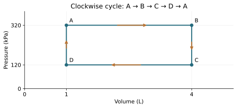
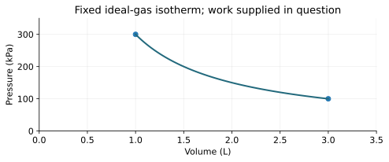

# T01 - Thermodynamics Fundamentals and Phase Changes

REGIONAL WEBSITE RELEASE 1.0 | public-student

Name/team: ____________________  Date: ______________

24 questions | 60 points

## Instructions
Use metric units and show reasoning. Suggested practice time: 45–55 minutes. These are instructional practice timings, not official event allocations. The full official event includes device testing. Use 273.15 for Celsius-to-Kelvin conversion and supplied constants. Q is positive into the system; W is positive by it; ΔU=Q−W. Closed-system energy calculations neglect bulk kinetic/potential changes unless stated. No calculus, trigonometry, logarithms or State/National-only radiation/third-law calculations are required. All datasets are original illustrative models.

Tests 1–3 are focused practice and are not full official written-test simulations. Test 4 covers all five Regional written categories; device items use supplied foundational models and do not require deferred Unit 7.

## T01-F1 - Heating graph
A pure substance at fixed pressure is initially solid, melts on the plateau, then is liquid. Input is steady; all data are illustrative.

| Time (min) | Temperature (°C) |
| --- | --- |
| 0 | -10 |
| 2 | 10 |
| 5 | 10 |
| 7 | 30 |

## T01-F2 - Phase diagram
Generic schematic, not a water diagram and not quantitatively scaled. X joins three boundaries; Y is below the liquid–gas boundary. Region labels are part of the reference.

| Feature | Description |
| --- | --- |
| X | Three boundaries meet |
| Y | Marked point at lower pressure than liquid–gas boundary |

## T01-Q01 (2 points)
A sealed flexible bag is warmed without leaking. Which system description applies? Choose and explain.

A. Open

B. Closed

C. Isolated

D. No thermodynamic system

____________________________________________

____________________________________________

____________________________________________

____________________________________________

## T01-Q02 (2 points)
A thermometer is in equilibrium with block A and separately with block B. What follows if both readings represent the same equilibrium state? Choose and explain.

A. Equal mass

B. Equal internal energy

C. Equal temperature

D. Zero molecular motion

____________________________________________

____________________________________________

____________________________________________

____________________________________________

## T01-Q03 (2 points)
Which statement uses heat correctly? Choose and explain.

A. Energy transferred because of a temperature difference

B. A fluid stored inside matter

C. The same quantity as temperature

D. A synonym for mass

____________________________________________

____________________________________________

____________________________________________

____________________________________________

## T01-Q04 (2 points)
Cut a uniform solid into two equal pieces at the same temperature. Which property ideally stays the same for each piece? Choose and explain.

A. Mass

B. Volume

C. Sample heat capacity

D. Density

____________________________________________

____________________________________________

____________________________________________

____________________________________________

## T01-Q05 (2 points)
Convert −12.0 °C to Kelvin. Report one decimal place.

____________________________________________

____________________________________________

____________________________________________

____________________________________________

## T01-Q06 (2 points)
Convert 95.0 °F to Celsius.

____________________________________________

____________________________________________

____________________________________________

____________________________________________

## T01-Q07 (2 points)
A sample warms from 18.5 °C to 26.0 °C. Give the temperature increase in K and explain whether 273.15 is added.

____________________________________________

____________________________________________

____________________________________________

____________________________________________

## T01-Q08 (2 points)
A process supplies 85.0 cal. Use 1 cal=4.184 J to find the energy in joules to three significant figures.

____________________________________________

____________________________________________

____________________________________________

____________________________________________

## T01-Q09 (2 points)
Name the phase changes (a) frost forming directly from water vapor and (b) solid dry ice becoming gas without a liquid stage.

____________________________________________

____________________________________________

____________________________________________

____________________________________________

## T01-Q10 (2 points)
A liquid and its vapor coexist in a sealed container at equilibrium. Are particles still changing phases? Explain.

____________________________________________

____________________________________________

____________________________________________

____________________________________________

## T01-Q11 (2 points)
On the T01 heating graph, temperature remains 10 °C from 2 to 5 minutes while energy is supplied steadily. The material is a pure substance at fixed pressure. What change occurs and why does temperature stay fixed?

____________________________________________

____________________________________________

____________________________________________

____________________________________________

## T01-Q12 (2 points)
On the T01 schematic phase diagram, identify what is special about point X and state the phase at point Y.

____________________________________________

____________________________________________

____________________________________________

____________________________________________

## T01-Q13 (3 points)
A 0.240 kg metal block with c=450 J/(kg·K) warms by 15.0 K. Ignore losses and phase changes. Find Q and interpret its sign.

____________________________________________

____________________________________________

____________________________________________

____________________________________________

____________________________________________

____________________________________________

## T01-Q14 (3 points)
How much energy is absorbed when 0.0750 kg of a solid melts at its melting temperature? Use L=2.40×10⁵ J/kg.

____________________________________________

____________________________________________

____________________________________________

____________________________________________

____________________________________________

____________________________________________

## T01-Q15 (3 points)
A gas has n=0.200 mol, V=0.00400 m³ and T=300 K. With R=8.31 J/(mol·K), calculate its absolute pressure.

____________________________________________

____________________________________________

____________________________________________

____________________________________________

____________________________________________

____________________________________________

## T01-Q16 (3 points)
A fixed ideal-gas sample at constant temperature changes from 180 kPa and 2.50 L to a volume of 3.75 L. Find its final absolute pressure and explain the trend.

____________________________________________

____________________________________________

____________________________________________

____________________________________________

____________________________________________

____________________________________________

## T01-Q17 (3 points)
Using the T01 heating graph, find the warming rate between 0 and 2 minutes. If the heater supplies 24 J each second, how much energy enters during the 2-to-5-minute plateau?

____________________________________________

____________________________________________

____________________________________________

____________________________________________

____________________________________________

____________________________________________

## T01-Q18 (3 points)
Explain why an open dish of water can lose mass by evaporation at 22 °C even though it is not boiling. Include a particle-level explanation.

____________________________________________

____________________________________________

____________________________________________

____________________________________________

____________________________________________

____________________________________________

## T01-Q19 (3 points)
At the pressure of a teaching experiment, 0.0400 kg ice at 0 °C melts and the resulting water warms to 12.0 °C. Use L=334000 J/kg and c_water=4200 J/(kg·K). Ignore losses. Find the total energy input.

____________________________________________

____________________________________________

____________________________________________

____________________________________________

____________________________________________

____________________________________________

## T01-Q20 (3 points)
A rigid sealed container of fixed ideal gas goes from 290 K to 348 K. Its initial absolute pressure is 125 kPa. Find the final pressure and state two conditions needed for your ratio.

____________________________________________

____________________________________________

____________________________________________

____________________________________________

____________________________________________

____________________________________________

## T01-Q21 (3 points)
A student calculates a gas pressure using 20 in a formula that requires Kelvin because the gas is at 20 °C. Identify the correction and explain why this is more than a harmless change of notation.

____________________________________________

____________________________________________

____________________________________________

____________________________________________

____________________________________________

____________________________________________

## T01-Q22 (3 points)
An insulated mixing model has 0.100 kg water at 50 °C and 0.300 kg water at 20 °C. Assume equal constant c, no phase change and negligible container capacity. Using T_f=(m₁T₁+m₂T₂)/(m₁+m₂), find the final temperature and explain why it is not 35 °C.

____________________________________________

____________________________________________

____________________________________________

____________________________________________

____________________________________________

____________________________________________

## T01-Q23 (3 points)
A cup and a bucket of the same liquid have equal temperatures. Explain why this neither guarantees equal internal energies nor tells you how much energy was transferred while each reached that state.

____________________________________________

____________________________________________

____________________________________________

____________________________________________

____________________________________________

____________________________________________

## T01-Q24 (3 points)
Two runs melt the same pure solid at fixed pressure. Run B’s plateau lasts twice as long as run A’s. The net power reaching the sample is constant and equal in both runs, and all solid melts during the plateau. What mass ratio m_B/m_A follows? Give one experimental condition that would make this inference unreliable.

____________________________________________

____________________________________________

____________________________________________

____________________________________________

____________________________________________

____________________________________________

# T02 - Heat Transfer and Thermal Calculations

REGIONAL WEBSITE RELEASE 1.0 | public-student

Name/team: ____________________  Date: ______________

24 questions | 60 points

## Instructions
Use metric units and show reasoning. Suggested practice time: 45–55 minutes. These are instructional practice timings, not official event allocations. The full official event includes device testing. Use 273.15 for Celsius-to-Kelvin conversion and supplied constants. Q is positive into the system; W is positive by it; ΔU=Q−W. Closed-system energy calculations neglect bulk kinetic/potential changes unless stated. No calculus, trigonometry, logarithms or State/National-only radiation/third-law calculations are required. All datasets are original illustrative models.

Tests 1–3 are focused practice and are not full official written-test simulations. Test 4 covers all five Regional written categories; device items use supplied foundational models and do not require deferred Unit 7.

## T02-F1 - Cooling curves
Recorded-style teaching data for two samples cooling toward a room colder than both. No historical or official device measurements are claimed.

| Time (min) | A (°C) | B (°C) |
| --- | --- | --- |
| 0 | 60 | 60 |
| 2 | 54 | 50 |
| 4 | 50 | 43 |
| 6 | 47 | 38 |

## T02-D2 - Steady slab data
Same material, cross-sectional area and face temperature difference for each row; steady one-dimensional model.

| Thickness (m) | Transfer rate (W) |
| --- | --- |
| 0.01 | 36 |
| 0.02 | 18 |
| 0.04 | 9 |

## T02-Q01 (2 points)
A metal spoon handle warms when its other end rests in warmer water. What mechanism carries energy along the stationary spoon? Choose and explain.

A. Natural convection

B. Conduction

C. Evaporation only

D. Work by a piston

____________________________________________

____________________________________________

____________________________________________

____________________________________________

## T02-Q02 (2 points)
Which example is forced convection? Choose and explain.

A. Energy through a solid rod

B. Radiation through vacuum

C. Fan-driven airflow

D. Buoyant warm air rising without a fan

____________________________________________

____________________________________________

____________________________________________

____________________________________________

## T02-Q03 (2 points)
A warmer object transfers energy to a cooler object across a vacuum gap. Which mechanism can do this? Choose and explain.

A. Radiation

B. Convection

C. Conduction through air

D. Liquid circulation

____________________________________________

____________________________________________

____________________________________________

____________________________________________

## T02-Q04 (2 points)
Which unit belongs to thermal conductivity k? Choose and explain the quantity it describes.

A. J

B. J/K

C. J/(kg·K)

D. W/(m·K)

____________________________________________

____________________________________________

____________________________________________

____________________________________________

## T02-Q05 (2 points)
A body has heat capacity 360 J/K. Neglect losses and work. How much heat raises its temperature by 4.5 K?

____________________________________________

____________________________________________

____________________________________________

____________________________________________

## T02-Q06 (2 points)
A 0.300 kg sample has c=750 J/(kg·K). Calculate its heat capacity.

____________________________________________

____________________________________________

____________________________________________

____________________________________________

## T02-Q07 (2 points)
Explain why natural convection can occur in a liquid but does not describe energy transfer through a solid block that remains fixed in shape.

____________________________________________

____________________________________________

____________________________________________

____________________________________________

## T02-Q08 (2 points)
A polished metal surface reflects much of the incident thermal radiation in a specified wavelength range. Does this mean it creates energy? Explain the energy accounting for an opaque surface.

____________________________________________

____________________________________________

____________________________________________

____________________________________________

## T02-Q09 (2 points)
Use the T02 cooling graph. Which sample cools more rapidly during the first 2 minutes, and what are the two average temperature-change rates?

____________________________________________

____________________________________________

____________________________________________

____________________________________________

## T02-Q10 (2 points)
Equal masses of two materials receive equal net energy without a phase change. Sample X warms less than Y. Which has the larger specific heat, and why?

____________________________________________

____________________________________________

____________________________________________

____________________________________________

## T02-Q11 (2 points)
Name the dominant transfer mechanism for each described segment: a lamp sends energy across air to a plate; energy moves through the solid plate; heated water circulates above the plate.

____________________________________________

____________________________________________

____________________________________________

____________________________________________

## T02-Q12 (2 points)
A 15 W heater operates for 80 s. What energy does it supply? State why 15 W is not an energy amount.

____________________________________________

____________________________________________

____________________________________________

____________________________________________

## T02-Q13 (3 points)
A plane slab has k=0.060 W/(m·K), A=0.50 m², thickness L=0.030 m and a steady temperature difference of 18 K. Use P=kAΔT/L to find its conductive transfer rate.

____________________________________________

____________________________________________

____________________________________________

____________________________________________

____________________________________________

____________________________________________

## T02-Q14 (3 points)
For the slab in Q13, find energy transferred in 5.0 minutes if the rate remains constant. If thickness doubles with all other model quantities unchanged, what is the new rate?

____________________________________________

____________________________________________

____________________________________________

____________________________________________

____________________________________________

____________________________________________

## T02-Q15 (3 points)
A 0.180 kg sample of water warms from 21.0 °C to 29.0 °C. With c=4200 J/(kg·K), find its thermal energy gain in the negligible-work model.

____________________________________________

____________________________________________

____________________________________________

____________________________________________

____________________________________________

____________________________________________

## T02-Q16 (3 points)
A body absorbs 2340 J and warms by 13.0 K. Its mass is 0.400 kg. Neglect losses and phase changes. Find c and state its unit.

____________________________________________

____________________________________________

____________________________________________

____________________________________________

____________________________________________

____________________________________________

## T02-Q17 (3 points)
A small water sample and its cup have heat capacities 420 J/K and 60 J/K respectively. They warm together by 7.0 K. Neglect losses. Find their total energy gain and the error from counting water alone.

____________________________________________

____________________________________________

____________________________________________

____________________________________________

____________________________________________

____________________________________________

## T02-Q18 (3 points)
Explain how trapped air can help an insulating layer, and why a large open air space that circulates freely may perform differently.

____________________________________________

____________________________________________

____________________________________________

____________________________________________

____________________________________________

____________________________________________

## T02-Q19 (3 points)
Two surfaces have equal geometry and temperature and receive identical incident radiation. In the relevant spectral range A absorbs a larger fraction than B. Can you conclude A always reaches a higher final temperature in every setup? Explain.

____________________________________________

____________________________________________

____________________________________________

____________________________________________

____________________________________________

____________________________________________

## T02-Q20 (3 points)
In the T02 graph, sample A has mass 0.100 kg and c=4200 J/(kg·K). Find the magnitude of its energy loss over the first 4 minutes and its average outward power. Neglect evaporation and cup energy.

____________________________________________

____________________________________________

____________________________________________

____________________________________________

____________________________________________

____________________________________________

## T02-Q21 (3 points)
A team compares two insulating covers, but changes water mass, initial temperature and airflow at the same time. Identify two controls and explain why the comparison cannot isolate the cover’s effect.

____________________________________________

____________________________________________

____________________________________________

____________________________________________

____________________________________________

____________________________________________

## T02-Q22 (3 points)
A warm body loses 7 W by convection and 5 W by radiation while receiving 20 W from a heater. Other transfers are negligible and rates are constant for 90 s. Find its net energy gain.

____________________________________________

____________________________________________

____________________________________________

____________________________________________

____________________________________________

____________________________________________

## T02-Q23 (3 points)
In two steady slab tests, area and temperature difference are fixed. The T02 table lists thickness 0.010, 0.020 and 0.040 m with powers 36, 18 and 9 W. Does P×L stay constant? Predict the power at 0.030 m under this model and state one assumption.

____________________________________________

____________________________________________

____________________________________________

____________________________________________

____________________________________________

____________________________________________

## T02-Q24 (3 points)
A student says, “The material with the greatest specific heat must also conduct fastest.” Explain why the claim does not follow, including the units of both quantities and the different experiments needed.

____________________________________________

____________________________________________

____________________________________________

____________________________________________

____________________________________________

____________________________________________

# T03 - Thermodynamic Laws and Processes

REGIONAL WEBSITE RELEASE 1.0 | public-student

Name/team: ____________________  Date: ______________

24 questions | 60 points

## Instructions
Use metric units and show reasoning. Suggested practice time: 45–55 minutes. These are instructional practice timings, not official event allocations. The full official event includes device testing. Use 273.15 for Celsius-to-Kelvin conversion and supplied constants. Q is positive into the system; W is positive by it; ΔU=Q−W. Closed-system energy calculations neglect bulk kinetic/potential changes unless stated. No calculus, trigonometry, logarithms or State/National-only radiation/third-law calculations are required. All datasets are original illustrative models.

Tests 1–3 are focused practice and are not full official written-test simulations. Test 4 covers all five Regional written categories; device items use supplied foundational models and do not require deferred Unit 7.

## T03-F1 - Rectangular cycle
Slowly mechanically balanced paths. Follow A→B→C→D→A. 1 kPa·L=1 J.

| State | V (L) | P (kPa) |
| --- | --- | --- |
| A | 1 | 320 |
| B | 4 | 320 |
| C | 4 | 120 |
| D | 1 | 120 |

## T03-F2 - Isothermal path
PV=300 kPa·L for this fixed ideal-gas teaching model. Use the supplied work in Q24; do not integrate or replace the curve with a rectangle.

| V (L) | P (kPa) |
| --- | --- |
| 1 | 300 |
| 1.5 | 200 |
| 2 | 150 |
| 3 | 100 |

## T03-Q01 (2 points)
Which statement describes internal energy U? Choose and explain.

A. Only energy presently crossing a wall

B. Microscopic energy of the system state

C. Work stored as a substance

D. Temperature in joules

____________________________________________

____________________________________________

____________________________________________

____________________________________________

## T03-Q02 (2 points)
For a rigid closed vessel, which statement about work is always justified by constant volume alone? Choose and explain.

A. No energy can enter

B. All work must be zero

C. PV boundary work is zero

D. Temperature must stay fixed

____________________________________________

____________________________________________

____________________________________________

____________________________________________

## T03-Q03 (2 points)
Which condition defines an adiabatic process? Choose and explain what it does not necessarily imply.

A. No heat transfer

B. Constant temperature

C. Constant pressure

D. No work transfer

____________________________________________

____________________________________________

____________________________________________

____________________________________________

## T03-Q04 (2 points)
Which proposal contradicts the second law under ordinary positive-temperature conditions? Choose and explain.

A. A cup cools in a cooler room

B. A refrigerator uses work

C. Friction warms a brake

D. A cycle converts single-reservoir heat entirely into work with no other effect

____________________________________________

____________________________________________

____________________________________________

____________________________________________

## T03-Q05 (2 points)
A closed system receives 620 J of heat and does 230 J of work. Find ΔU.

____________________________________________

____________________________________________

____________________________________________

____________________________________________

## T03-Q06 (2 points)
A fixed ideal gas expands isothermally from 90 kPa at 6.0 L to 9.0 L. Find its final absolute pressure.

____________________________________________

____________________________________________

____________________________________________

____________________________________________

## T03-Q07 (2 points)
Convert 75 kPa·L to joules, explaining the conversion.

____________________________________________

____________________________________________

____________________________________________

____________________________________________

## T03-Q08 (2 points)
A fixed ideal gas at constant volume doubles its Kelvin temperature. How does absolute pressure change? Explain.

____________________________________________

____________________________________________

____________________________________________

____________________________________________

## T03-Q09 (2 points)
A fixed ideal gas is heated at constant pressure from 250 K to 325 K. Its initial volume is 2.0 L. Find the final volume.

____________________________________________

____________________________________________

____________________________________________

____________________________________________

## T03-Q10 (2 points)
All affected parts of an isolated combination have supplied entropy changes −5 J/K and +8 J/K. Find the total and state whether the signs alone conflict with the second law.

____________________________________________

____________________________________________

____________________________________________

____________________________________________

## T03-Q11 (2 points)
A working gas completes a thermodynamic cycle. What is its net internal-energy change? Can net work still be nonzero?

____________________________________________

____________________________________________

____________________________________________

____________________________________________

## T03-Q12 (2 points)
An insulated ideal-gas sample does 150 J of work on its surroundings. What is ΔU, and does its temperature rise or fall?

____________________________________________

____________________________________________

____________________________________________

____________________________________________

## T03-Q13 (3 points)
A gas expands slowly against constant opposing pressure 140 kPa from 1.5 L to 4.0 L. Find its boundary work. If Q=510 J enters, find ΔU.

____________________________________________

____________________________________________

____________________________________________

____________________________________________

____________________________________________

____________________________________________

## T03-Q14 (3 points)
During compression, the surroundings do 280 J of work on a gas while the gas releases 95 J of heat. Find ΔU with the work-by convention and explain its sign.

____________________________________________

____________________________________________

____________________________________________

____________________________________________

____________________________________________

____________________________________________

## T03-Q15 (3 points)
A fixed ideal gas is compressed isothermally. Work done by the gas is −210 J. Find ΔU and Q, and explain the direction of heat transfer.

____________________________________________

____________________________________________

____________________________________________

____________________________________________

____________________________________________

____________________________________________

## T03-Q16 (3 points)
An adiabatic compression supplies 540 J of work to a fixed ideal gas with supplied internal-energy coefficient C_U=90 J/K. Find ΔU and ΔT.

____________________________________________

____________________________________________

____________________________________________

____________________________________________

____________________________________________

____________________________________________

## T03-Q17 (3 points)
Use the T03 rectangular cycle A→B→C→D→A. Find work on each horizontal segment and the net work. Assume slowly balanced pressure-volume paths.

____________________________________________

____________________________________________

____________________________________________

____________________________________________

____________________________________________

____________________________________________

## T03-Q18 (3 points)
Reverse the cycle in Q17. State the new net work and net heat into the gas over the complete cycle, explaining why its net ΔU remains zero.

____________________________________________

____________________________________________

____________________________________________

____________________________________________

____________________________________________

____________________________________________

## T03-Q19 (3 points)
Three stages of a four-stage cycle have internal-energy changes +170 J, −260 J and +40 J. Find the fourth change. If that stage does 65 J of work, find its heat input.

____________________________________________

____________________________________________

____________________________________________

____________________________________________

____________________________________________

____________________________________________

## T03-Q20 (3 points)
An engine absorbs 1800 J and rejects 1080 J each cycle. Its reservoirs are 600 K and 330 K. Calculate work, actual efficiency and the modern ideal maximum.

____________________________________________

____________________________________________

____________________________________________

____________________________________________

____________________________________________

____________________________________________

## T03-Q21 (3 points)
A student uses W/Q_net as heat-engine efficiency. Explain why this denominator is wrong and state what the ratio would give for a cycle with nonzero net output.

____________________________________________

____________________________________________

____________________________________________

____________________________________________

____________________________________________

____________________________________________

## T03-Q22 (3 points)
A gas returns to the same state every cycle, but friction is present. A student concludes each cycle is reversible because the gas’s entropy returns to its initial value. Diagnose the error.

____________________________________________

____________________________________________

____________________________________________

____________________________________________

____________________________________________

____________________________________________

## T03-Q23 (3 points)
Two paths connect the same initial and final states of a closed system. Path A has Q=400 J and W=240 J. Path B does 90 J of work. Find Q for B and explain why it differs from A.

____________________________________________

____________________________________________

____________________________________________

____________________________________________

____________________________________________

____________________________________________

## T03-Q24 (3 points)
The T03 isotherm goes from 300 kPa at 1.0 L to 100 kPa at 3.0 L. The measured work for this ideal-gas expansion is supplied as 330 J. Find Q. Explain why using the starting pressure times the entire volume change is not a valid work calculation.

____________________________________________

____________________________________________

____________________________________________

____________________________________________

____________________________________________

____________________________________________

# T04 - Comprehensive Regional Science Olympiad Examination

REGIONAL WEBSITE RELEASE 1.0 | public-student

Name/team: ____________________  Date: ______________

24 questions | 60 points

## Instructions
Use metric units and show reasoning. Suggested practice time: 50–60 minutes (extended written practice). These are instructional practice timings, not official event allocations. The full official event includes device testing. Use 273.15 for Celsius-to-Kelvin conversion and supplied constants. Q is positive into the system; W is positive by it; ΔU=Q−W. Closed-system energy calculations neglect bulk kinetic/potential changes unless stated. No calculus, trigonometry, logarithms or State/National-only radiation/third-law calculations are required. All datasets are original illustrative models.

Tests 1–3 are focused practice and are not full official written-test simulations. Test 4 covers all five Regional written categories; device items use supplied foundational models and do not require deferred Unit 7.

## T04-F1 - Low-pressure phase path
Generic schematic. The heating arrow is below the triple-point pressure. It crosses the solid–gas boundary; no numerical scale is supplied.

| Axis | Meaning |
| --- | --- |
| Horizontal | Temperature |
| Vertical | Pressure |

## T04-F2 - Heating data
A pure substance begins solid and becomes liquid after the melting plateau. Fixed pressure and constant net input are the stated model.

| Time (min) | Temperature (°C) |
| --- | --- |
| 0 | 0 |
| 2 | 20 |
| 6 | 20 |
| 8 | 40 |

## T04-F3 - Triangular cycle
Straight, mechanically balanced paths with A→B→C→A. Use elementary geometric area only.

| State | V (L) | P (kPa) |
| --- | --- | --- |
| A | 1 | 100 |
| B | 1 | 280 |
| C | 5 | 100 |

## T04-Q01 (2 points)
A cup of water is open to the room while evaporating under a lamp. Which classification applies to the water system? Choose and explain.

A. Open

B. Closed with no mass exchange

C. Isolated

D. Not a system because it changes

____________________________________________

____________________________________________

____________________________________________

____________________________________________

## T04-Q02 (2 points)
Two objects separately reach equilibrium with the same stable thermometer. Which conclusion follows? Choose and explain one conclusion that does not follow.

A. Equal internal energy

B. Zero particle motion

C. Equal temperature

D. Equal heat capacity

____________________________________________

____________________________________________

____________________________________________

____________________________________________

## T04-Q03 (2 points)
A water sample starts at 68.0 °F. Convert this reading to Celsius and Kelvin. Give Kelvin to two decimal places.

____________________________________________

____________________________________________

____________________________________________

____________________________________________

## T04-Q04 (2 points)
Identify the intensive quantity, mass or density. Then convert 2.50 cal to J using 4.184 J/cal.

____________________________________________

____________________________________________

____________________________________________

____________________________________________

## T04-Q05 (2 points)
In the T04 phase diagram, a sample travels at pressure below X from the solid region directly into gas as temperature increases. Name the transition and explain why a liquid stage is absent on this path.

____________________________________________

____________________________________________

____________________________________________

____________________________________________

## T04-Q06 (2 points)
At its melting point, 0.0200 kg of a solid absorbs 5600 J while completely melting. Find its specific latent heat and explain why dividing by a temperature rise would be inappropriate.

____________________________________________

____________________________________________

____________________________________________

____________________________________________

## T04-Q07 (2 points)
An ideal-gas sample has P=160 kPa, V=0.00500 m³ and T=320 K. Use R=8.31 J/(mol·K) to find n to three significant figures.

____________________________________________

____________________________________________

____________________________________________

____________________________________________

## T04-Q08 (2 points)
Use the T04 heating graph for a pure substance at fixed pressure. Which interval is a phase change? If net input is 30 W, find the energy supplied during that interval.

____________________________________________

____________________________________________

____________________________________________

____________________________________________

## T04-Q09 (2 points)
Which sequence best describes energy entering lamp-heated water through a solid cup wall, followed by circulation within the water? Choose and explain.

A. Conduction, radiation, conduction

B. Radiation, conduction, convection

C. Convection, convection, radiation

D. Work, work, work

____________________________________________

____________________________________________

____________________________________________

____________________________________________

## T04-Q10 (2 points)
Two identical slabs have the same area and temperature difference. Slab B has twice A’s conductivity and three times its thickness. Find P_B/P_A for the steady slab model.

____________________________________________

____________________________________________

____________________________________________

____________________________________________

## T04-Q11 (2 points)
A 0.100 kg water sample with c=4200 J/(kg·K) gains 2100 J. Neglect cup energy, evaporation, work and losses. Find its temperature increase.

____________________________________________

____________________________________________

____________________________________________

____________________________________________

## T04-Q12 (2 points)
A highly reflective surface receives incident lamp radiation. Explain why increased reflection can reduce absorption at that surface, but does not by itself prove a lower final water temperature in a complete collection device.

____________________________________________

____________________________________________

____________________________________________

____________________________________________

## T04-Q13 (3 points)
A closed gas releases 120 J as heat while the surroundings do 310 J of work on it. Find ΔU and explain whether heat loss alone proves the gas cooled.

____________________________________________

____________________________________________

____________________________________________

____________________________________________

____________________________________________

____________________________________________

## T04-Q14 (3 points)
Which pairing of process and defining condition is correct? Choose it, then correct the other three pairings.

A. Isothermal: Q=0

B. Adiabatic: T constant

C. Isochoric: P constant

D. Isobaric: P constant

____________________________________________

____________________________________________

____________________________________________

____________________________________________

____________________________________________

____________________________________________

## T04-Q15 (3 points)
A fixed ideal gas expands isothermally and does a supplied 275 J of work. Another fixed ideal-gas sample expands adiabatically and does 275 J of work. Compare Q and ΔU for the two samples and their temperature trends.

____________________________________________

____________________________________________

____________________________________________

____________________________________________

____________________________________________

____________________________________________

## T04-Q16 (3 points)
Use the T04 triangular cycle A→B→C→A, with mechanically balanced straight paths. Calculate net work from geometric area and determine the signed net heat into the gas over a cycle.

____________________________________________

____________________________________________

____________________________________________

____________________________________________

____________________________________________

____________________________________________

## T04-Q17 (3 points)
An engine absorbs 2400 J and rejects 1440 J per cycle between 550 K and 330 K. Find actual efficiency and the ideal upper bound. What would equality require?

____________________________________________

____________________________________________

____________________________________________

____________________________________________

____________________________________________

____________________________________________

## T04-Q18 (3 points)
An inventor claims a gas returns to its starting state each cycle while heat moves from a cold reservoir to a hotter one, with no work input or other change. Explain why ΔU_cycle=0 does not validate the claim.

____________________________________________

____________________________________________

____________________________________________

____________________________________________

____________________________________________

____________________________________________

## T04-Q19 (3 points)
A historian pairs (a) a melting plateau with Black and (b) absolute-temperature ratios with Kelvin. Explain both associations and one limit of attributing modern equations directly to these scientists.

____________________________________________

____________________________________________

____________________________________________

____________________________________________

____________________________________________

____________________________________________

## T04-Q20 (3 points)
Explain how Joule’s paddle experiments and Carnot’s ideal-engine reasoning answer different questions. Identify the outdated assumption in Carnot’s published 1824 framework that later thermodynamics corrected.

____________________________________________

____________________________________________

____________________________________________

____________________________________________

____________________________________________

____________________________________________

## T04-Q21 (3 points)
Match Clausius and Planck to entropy and radiation energy quanta, then explain why neither contribution means that energy is destroyed.

____________________________________________

____________________________________________

____________________________________________

____________________________________________

____________________________________________

____________________________________________

## T04-Q22 (3 points)
A gas at equilibrium contains many molecular speeds. Relate this to Maxwell’s contribution, then connect Boltzmann’s entropy interpretation to microscopic possibilities. Explain why the combined name does not prove one joint experiment.

____________________________________________

____________________________________________

____________________________________________

____________________________________________

____________________________________________

____________________________________________

## T04-Q23 (3 points)
A recorded lamp-heating study compares covers A and B. A uses 100 g water starting at 20 °C; B uses 80 g starting at 24 °C. Both end at 30 °C after the same duration. Explain why final temperature alone cannot rank the covers, calculate each water energy gain with c=4.20 J/(g·K), and propose one controlled retest.

____________________________________________

____________________________________________

____________________________________________

____________________________________________

____________________________________________

____________________________________________

## T04-Q24 (3 points)
A supplied water-only model receives 12 W while losing 5 W on average for 10 minutes. The water mass is 0.100 kg, c=4200 J/(kg·K), and its initial temperature is 22 °C. Predict the final temperature. Explain why the lamp’s electrical wattage alone cannot replace the 12 W input, and give one limit of your prediction.

____________________________________________

____________________________________________

____________________________________________

____________________________________________

____________________________________________

____________________________________________
