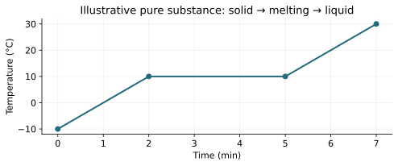
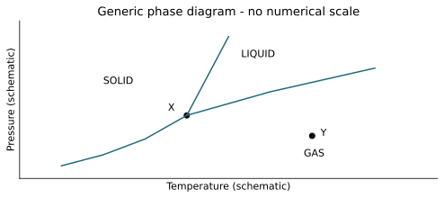

# T01 - Thermodynamics Fundamentals and Phase Changes

REGIONAL WEBSITE RELEASE 1.0 | public-student

Name/team: ____________________  Date: ______________

24 questions | 60 points

## Instructions
Use metric units and show reasoning. Suggested practice time: 45–55 minutes. These are instructional practice timings, not official event allocations. The full official event includes device testing. Use 273.15 for Celsius-to-Kelvin conversion and supplied constants. Q is positive into the system; W is positive by it; ΔU=Q−W. Closed-system energy calculations neglect bulk kinetic/potential changes unless stated. No calculus, trigonometry, logarithms or State/National-only radiation/third-law calculations are required. All datasets are original illustrative models.

Tests 1–3 are focused practice and are not full official written-test simulations. Test 4 covers all five Regional written categories; device items use supplied foundational models and do not require deferred Unit 7.

## T01-F1 - Heating graph
A pure substance at fixed pressure is initially solid, melts on the plateau, then is liquid. Input is steady; all data are illustrative.

| Time (min) | Temperature (°C) |
| --- | --- |
| 0 | -10 |
| 2 | 10 |
| 5 | 10 |
| 7 | 30 |

## T01-F2 - Phase diagram
Generic schematic, not a water diagram and not quantitatively scaled. X joins three boundaries; Y is below the liquid–gas boundary. Region labels are part of the reference.

| Feature | Description |
| --- | --- |
| X | Three boundaries meet |
| Y | Marked point at lower pressure than liquid–gas boundary |

## T01-Q01 (2 points)
A sealed flexible bag is warmed without leaking. Which system description applies? Choose and explain.

A. Open

B. Closed

C. Isolated

D. No thermodynamic system

____________________________________________

____________________________________________

____________________________________________

____________________________________________

## T01-Q02 (2 points)
A thermometer is in equilibrium with block A and separately with block B. What follows if both readings represent the same equilibrium state? Choose and explain.

A. Equal mass

B. Equal internal energy

C. Equal temperature

D. Zero molecular motion

____________________________________________

____________________________________________

____________________________________________

____________________________________________

## T01-Q03 (2 points)
Which statement uses heat correctly? Choose and explain.

A. Energy transferred because of a temperature difference

B. A fluid stored inside matter

C. The same quantity as temperature

D. A synonym for mass

____________________________________________

____________________________________________

____________________________________________

____________________________________________

## T01-Q04 (2 points)
Cut a uniform solid into two equal pieces at the same temperature. Which property ideally stays the same for each piece? Choose and explain.

A. Mass

B. Volume

C. Sample heat capacity

D. Density

____________________________________________

____________________________________________

____________________________________________

____________________________________________

## T01-Q05 (2 points)
Convert −12.0 °C to Kelvin. Report one decimal place.

____________________________________________

____________________________________________

____________________________________________

____________________________________________

## T01-Q06 (2 points)
Convert 95.0 °F to Celsius.

____________________________________________

____________________________________________

____________________________________________

____________________________________________

## T01-Q07 (2 points)
A sample warms from 18.5 °C to 26.0 °C. Give the temperature increase in K and explain whether 273.15 is added.

____________________________________________

____________________________________________

____________________________________________

____________________________________________

## T01-Q08 (2 points)
A process supplies 85.0 cal. Use 1 cal=4.184 J to find the energy in joules to three significant figures.

____________________________________________

____________________________________________

____________________________________________

____________________________________________

## T01-Q09 (2 points)
Name the phase changes (a) frost forming directly from water vapor and (b) solid dry ice becoming gas without a liquid stage.

____________________________________________

____________________________________________

____________________________________________

____________________________________________

## T01-Q10 (2 points)
A liquid and its vapor coexist in a sealed container at equilibrium. Are particles still changing phases? Explain.

____________________________________________

____________________________________________

____________________________________________

____________________________________________

## T01-Q11 (2 points)
On the T01 heating graph, temperature remains 10 °C from 2 to 5 minutes while energy is supplied steadily. The material is a pure substance at fixed pressure. What change occurs and why does temperature stay fixed?

____________________________________________

____________________________________________

____________________________________________

____________________________________________

## T01-Q12 (2 points)
On the T01 schematic phase diagram, identify what is special about point X and state the phase at point Y.

____________________________________________

____________________________________________

____________________________________________

____________________________________________

## T01-Q13 (3 points)
A 0.240 kg metal block with c=450 J/(kg·K) warms by 15.0 K. Ignore losses and phase changes. Find Q and interpret its sign.

____________________________________________

____________________________________________

____________________________________________

____________________________________________

____________________________________________

____________________________________________

## T01-Q14 (3 points)
How much energy is absorbed when 0.0750 kg of a solid melts at its melting temperature? Use L=2.40×10⁵ J/kg.

____________________________________________

____________________________________________

____________________________________________

____________________________________________

____________________________________________

____________________________________________

## T01-Q15 (3 points)
A gas has n=0.200 mol, V=0.00400 m³ and T=300 K. With R=8.31 J/(mol·K), calculate its absolute pressure.

____________________________________________

____________________________________________

____________________________________________

____________________________________________

____________________________________________

____________________________________________

## T01-Q16 (3 points)
A fixed ideal-gas sample at constant temperature changes from 180 kPa and 2.50 L to a volume of 3.75 L. Find its final absolute pressure and explain the trend.

____________________________________________

____________________________________________

____________________________________________

____________________________________________

____________________________________________

____________________________________________

## T01-Q17 (3 points)
Using the T01 heating graph, find the warming rate between 0 and 2 minutes. If the heater supplies 24 J each second, how much energy enters during the 2-to-5-minute plateau?

____________________________________________

____________________________________________

____________________________________________

____________________________________________

____________________________________________

____________________________________________

## T01-Q18 (3 points)
Explain why an open dish of water can lose mass by evaporation at 22 °C even though it is not boiling. Include a particle-level explanation.

____________________________________________

____________________________________________

____________________________________________

____________________________________________

____________________________________________

____________________________________________

## T01-Q19 (3 points)
At the pressure of a teaching experiment, 0.0400 kg ice at 0 °C melts and the resulting water warms to 12.0 °C. Use L=334000 J/kg and c_water=4200 J/(kg·K). Ignore losses. Find the total energy input.

____________________________________________

____________________________________________

____________________________________________

____________________________________________

____________________________________________

____________________________________________

## T01-Q20 (3 points)
A rigid sealed container of fixed ideal gas goes from 290 K to 348 K. Its initial absolute pressure is 125 kPa. Find the final pressure and state two conditions needed for your ratio.

____________________________________________

____________________________________________

____________________________________________

____________________________________________

____________________________________________

____________________________________________

## T01-Q21 (3 points)
A student calculates a gas pressure using 20 in a formula that requires Kelvin because the gas is at 20 °C. Identify the correction and explain why this is more than a harmless change of notation.

____________________________________________

____________________________________________

____________________________________________

____________________________________________

____________________________________________

____________________________________________

## T01-Q22 (3 points)
An insulated mixing model has 0.100 kg water at 50 °C and 0.300 kg water at 20 °C. Assume equal constant c, no phase change and negligible container capacity. Using T_f=(m₁T₁+m₂T₂)/(m₁+m₂), find the final temperature and explain why it is not 35 °C.

____________________________________________

____________________________________________

____________________________________________

____________________________________________

____________________________________________

____________________________________________

## T01-Q23 (3 points)
A cup and a bucket of the same liquid have equal temperatures. Explain why this neither guarantees equal internal energies nor tells you how much energy was transferred while each reached that state.

____________________________________________

____________________________________________

____________________________________________

____________________________________________

____________________________________________

____________________________________________

## T01-Q24 (3 points)
Two runs melt the same pure solid at fixed pressure. Run B’s plateau lasts twice as long as run A’s. The net power reaching the sample is constant and equal in both runs, and all solid melts during the plateau. What mass ratio m_B/m_A follows? Give one experimental condition that would make this inference unreliable.

____________________________________________

____________________________________________

____________________________________________

____________________________________________

____________________________________________

____________________________________________
