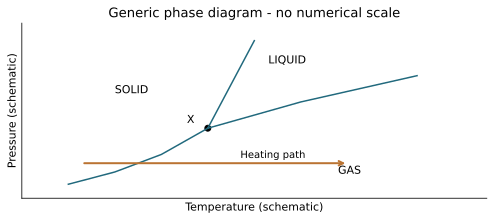
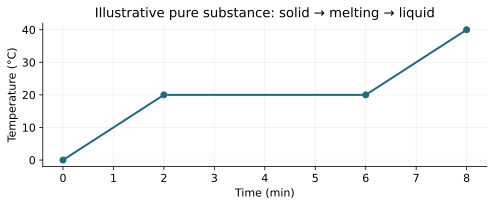
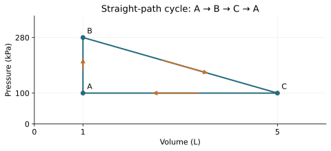

# T04 - Comprehensive Regional Science Olympiad Examination

REGIONAL WEBSITE RELEASE 1.0 | public-student

Name/team: ____________________  Date: ______________

24 questions | 60 points

## Instructions
Use metric units and show reasoning. Suggested practice time: 50–60 minutes (extended written practice). These are instructional practice timings, not official event allocations. The full official event includes device testing. Use 273.15 for Celsius-to-Kelvin conversion and supplied constants. Q is positive into the system; W is positive by it; ΔU=Q−W. Closed-system energy calculations neglect bulk kinetic/potential changes unless stated. No calculus, trigonometry, logarithms or State/National-only radiation/third-law calculations are required. All datasets are original illustrative models.

Tests 1–3 are focused practice and are not full official written-test simulations. Test 4 covers all five Regional written categories; device items use supplied foundational models and do not require deferred Unit 7.

## T04-F1 - Low-pressure phase path
Generic schematic. The heating arrow is below the triple-point pressure. It crosses the solid–gas boundary; no numerical scale is supplied.

| Axis | Meaning |
| --- | --- |
| Horizontal | Temperature |
| Vertical | Pressure |

## T04-F2 - Heating data
A pure substance begins solid and becomes liquid after the melting plateau. Fixed pressure and constant net input are the stated model.

| Time (min) | Temperature (°C) |
| --- | --- |
| 0 | 0 |
| 2 | 20 |
| 6 | 20 |
| 8 | 40 |

## T04-F3 - Triangular cycle
Straight, mechanically balanced paths with A→B→C→A. Use elementary geometric area only.

| State | V (L) | P (kPa) |
| --- | --- | --- |
| A | 1 | 100 |
| B | 1 | 280 |
| C | 5 | 100 |

## T04-Q01 (2 points)
A cup of water is open to the room while evaporating under a lamp. Which classification applies to the water system? Choose and explain.

A. Open

B. Closed with no mass exchange

C. Isolated

D. Not a system because it changes

____________________________________________

____________________________________________

____________________________________________

____________________________________________

## T04-Q02 (2 points)
Two objects separately reach equilibrium with the same stable thermometer. Which conclusion follows? Choose and explain one conclusion that does not follow.

A. Equal internal energy

B. Zero particle motion

C. Equal temperature

D. Equal heat capacity

____________________________________________

____________________________________________

____________________________________________

____________________________________________

## T04-Q03 (2 points)
A water sample starts at 68.0 °F. Convert this reading to Celsius and Kelvin. Give Kelvin to two decimal places.

____________________________________________

____________________________________________

____________________________________________

____________________________________________

## T04-Q04 (2 points)
Identify the intensive quantity, mass or density. Then convert 2.50 cal to J using 4.184 J/cal.

____________________________________________

____________________________________________

____________________________________________

____________________________________________

## T04-Q05 (2 points)
In the T04 phase diagram, a sample travels at pressure below X from the solid region directly into gas as temperature increases. Name the transition and explain why a liquid stage is absent on this path.

____________________________________________

____________________________________________

____________________________________________

____________________________________________

## T04-Q06 (2 points)
At its melting point, 0.0200 kg of a solid absorbs 5600 J while completely melting. Find its specific latent heat and explain why dividing by a temperature rise would be inappropriate.

____________________________________________

____________________________________________

____________________________________________

____________________________________________

## T04-Q07 (2 points)
An ideal-gas sample has P=160 kPa, V=0.00500 m³ and T=320 K. Use R=8.31 J/(mol·K) to find n to three significant figures.

____________________________________________

____________________________________________

____________________________________________

____________________________________________

## T04-Q08 (2 points)
Use the T04 heating graph for a pure substance at fixed pressure. Which interval is a phase change? If net input is 30 W, find the energy supplied during that interval.

____________________________________________

____________________________________________

____________________________________________

____________________________________________

## T04-Q09 (2 points)
Which sequence best describes energy entering lamp-heated water through a solid cup wall, followed by circulation within the water? Choose and explain.

A. Conduction, radiation, conduction

B. Radiation, conduction, convection

C. Convection, convection, radiation

D. Work, work, work

____________________________________________

____________________________________________

____________________________________________

____________________________________________

## T04-Q10 (2 points)
Two identical slabs have the same area and temperature difference. Slab B has twice A’s conductivity and three times its thickness. Find P_B/P_A for the steady slab model.

____________________________________________

____________________________________________

____________________________________________

____________________________________________

## T04-Q11 (2 points)
A 0.100 kg water sample with c=4200 J/(kg·K) gains 2100 J. Neglect cup energy, evaporation, work and losses. Find its temperature increase.

____________________________________________

____________________________________________

____________________________________________

____________________________________________

## T04-Q12 (2 points)
A highly reflective surface receives incident lamp radiation. Explain why increased reflection can reduce absorption at that surface, but does not by itself prove a lower final water temperature in a complete collection device.

____________________________________________

____________________________________________

____________________________________________

____________________________________________

## T04-Q13 (3 points)
A closed gas releases 120 J as heat while the surroundings do 310 J of work on it. Find ΔU and explain whether heat loss alone proves the gas cooled.

____________________________________________

____________________________________________

____________________________________________

____________________________________________

____________________________________________

____________________________________________

## T04-Q14 (3 points)
Which pairing of process and defining condition is correct? Choose it, then correct the other three pairings.

A. Isothermal: Q=0

B. Adiabatic: T constant

C. Isochoric: P constant

D. Isobaric: P constant

____________________________________________

____________________________________________

____________________________________________

____________________________________________

____________________________________________

____________________________________________

## T04-Q15 (3 points)
A fixed ideal gas expands isothermally and does a supplied 275 J of work. Another fixed ideal-gas sample expands adiabatically and does 275 J of work. Compare Q and ΔU for the two samples and their temperature trends.

____________________________________________

____________________________________________

____________________________________________

____________________________________________

____________________________________________

____________________________________________

## T04-Q16 (3 points)
Use the T04 triangular cycle A→B→C→A, with mechanically balanced straight paths. Calculate net work from geometric area and determine the signed net heat into the gas over a cycle.

____________________________________________

____________________________________________

____________________________________________

____________________________________________

____________________________________________

____________________________________________

## T04-Q17 (3 points)
An engine absorbs 2400 J and rejects 1440 J per cycle between 550 K and 330 K. Find actual efficiency and the ideal upper bound. What would equality require?

____________________________________________

____________________________________________

____________________________________________

____________________________________________

____________________________________________

____________________________________________

## T04-Q18 (3 points)
An inventor claims a gas returns to its starting state each cycle while heat moves from a cold reservoir to a hotter one, with no work input or other change. Explain why ΔU_cycle=0 does not validate the claim.

____________________________________________

____________________________________________

____________________________________________

____________________________________________

____________________________________________

____________________________________________

## T04-Q19 (3 points)
A historian pairs (a) a melting plateau with Black and (b) absolute-temperature ratios with Kelvin. Explain both associations and one limit of attributing modern equations directly to these scientists.

____________________________________________

____________________________________________

____________________________________________

____________________________________________

____________________________________________

____________________________________________

## T04-Q20 (3 points)
Explain how Joule’s paddle experiments and Carnot’s ideal-engine reasoning answer different questions. Identify the outdated assumption in Carnot’s published 1824 framework that later thermodynamics corrected.

____________________________________________

____________________________________________

____________________________________________

____________________________________________

____________________________________________

____________________________________________

## T04-Q21 (3 points)
Match Clausius and Planck to entropy and radiation energy quanta, then explain why neither contribution means that energy is destroyed.

____________________________________________

____________________________________________

____________________________________________

____________________________________________

____________________________________________

____________________________________________

## T04-Q22 (3 points)
A gas at equilibrium contains many molecular speeds. Relate this to Maxwell’s contribution, then connect Boltzmann’s entropy interpretation to microscopic possibilities. Explain why the combined name does not prove one joint experiment.

____________________________________________

____________________________________________

____________________________________________

____________________________________________

____________________________________________

____________________________________________

## T04-Q23 (3 points)
A recorded lamp-heating study compares covers A and B. A uses 100 g water starting at 20 °C; B uses 80 g starting at 24 °C. Both end at 30 °C after the same duration. Explain why final temperature alone cannot rank the covers, calculate each water energy gain with c=4.20 J/(g·K), and propose one controlled retest.

____________________________________________

____________________________________________

____________________________________________

____________________________________________

____________________________________________

____________________________________________

## T04-Q24 (3 points)
A supplied water-only model receives 12 W while losing 5 W on average for 10 minutes. The water mass is 0.100 kg, c=4200 J/(kg·K), and its initial temperature is 22 °C. Predict the final temperature. Explain why the lamp’s electrical wattage alone cannot replace the 12 W input, and give one limit of your prediction.

____________________________________________

____________________________________________

____________________________________________

____________________________________________

____________________________________________

____________________________________________
