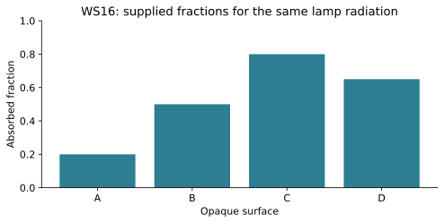
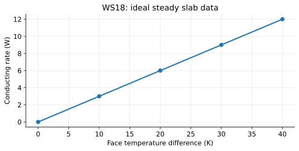

# WS14 - Conduction

Name: ____________________   Date: ____________________

Unit 3 | All levels | public-student

Objectives: Explain conduction microscopically; identify its direction; interpret a temperature profile; calculate a gradient and energy from a constant rate.

Difficulty: Beginner through application; final question is a challenge

Suggested duration: 25–30 minutes | Total: 20 points

Show the equation, substitution, arithmetic and units for numerical answers. Explain physical meaning. Use given constants. Retain intermediate digits and round final answers as requested; for unspecified precision, accept sensible rounding. Graphs and data are simulated educational models.

## Reference data
Ideal, uniform, steady one-dimensional profile. Position is measured from the warmer face. These are model values, not time readings.

| position_m | temperature_C |
| --- | --- |
| 0 | 50 |
| 0.02 | 40 |
| 0.04 | 30 |
| 0.06 | 20 |

## WS14-Q01 (2 points)
A solid rod warms at one end. Explain how energy can reach the other end without the atoms flowing along the rod.

____________________________________________________________
____________________________________________________________
____________________________________________________________
____________________________________________________________

## WS14-Q02 (2 points)
A rod has faces at 45 °C and 25 °C. In which direction is net conduction? What happens to the net conducting transfer if the entire rod reaches 25 °C?

____________________________________________________________
____________________________________________________________
____________________________________________________________
____________________________________________________________

## WS14-Q03 (2 points)
Which statement is correct? A. Only solids conduct. B. Still fluids can conduct. C. Conduction requires bulk circulation. Explain.

____________________________________________________________
____________________________________________________________
____________________________________________________________
____________________________________________________________

## WS14-Q04 (2 points)
A constant conducting rate is 4.0 W. State what this means in joules and seconds, then calculate the energy transferred in 30 s.

____________________________________________________________
____________________________________________________________
____________________________________________________________
____________________________________________________________

## WS14-Q05 (3 points)
The WS 14 reference profile is steady. Calculate its gradient magnitude in K/m and identify the direction of net conduction.

____________________________________________________________
____________________________________________________________
____________________________________________________________
____________________________________________________________
____________________________________________________________
____________________________________________________________

## WS14-Q06 (3 points)
A conducting path transfers 2.5 W for 2.0 min and then 1.5 W for 1.0 min. Calculate total energy.

____________________________________________________________
____________________________________________________________
____________________________________________________________
____________________________________________________________
____________________________________________________________
____________________________________________________________

## WS14-Q07 (3 points)
Two dry room-temperature blocks, metal and wood, have the same measured temperature. The metal feels colder. Explain and name a reason touch is a poor thermometer.

____________________________________________________________
____________________________________________________________
____________________________________________________________
____________________________________________________________
____________________________________________________________
____________________________________________________________

## WS14-Q08 (3 points)
Challenge: A student compares equal-area slabs of the same material, one 5 mm thick and one 10 mm thick, with identical fixed face-temperature differences. Predict the ideal rate ratio, then explain why a real contact gap could spoil this comparison.

____________________________________________________________
____________________________________________________________
____________________________________________________________
____________________________________________________________
____________________________________________________________
____________________________________________________________

# WS15 - Convection

Name: ____________________   Date: ____________________

Unit 3 | All levels | public-student

Objectives: Explain buoyancy-driven circulation and forced circulation; distinguish flow from molecular conduction; analyze rates, density and cooling data.

Difficulty: Beginner through application; final question is a challenge

Suggested duration: 25–30 minutes | Total: 20 points

Show the equation, substitution, arithmetic and units for numerical answers. Explain physical meaning. Use given constants. Retain intermediate digits and round final answers as requested; for unspecified precision, accept sensible rounding. Graphs and data are simulated educational models.

## Reference data
Simulated equal-capacity dry samples, identical starts and room conditions. Only imposed airflow differs in this ideal comparison.

| time_min | still_air_C | moving_air_C |
| --- | --- | --- |
| 0 | 40 | 40 |
| 2 | 37 | 34 |
| 4 | 34 | 28 |

## WS15-Q01 (2 points)
Define a fluid and explain why a rigid solid cannot transfer energy by bulk convection within itself.

____________________________________________________________
____________________________________________________________
____________________________________________________________
____________________________________________________________

## WS15-Q02 (2 points)
Ordinary air well above freezing warms and expands at nearly constant pressure with no mass change. Explain the density change and its possible buoyant motion.

____________________________________________________________
____________________________________________________________
____________________________________________________________
____________________________________________________________

## WS15-Q03 (2 points)
Classify (a) a pump circulating radiator water and (b) air rising above a warm radiator without a fan.

____________________________________________________________
____________________________________________________________
____________________________________________________________
____________________________________________________________

## WS15-Q04 (2 points)
A sealed flexible model parcel contains 2.0 g of air in 2.5 L. Calculate density.

____________________________________________________________
____________________________________________________________
____________________________________________________________
____________________________________________________________

## WS15-Q05 (3 points)
Sketch a plausible natural-convection loop for water heated gently from below and cooled near the top. Label warmer/less-dense and cooler/denser regions. Assume water stays above 10 °C.

____________________________________________________________
____________________________________________________________
____________________________________________________________
____________________________________________________________
____________________________________________________________
____________________________________________________________

## WS15-Q06 (3 points)
Use the WS 15 cooling data. Calculate the average 0–4 min slopes for still air and moving air. Which has larger cooling magnitude?

____________________________________________________________
____________________________________________________________
____________________________________________________________
____________________________________________________________
____________________________________________________________
____________________________________________________________

## WS15-Q07 (3 points)
A fan moves 45 °C dry air over a dry object at 25 °C. Predict the direction of convective transfer and explain why “fans always cool” fails.

____________________________________________________________
____________________________________________________________
____________________________________________________________
____________________________________________________________
____________________________________________________________
____________________________________________________________

## WS15-Q08 (3 points)
Challenge: Two equal water samples begin at 30 °C. One is heated from below and one from above. Explain which arrangement more readily produces natural overturning. Name two controls needed to compare it fairly.

____________________________________________________________
____________________________________________________________
____________________________________________________________
____________________________________________________________
____________________________________________________________
____________________________________________________________

# WS16 - Thermal Radiation

Name: ____________________   Date: ____________________

Unit 3 | All levels | public-student

Objectives: Explain thermal radiation and net exchange; distinguish absorption, reflection and transmission; calculate energy budgets from supplied incident power and fractions.

Difficulty: Beginner through application; final question is a challenge

Suggested duration: 25–30 minutes | Total: 20 points

Show the equation, substitution, arithmetic and units for numerical answers. Explain physical meaning. Use given constants. Retain intermediate digits and round final answers as requested; for unspecified precision, accept sensible rounding. Graphs and data are simulated educational models.

## Reference data
Supplied absorption fractions for opaque surfaces under the same lamp radiation. These are illustrative properties, not measured claims about named materials.

| surface | absorbed_fraction |
| --- | --- |
| A | 0.2 |
| B | 0.5 |
| C | 0.8 |
| D | 0.65 |

## WS16-Q01 (2 points)
Why can radiation cross a vacuum while convection cannot?

____________________________________________________________
____________________________________________________________
____________________________________________________________
____________________________________________________________

## WS16-Q02 (2 points)
An ice cube at −5 °C is in a 20 °C room. Does it emit thermal radiation? Explain without using an advanced radiation formula.

____________________________________________________________
____________________________________________________________
____________________________________________________________
____________________________________________________________

## WS16-Q03 (2 points)
An opaque surface absorbs 0.30 of a specified incident beam. Find its reflected fraction, assuming no other destination for that beam.

____________________________________________________________
____________________________________________________________
____________________________________________________________
____________________________________________________________

## WS16-Q04 (2 points)
Two coatings look equally black in visible light. Must they have identical infrared absorption? Explain.

____________________________________________________________
____________________________________________________________
____________________________________________________________
____________________________________________________________

## WS16-Q05 (3 points)
A surface receives 20 W of radiation with α=.60, ρ=.25 and τ=.15. Calculate all three power destinations and check the sum.

____________________________________________________________
____________________________________________________________
____________________________________________________________
____________________________________________________________
____________________________________________________________
____________________________________________________________

## WS16-Q06 (3 points)
A sample absorbs 9.0 W and emits 4.0 W for 3.0 min; other transfers are negligible and rates are constant. Calculate net radiative heat input.

____________________________________________________________
____________________________________________________________
____________________________________________________________
____________________________________________________________
____________________________________________________________
____________________________________________________________

## WS16-Q07 (3 points)
The WS 16 bar chart gives absorbed fractions for four opaque surfaces under the same lamp. Which absorbs the most of a 10 W incident beam, and how much does that surface reflect?

____________________________________________________________
____________________________________________________________
____________________________________________________________
____________________________________________________________
____________________________________________________________
____________________________________________________________

## WS16-Q08 (3 points)
Challenge: A student uses a 100 W bulb rating and a surface absorptivity of .80 to claim water receives 80 W net. Identify two missing links and state what can actually be calculated if only 15 W reaches that surface.

____________________________________________________________
____________________________________________________________
____________________________________________________________
____________________________________________________________
____________________________________________________________
____________________________________________________________

# WS17 - Comparing Heat Transfer Mechanisms

Name: ____________________   Date: ____________________

Unit 3 | All levels | public-student

Objectives: Identify multiple transfer paths; trace energy across chosen boundaries; avoid double counting; evaluate explanations and diagrams.

Difficulty: Beginner through application; final question is a challenge

Suggested duration: 25–30 minutes | Total: 20 points

Show the equation, substitution, arithmetic and units for numerical answers. Explain physical meaning. Use given constants. Retain intermediate digits and round final answers as requested; for unspecified precision, accept sensible rounding. Graphs and data are simulated educational models.

## Reference data
The selected boundary encloses both cup wall and water; lamp and room air are outside. The diagram shows a simplified set of paths, not every possible transfer.

| path | description |
| --- | --- |
| lamp to wall | radiation |
| wall to water | transfer at wall and water circulation |
| cup to air | loss to cooler room air |

## WS17-Q01 (2 points)
Match three stages: (a) energy across empty space from lamp, (b) through a stationary solid cup wall, (c) carried by circulating water.

____________________________________________________________
____________________________________________________________
____________________________________________________________
____________________________________________________________

## WS17-Q02 (2 points)
A warm cup transfers energy to cooler air while absorbing lamp radiation. Can it warm overall? Explain.

____________________________________________________________
____________________________________________________________
____________________________________________________________
____________________________________________________________

## WS17-Q03 (2 points)
Choose the most precise claim: A. Only conduction occurs in a spoon-in-soup setup. B. Conduction carries energy along the solid spoon, while other paths may coexist. Explain.

____________________________________________________________
____________________________________________________________
____________________________________________________________
____________________________________________________________

## WS17-Q04 (2 points)
In an ideal lossless sequence, 400 J is absorbed by a plate, then passes through a wall, then enters water. How much reaches water, and why not 1200 J?

____________________________________________________________
____________________________________________________________
____________________________________________________________
____________________________________________________________

## WS17-Q05 (3 points)
A selected system gains 200 J by one boundary path and 350 J independently by another, while losing 150 J. Find net input and explain why these quantities may be combined.

____________________________________________________________
____________________________________________________________
____________________________________________________________
____________________________________________________________
____________________________________________________________
____________________________________________________________

## WS17-Q06 (3 points)
Use the WS 17 reference diagram. For a cup-plus-water boundary, is wall-to-water transfer external or internal? Name one external input and one external output in the diagram.

____________________________________________________________
____________________________________________________________
____________________________________________________________
____________________________________________________________
____________________________________________________________
____________________________________________________________

## WS17-Q07 (3 points)
A system receives 10 W by a separate radiative input and 3 W by conduction, while losing 5 W to air. All rates are constant for 2 min. Calculate net energy input.

____________________________________________________________
____________________________________________________________
____________________________________________________________
____________________________________________________________
____________________________________________________________
____________________________________________________________

## WS17-Q08 (3 points)
Challenge: A covering reduces a cup’s measured cooling rate. A student concludes it changed only conduction. Explain why that conclusion is too strong and propose a better comparison.

____________________________________________________________
____________________________________________________________
____________________________________________________________
____________________________________________________________
____________________________________________________________
____________________________________________________________

# WS18 - Thermal Conductivity

Name: ____________________   Date: ____________________

Unit 3 | All levels | public-student

Objectives: Use the steady slab model; distinguish material conductivity from whole-object performance; convert area and thickness units; interpret conductivity data.

Difficulty: Beginner through application; final question is a challenge

Suggested duration: 25–30 minutes | Total: 20 points

Show the equation, substitution, arithmetic and units for numerical answers. Explain physical meaning. Use given constants. Retain intermediate digits and round final answers as requested; for unspecified precision, accept sensible rounding. Graphs and data are simulated educational models.

## Reference data
Ideal steady slab values at fixed geometry and uniform conductivity; negligible edge and contact losses.

| face_difference_K | rate_W |
| --- | --- |
| 0 | 0 |
| 10 | 3 |
| 20 | 6 |
| 30 | 9 |
| 40 | 12 |

## WS18-Q01 (2 points)
State the SI unit of thermal conductivity k and explain why k alone is not a heat-transfer rate.

____________________________________________________________
____________________________________________________________
____________________________________________________________
____________________________________________________________

## WS18-Q02 (2 points)
Convert 250 cm² to m² and 8.0 mm to m.

____________________________________________________________
____________________________________________________________
____________________________________________________________
____________________________________________________________

## WS18-Q03 (2 points)
With k,A and face-temperature difference fixed, how does doubling slab thickness affect the ideal steady rate?

____________________________________________________________
____________________________________________________________
____________________________________________________________
____________________________________________________________

## WS18-Q04 (2 points)
Two equal-geometry slabs have k=.20 and .050 W/(m·K) with the same face temperatures. Find the ratio of their rates, first to second.

____________________________________________________________
____________________________________________________________
____________________________________________________________
____________________________________________________________

## WS18-Q05 (3 points)
A slab has k=.060 W/(m·K), area .40 m², thickness .030 m and face-temperature difference 20 K. Calculate steady conducting rate.

____________________________________________________________
____________________________________________________________
____________________________________________________________
____________________________________________________________
____________________________________________________________
____________________________________________________________

## WS18-Q06 (3 points)
A steady test conducts 2.4 W through area .020 m² and thickness .010 m with a 15 K face difference. Determine k.

____________________________________________________________
____________________________________________________________
____________________________________________________________
____________________________________________________________
____________________________________________________________
____________________________________________________________

## WS18-Q07 (3 points)
Use the WS 18 reference graph. Find its P-versus-ΔT slope. For A=.10 m² and L=.020 m, infer k.

____________________________________________________________
____________________________________________________________
____________________________________________________________
____________________________________________________________
____________________________________________________________
____________________________________________________________

## WS18-Q08 (3 points)
Challenge: Layer A has k=.040 W/(m·K), thickness .010 m; layer B has k=.060 W/(m·K), thickness .020 m. Compare separate slabs with equal area and equal fixed face differences. Which conducts less, and by what fraction relative to A?

____________________________________________________________
____________________________________________________________
____________________________________________________________
____________________________________________________________
____________________________________________________________
____________________________________________________________

# WS19 - Heat Capacity and Specific Heat

Name: ____________________   Date: ____________________

Unit 3 | All levels | public-student

Objectives: Distinguish C from c and k; calculate signed heat; solve isolated mixing and container-aware calorimetry; check results physically.

Difficulty: Beginner through application; final question is a challenge

Suggested duration: 25–30 minutes | Total: 20 points

Show the equation, substitution, arithmetic and units for numerical answers. Explain physical meaning. Use given constants. Retain intermediate digits and round final answers as requested; for unspecified precision, accept sensible rounding. Graphs and data are simulated educational models.

## WS19-Q01 (2 points)
Match k,c,C to these units: W/(m·K), J/(kg·K), J/K. Explain which quantity doubles when a homogeneous sample mass doubles at the same conditions.

____________________________________________________________
____________________________________________________________
____________________________________________________________
____________________________________________________________

## WS19-Q02 (2 points)
A 250 g sample has c=.80 J/(g·°C). Find its heat capacity.

____________________________________________________________
____________________________________________________________
____________________________________________________________
____________________________________________________________

## WS19-Q03 (2 points)
Water cools from 32 °C to 24 °C. Give ΔT and the sign of Q for the water under the sensible-heat model.

____________________________________________________________
____________________________________________________________
____________________________________________________________
____________________________________________________________

## WS19-Q04 (2 points)
An isolated pair has heat capacities 100 J/K and 300 J/K at 60 °C and 20 °C respectively. Does the equilibrium temperature lie below, at, or above 40 °C? Explain without calculating it exactly.

____________________________________________________________
____________________________________________________________
____________________________________________________________
____________________________________________________________

## WS19-Q05 (3 points)
120 g water with c=4.18 J/(g·°C) warms from 18.0 to 25.0 °C. Calculate heat received, assuming no phase change or work.

____________________________________________________________
____________________________________________________________
____________________________________________________________
____________________________________________________________
____________________________________________________________
____________________________________________________________

## WS19-Q06 (3 points)
Mix 60 g water at 70 °C with 140 g water at 20 °C in an isolated negligible-capacity cup. Find equilibrium temperature; use the same constant c for both.

____________________________________________________________
____________________________________________________________
____________________________________________________________
____________________________________________________________
____________________________________________________________
____________________________________________________________

## WS19-Q07 (3 points)
A 100 g metal at 80 °C is placed in 200 g water at 20 °C. The isolated system reaches 23 °C; cup capacity is negligible. Use water c=4.18 J/(g·°C). Find metal c.

____________________________________________________________
____________________________________________________________
____________________________________________________________
____________________________________________________________
____________________________________________________________
____________________________________________________________

## WS19-Q08 (3 points)
Challenge: Hot object C=120 J/K at 75 °C; water C=360 J/K and cup C=120 J/K both start at 25 °C. Find final temperature and energy gained separately by water and cup in an isolated model.

____________________________________________________________
____________________________________________________________
____________________________________________________________
____________________________________________________________
____________________________________________________________
____________________________________________________________

# WS20 - Combined Heat Transfer and Experimental Reasoning

Name: ____________________   Date: ____________________

Unit 3 | All levels | public-student

Objectives: Combine energy paths with heat capacity; read interval slopes; evaluate controls, uncertainty and device-model limits; justify competition-style predictions.

Difficulty: Beginner through application; final question is a challenge

Suggested duration: 25–30 minutes | Total: 20 points

Show the equation, substitution, arithmetic and units for numerical answers. Explain physical meaning. Use given constants. Retain intermediate digits and round final answers as requested; for unspecified precision, accept sensible rounding. Graphs and data are simulated educational models.

## Reference data
Simulated common-temperature cup-and-water system with C=500 J/K, no phase change and negligible work. Absorbed input stays20 W. Use interval averages; these are not actual device measurements.

| time_s | temperature_C |
| --- | --- |
| 0 | 20 |
| 100 | 23 |
| 200 | 25 |
| 300 | 26.5 |
| 400 | 27 |
| 500 | 27 |

## WS20-Q01 (2 points)
A cup-and-water system has absorbed input 10 W and total separate losses 6 W. State net power and whether its temperature rises in a no-phase-change, negligible-work model.

____________________________________________________________
____________________________________________________________
____________________________________________________________
____________________________________________________________

## WS20-Q02 (2 points)
Why is a lamp’s electrical wattage insufficient to calculate the water temperature rise? Name two missing quantities or processes.

____________________________________________________________
____________________________________________________________
____________________________________________________________
____________________________________________________________

## WS20-Q03 (2 points)
A model water-and-cup system has capacity 500 J/K and receives net 2000 J. Find ΔT and final temperature from 21 °C.

____________________________________________________________
____________________________________________________________
____________________________________________________________
____________________________________________________________

## WS20-Q04 (2 points)
Name two controls for comparing surface treatments using water temperature gain, and explain why final temperature alone can be misleading.

____________________________________________________________
____________________________________________________________
____________________________________________________________
____________________________________________________________

## WS20-Q05 (3 points)
100 g water (c=4.18 J/(g·°C)) and a cup(C=32 J/K) share a temperature. Absorbed input is 14 W; separate losses are 3 W and 2 W. Constant rates act for 250 s from 20 °C. Find final temperature.

____________________________________________________________
____________________________________________________________
____________________________________________________________
____________________________________________________________
____________________________________________________________
____________________________________________________________

## WS20-Q06 (3 points)
Use the WS 20 simulated curve for C=500 J/K. Calculate average net powers for 0–100 s and 100–200 s. If absorbed input stays 20 W, infer average total losses in each interval.

____________________________________________________________
____________________________________________________________
____________________________________________________________
____________________________________________________________
____________________________________________________________
____________________________________________________________

## WS20-Q07 (3 points)
Trials A and B show gains 3.0 °C and 3.2 °C. Each initial and final reading has a stated possible error±.1 °C. Give worst-case gain ranges and assess whether the bounds prove B is better.

____________________________________________________________
____________________________________________________________
____________________________________________________________
____________________________________________________________
____________________________________________________________
____________________________________________________________

## WS20-Q08 (3 points)
Challenge: The WS 20 system levels at 27 °C from 400–500 s while still absorbing 20 W. Explain its net power and loss rate. Why is a prediction made by extending the first 100 s slope to 500 s unjustified?

____________________________________________________________
____________________________________________________________
____________________________________________________________
____________________________________________________________
____________________________________________________________
____________________________________________________________
