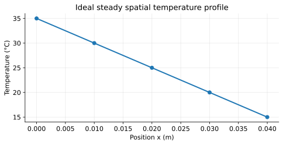
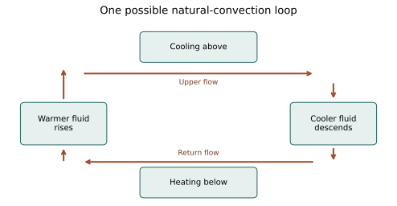
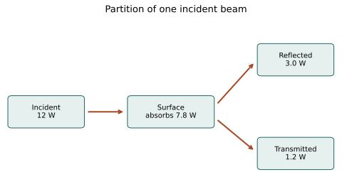
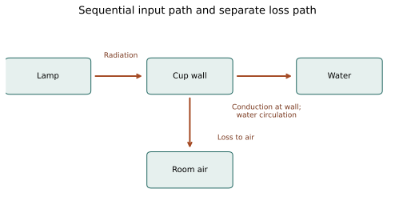
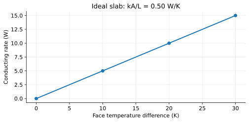
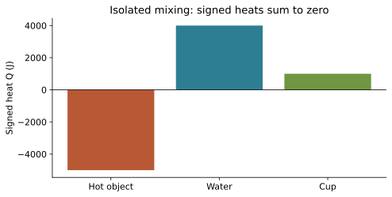
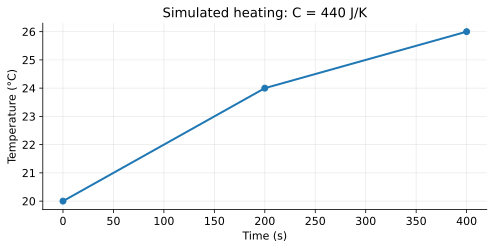

# Maple Thermodynamics Academy

Unit 3: Heat Transfer

Student textbook | All competition levels | Batch 3

Seven complete chapters; 17 fully worked examples; original diagrams and simulated graphs; formula packet, glossary and unit review. Use Units1–2 as prerequisites and the separate WS14–WS20 practice packet.

Contents: Conduction; Convection; Thermal radiation; Comparing mechanisms; Thermal conductivity; Heat capacity and specific heat; Combined applications.

This volume is part of an unfinished seven-unit curriculum.

# U3-C01 - Conduction

Unit 3 | All competition levels | public-student | Rule alignment: 5.c.iii, printed B57

## Learning objectives
Explain conduction microscopically; identify its direction; interpret a temperature profile; calculate a gradient and energy from a constant rate.

## Prerequisites
Units 1–2: temperature, particles, energy and equilibrium. A rate means an amount divided by elapsed time. A watt is one joule per second.

## Why the far end of a spoon warms
Place one end of a spoon in warm soup. The submerged end warms first, but after a while the handle can warm too. The spoon has not carried a stream of liquid along its length. Instead, energy has moved through interactions within the material. This transfer associated with a temperature difference is conduction. It occurs within a material and across contacts between materials. Contact is necessary for an ordinary conducting path; direct sunlight reaching a spoon is a different mechanism.

Temperature describes the thermal state, not the amount of heat stored. A warmer region and a cooler region can exchange energy through microscopic interactions. On average the net transfer is from the warmer region to the cooler region. Individual particles do not obey a rule that every collision transfers energy in one direction; the macroscopic net result reflects many interactions. Once temperatures become equal, microscopic activity continues but there is no net conduction driven by a temperature difference.

## The microscopic story depends on the material
In a solid, atoms remain near average positions while vibrating. Neighboring atoms interact, so energy associated with their motion can spread through the solid. A row of touching people passing a gentle push is a rough analogy: the disturbance travels without each person walking across the room. The analogy is limited because real atoms move and interact in three dimensions, and their energy is not a single traveling object.

Metals have another important pathway: mobile electrons carry energy through the material and exchange it with the lattice. This helps explain why many metals conduct thermal energy well. Avoid saying that metal atoms travel from the hot end to the cold end. The atoms mainly remain in their solid structure. Also avoid assuming that all nonmetals are poor conductors; material structure matters, and diamond is a notable nonmetal conductor.

Liquids and gases also conduct. Their particles interact and collide, exchanging energy even if the fluid has no organized circulation. Still air usually conducts much less effectively than a metal, but “less” is not zero. In a fluid that also moves, conduction and convection may occur together. Labeling an entire experiment with one word can hide these simultaneous processes.

## Read a temperature gradient
A temperature gradient describes how temperature changes with position. For an introductory straight, uniform slab, use the magnitude of the face-temperature difference divided by its thickness: G=(T_hot−T_cold)/L. Here G is in kelvins per meter if L is in meters. A difference of 20 °C has the same size as a difference of 20 K. This does not mean an absolute temperature of 20 °C equals 20 K.

A larger gradient means a larger temperature change over each meter. Under otherwise identical steady conditions, a steeper gradient drives a larger conducting rate. A graph of temperature versus position is not a heating curve: its horizontal axis is distance, not time. A downward line from left to right says the left side is hotter; it does not say the whole slab is cooling with time. In the ideal steady case, each location keeps the same temperature while energy continues passing through.

## Separate the amount from the rate
If 12 joules pass a boundary every second, the transfer rate is 12 W. After 10 seconds at that constant rate, 120 J have passed. P describes how quickly energy moves; Q describes the transferred energy over an interval. If the rate varies, multiplying one early reading by the whole duration is generally unjustified. Use a supplied average rate or add the energy for separate constant-rate intervals.

Chapter 5 develops the slab relationship P_cond=kAG. For now notice three influences: the material, the area available for transfer, and the temperature gradient. This relationship is a model for steady one-dimensional conduction, not a universal prediction for an irregular object warming rapidly. The hot and cold faces must be specified. A lamp's power rating is not the conducting power through a spoon.

## Why surfaces and contact matter
Two surfaces that look flat may touch at only small regions, with air gaps between them. Such contacts can limit conduction. Pressing contact surfaces together can change transfer even when neither material's conductivity changes. Real handles also exchange energy with air and by radiation. A simple classroom result therefore need not match a bare slab calculation exactly. A strong explanation names the idealization and identifies plausible extra paths.

## Visual model

Ideal steady profile: temperature falls linearly from 35 °C at x=0 to 15 °C at x=0.040 m. Net conduction is toward the cooler face; the profile is not a temperature-versus-time graph.

## Definitions and units
Conduction: thermal energy transfer through microscopic interactions without requiring bulk material transport. Gradient magnitude G: temperature difference per distance, K/m. P: heat-transfer rate, W=J/s. Q: energy transferred, J. L: path length, m. Steady state: quantities at each location do not change with time; it does not imply equilibrium.

## Equations and their meaning
G=(T_hot−T_cold)/L. Q=PΔt for a constant rate or a supplied interval-average rate. P=Q/Δt. Positive Q means transfer into the selected system; a stated hot-to-cold rate is usually a positive magnitude.

## Worked example: A profile across a wall

**Given:** Faces are 35 °C and 15 °C; thickness is 0.040 m.

**Find:** Gradient magnitude and direction.

**Equation:** G=(T_hot−T_cold)/L.

**Substitution:** G=(35−15) K/0.040 m.

**Arithmetic:** ΔT=20 K; 20/0.040=500.

**Answer with units:** G=500 K/m; net conduction toward the 15 °C face.

**Physical interpretation:** This is a spatial gradient, not a rate of warming.

## Worked example: Energy through a handle

**Given:** Constant conducting rate 1.5 W for 4.0 min.

**Find:** Energy transferred.

**Equation:** Q=PΔt; Δt in seconds.

**Substitution:** Q=1.5 J/s×(4.0×60) s.

**Arithmetic:** Δt=240 s; 1.5×240=360.

**Answer with units:** Q=360 J transferred toward the cooler region.

**Physical interpretation:** The energy amount grows with time although the rate stays fixed.

## Common misconceptions
Conduction does not require a solid, and it does not require atoms to flow along a rod. Metals feeling cold does not establish that they started colder than nearby wood. Your hand can lose energy faster to one surface. At equilibrium particles still move. A steady temperature gradient can coexist with a continuing transfer.

## Real-world application and safe exploration
A pan benefits from a conducting base while its handle can restrict transfer. For an adult-supervised school comparison, place equal immersed lengths of room-temperature metal and wooden spoons in comfortably warm, not boiling, water in a stable cup. Observe with an adult-operated thermometer or use recorded data; do not test with skin or taste. Equal geometry and contact improve the comparison, but different spoons rarely isolate material perfectly. This is a classroom demonstration, not a competition device proposal.

## Chapter recap
Conduction connects microscopic interactions to a measurable macroscopic rate. Identify temperatures, distance, material and area before claiming which path transfers energy faster. Read graph axes and distinguish watts from joules.

## Chapter review
1. How can energy cross a solid without its atoms flowing across it?
2. Why does a steady temperature profile not prove zero transfer?
3. What distinguishes a position graph from a time graph?

## Practice
[WS14](../worksheets/WS14.md) progresses from foundations to competition reasoning.

## Mastery checklist
- [ ] I can describe lattice and electron pathways.
- [ ] I can calculate a spatial gradient with correct units.
- [ ] I can convert a constant rate into transferred energy.

# U3-C02 - Convection

Unit 3 | All competition levels | public-student | Rule alignment: 5.c.iii, printed B57

## Learning objectives
Explain buoyancy-driven circulation and forced circulation; distinguish flow from molecular conduction; analyze rates, density and cooling data.

## Prerequisites
Conduction and Unit 1 density ρ=m/V. Buoyancy is an upward force exerted by a fluid on an immersed region or object. A fluid is a liquid or gas.

## Energy travels with moving fluid
Watch water circulate in a pot as a warm region develops near the bottom. Warmer water can move upward and cooler water can move downward, carrying internal energy as matter moves. This bulk movement is central to convection. A gas is also a fluid, so air circulation can produce convection. A rigid solid cannot circulate in this way, although it can conduct energy.

At a solid-fluid boundary, the complete process includes microscopic conduction through the fluid very near the surface and motion that replaces this fluid farther away. A fan does not make conduction vanish. Engineers often call the combined surface-to-moving-fluid transfer convective heat transfer. At this level, distinguish its essential transport feature: fluid motion carries energy from place to place.

## Natural convection begins with a density difference
For many ordinary fluids over a suitable temperature interval, heating causes expansion at approximately constant pressure. The same mass occupies more volume, so its density decreases. If the warmed region is less dense than neighboring fluid in a gravitational field, buoyancy tends to move it upward. Cooler, denser fluid can move in to replace it, establishing circulation. Gravity and the geometry determine the possible flow pattern.

This account contains conditions, not merely the phrase “heat rises.” Energy can conduct downward and radiation can travel in any direction. It is the less-dense fluid that tends to rise relative to denser fluid. Heating a fluid from above can make a stable arrangement: the less-dense fluid is already above denser fluid, so strong overturning may not occur. Heating from below is more likely to create an unstable arrangement and circulation.

Thermal expansion is not identical for all substances and temperatures. Liquid water near freezing has unusual density behavior; the simple warmer-means-less-dense explanation should not be extended blindly through that interval. In our examples, ordinary air and liquid water well above 4 °C follow the usual trend. Convection also need not be purely thermal: differences in composition can produce density differences, although that is outside this unit's main focus.

## Forced convection uses imposed motion
A fan pushes air across a warm surface; a pump moves liquid through a radiator. These are examples of forced convection. The driving motion is imposed rather than arising solely from buoyancy. Natural and forced effects may coexist. Wind moving past a building can change its heat loss, even though the wall material and thickness remain unchanged.

Moving air does not automatically cool every object. If the air is colder than the surface, increased circulation often increases cooling. If the air is hotter than the object, it can increase heating. Evaporation can add cooling when moisture is present, so a wet-surface experiment cannot isolate ordinary convective sensible-heat transfer without accounting for phase change. Compare dry surfaces first when the intended variable is airflow alone.

## Follow a circulation loop instead of one arrow
To sketch a possible natural-convection loop, mark a warmer region, an upward path for less-dense fluid, a cooling region, and a return path for denser fluid. The arrows represent bulk flow, not separate substances called hot and cold. In a closed container, upward motion must be accompanied by returning motion somewhere else; matter cannot simply accumulate indefinitely at the top.

The diagram is an explanatory model, not a guaranteed prediction of a real turbulent flow. Obstacles, shape, heating location and viscosity can alter patterns. A small air gap can reduce circulation and act as part of insulation, but a large open gap can support moving air. “Contains air” is not sufficient evidence of excellent insulation. Preventing bulk flow and reducing conduction are related design choices with distinct mechanisms.

## Interpret cooling data fairly
A temperature-versus-time graph for a warm sample often becomes less steep as the sample approaches room temperature. A smaller temperature difference generally reduces the net heat-loss rate under comparable conditions. A straight line is therefore usually a limited-interval approximation. Compare average slopes over named intervals, not just final temperatures from different starting conditions.

An airflow comparison should hold sample mass, material, initial temperature, container, room temperature, surface area and observation duration as constant as practical. Repeated trials help distinguish an effect from measurement variation. A fan-on curve that cools faster is consistent with increased convective loss, but if the fan also changes evaporation or the sensor exposure, those alternative influences must be considered. A scientific claim should match what the experiment actually controls.

## Visual model

Schematic natural-convection loop: a heated lower region rises, fluid crosses the top, cooled fluid descends, and fluid returns along the bottom. Arrows show possible bulk flow, not molecular paths.

## Definitions and units
Natural convection: fluid motion driven by buoyancy associated with density differences. Forced convection: motion imposed by a fan, pump or other external agency. Density ρ: mass per volume. Average temperature slope: ΔT/Δt, such as °C/min. Bulk flow: organized movement of material on a scale larger than random microscopic motion.

## Equations and their meaning
ρ=m/V. Average temperature slope=(T_f−T_i)/Δt. Q=P_avgΔt when the interval-average transfer rate is supplied. These arithmetic relationships do not by themselves predict the full fluid flow. There is no universal convection rate independent of geometry, airflow and temperature.

## Worked example: An expanding parcel

**Given:** A model air parcel has mass 1.20 g; its volume increases from 1.00 L to 1.10 L at nearly constant pressure.

**Find:** Density before and after.

**Equation:** ρ=m/V.

**Substitution:** ρ_i=1.20/1.00; ρ_f=1.20/1.10.

**Arithmetic:** 1.20/1.00=1.20; 1.20/1.10≈1.091.

**Answer with units:** 1.20 g/L initially; about 1.09 g/L finally.

**Physical interpretation:** The parcel becomes less dense; whether it rises depends on its surroundings and gravity.

## Worked example: Compare two cooling intervals

**Given:** Equal dry samples start at 40 °C. After 5 min, still-air sample is 35 °C and fan sample is 30 °C.

**Find:** Average temperature slopes.

**Equation:** s=(T_f−T_i)/Δt.

**Substitution:** s_still=(35−40)/5; s_fan=(30−40)/5.

**Arithmetic:** −5/5=−1; −10/5=−2.

**Answer with units:** −1.0 °C/min and −2.0 °C/min.

**Physical interpretation:** The fan sample has twice the magnitude of average cooling slope for this interval; future slopes need not keep this ratio.

## Common misconceptions
Heat itself does not rise. Fluids can conduct even without circulation. A fan changes transfer conditions, not the material’s specific heat. Cooling rate in °C/min is not a heat-transfer rate in W until heat capacity and assumptions are supplied.

## Real-world application and safe exploration
Room ventilation, radiators and ocean circulation involve moving fluids. For a supervised classroom comparison use stable cups of comfortably warm water and an adult-controlled fan placed away from spills; never put electrical equipment near water. Prefer the provided simulated data if equipment or supervision is unavailable. A classroom fan or sensor is not a proposed part of the event device, which has separate construction restrictions.

## Chapter recap
Natural convection links expansion, density and buoyancy; forced convection uses imposed flow. State the temperature relation and experimental controls before predicting warming or cooling.

## Chapter review
1. Why can heating from above suppress a natural-convection loop?
2. When might a fan warm an object?
3. Why does a cooling slope not directly give watts?

## Practice
[WS15](../worksheets/WS15.md) progresses from foundations to competition reasoning.

## Mastery checklist
- [ ] I can draw a complete flow loop.
- [ ] I can distinguish natural and forced motion.
- [ ] I can evaluate controlled cooling comparisons.

# U3-C03 - Thermal Radiation

Unit 3 | All competition levels | public-student | Rule alignment: 5.c.iii, printed B57

## Learning objectives
Explain thermal radiation and net exchange; distinguish absorption, reflection and transmission; calculate energy budgets from supplied incident power and fractions.

## Prerequisites
Units 1–2 energy and temperature, fractions and percentages; Unit 3 rate P in watts. Electromagnetic waves can carry energy through a vacuum.

## A transfer that needs no material bridge
You can feel warming from sunlight even though space between the Sun and Earth is mostly empty. Energy crosses space as electromagnetic radiation. Thermal radiation is electromagnetic emission associated with the thermal state of matter. Unlike conduction and convection, it does not require matter along the entire route. A transparent material can transmit some radiation, but a vacuum is sufficient for propagation.

Infrared radiation is especially important for objects near ordinary temperatures, but thermal radiation is not synonymous with infrared at every temperature. A sufficiently hot object can also emit visible light. The detailed spectrum belongs in the later advanced unit. Here the essential point is that waves carry energy, and the energy can be absorbed by matter when they arrive.

## Every ordinary object emits and receives
An object above absolute zero can emit thermal radiation even when it feels cold to a person. It also receives radiation from its surroundings. A warm cup in a room does not send energy into a perfectly empty one-way channel: the room radiates toward the cup too. The net radiative exchange is the difference between energy absorbed from surroundings and energy emitted by the cup.

If an object and its surroundings are at the same temperature in thermal equilibrium, exchange continues in both directions while the net transfer is zero. This resembles the distinction between particle motion and net conduction: microscopic or directional processes can continue without a net change. Do not identify “emits radiation” with “is cooling”; other energy inputs may exceed emission.

## Three destinations for incident radiation
Incident radiation is radiation arriving at a surface. Some may be absorbed, increasing energy in the material; some reflected, redirected away; and some transmitted, passing through. For a stated wavelength range and geometry, the fractions satisfy α+ρ+τ=1. Here α is absorptivity, ρ reflectivity and τ transmissivity. In this chapter ρ means a radiation fraction, whereas in density equations ρ means density; context and units distinguish them.

An opaque surface has essentially zero transmission in the specified range. Its absorbed and reflected fractions then sum to one. “Opaque” is wavelength-dependent: glass that transmits visible light can interact quite differently with thermal infrared. Treat a supplied fraction as applying to the source and conditions described; do not assume that a visible-light measurement determines all infrared behavior.

For example, if 70 percent of the incident radiant power is absorbed, multiply the incident power by 0.70. Do not multiply by 70. This calculation is an incoming-energy partition. It does not yet subtract the surface's own emission, conduction to supports or exchange with air. Absorbed energy and retained energy are different quantities.

## Surface properties are more than visible color
A matte dark coating often absorbs a large fraction of ordinary lamp radiation, whereas a shiny metallic surface often reflects much of it. These are useful tendencies, not a universal ranking based only on appearance. Surface finish, composition, wavelength and direction affect absorption and emission. Two surfaces that look equally black can have different infrared properties.

At thermal equilibrium, a surface's absorptivity and emissivity are related for the same wavelength and direction. This does not justify applying a visible-light absorption fraction to all thermal emission. The quantitative blackbody and Stefan–Boltzmann treatment is State/National content reserved for Unit 6. Unit 3 uses only supplied fractions and power rates; no fourth-power temperature law is needed.

## A reflector redirects; it does not create energy
A reflector can change where radiation travels. The outgoing reflected energy cannot exceed the incident energy unless an additional source is involved. Concentrating radiation into a smaller region can increase local heating, so real lamp and reflector demonstrations require adult-controlled school safety procedures. Students can reason fully from diagrams and data without building a hot setup.

In the heat-collection context, lamp output, incident power at a surface, absorbed power and net power warming water are different stages. The bulb's electrical wattage is not automatically the radiant power reaching the cup. Geometry, reflection, absorption, warming of other parts and losses intervene. A numerical problem must give enough information for its chosen boundary; missing fractions cannot be invented.

## Use an energy ledger
Write incoming power first, then allocate reflected, transmitted and absorbed portions. If asked for net warming, separately subtract the outgoing powers that cross the chosen boundary. Keep the same interval and units throughout. At constant rates, multiply the final net power by elapsed seconds to obtain joules. If rates change with temperature, use interval averages or separate intervals rather than assuming a permanent linear rise.

## Visual model

Power ledger for the worked example: 12 W incident becomes 7.8 W absorbed, 3.0 W reflected and 1.2 W transmitted. Arrow values refer to the incident beam only, not the surface’s separate thermal emission.

## Definitions and units
Radiation: energy transport by electromagnetic waves. Incident power: power arriving at a surface, W. Absorptivity α, reflectivity ρ and transmissivity τ: dimensionless fractions for specified radiation. Emission: radiation leaving a material because of its thermal state. Net exchange: signed difference between incoming absorbed and outgoing emitted radiation.

## Equations and their meaning
α+ρ+τ=1. P_abs=αP_inc; P_ref=ρP_inc; P_trans=τP_inc. For opaque surfaces in the stated band, τ=0. Q_abs=P_absΔt at constant absorbed rate. P_net,rad=P_abs,in−P_emit,out for the defined boundary; other mechanisms must be included separately if present.

## Worked example: Partition lamp power

**Given:** A surface receives 12 W in a stated radiation band; α=0.65, ρ=0.25, τ=0.10.

**Find:** Absorbed, reflected and transmitted powers.

**Equation:** Each part=fraction×P_inc.

**Substitution:** P_abs=.65×12; P_ref=.25×12; P_trans=.10×12.

**Arithmetic:** 7.8+3.0+1.2=12.0.

**Answer with units:** 7.8 W absorbed, 3.0 W reflected, 1.2 W transmitted.

**Physical interpretation:** The sum equals incident power; absorbed power is not necessarily retained power.

## Worked example: Net radiative warming

**Given:** A sample absorbs 8.0 W of radiation and emits 3.0 W; other transfers are negligible for 120 s.

**Find:** Net radiative energy entering.

**Equation:** Q_net=(P_abs−P_emit)Δt.

**Substitution:** Q_net=(8.0−3.0) J/s×120 s.

**Arithmetic:** 5.0×120=600.

**Answer with units:** Q_net=+600 J.

**Physical interpretation:** The sample emits while gaining energy because absorption exceeds emission.

## Common misconceptions
Cold objects emit too. Reflection is not absorption followed automatically by warming. Dark visible color alone does not establish infrared emissivity. Absorbed radiant power does not equal the lamp’s rated electrical power or the net water-heating power.

## Real-world application and safe exploration
A shiny emergency blanket can reduce some radiative exchange, but real performance also depends on wind and contact. Compare provided absorption-fraction data for surfaces without a hot-lamp experiment. If a school conducts any lamp investigation, an adult must control placement, electrical equipment, exposure and cooldown; students must not touch bulbs or focus sunlight. Device legality and construction details remain in Unit 7.

## Chapter recap
Radiation crosses a vacuum, is exchanged in both directions, and interacts with surfaces by absorption, reflection and transmission. Specify wavelength context and distinguish incident, absorbed and net powers.

## Chapter review
1. How can a sample emit radiation while warming?
2. Why must absorption, reflection and transmission fractions sum to one?
3. Why is visible color insufficient to predict every radiative property?

## Practice
[WS16](../worksheets/WS16.md) progresses from foundations to competition reasoning.

## Mastery checklist
- [ ] I can distinguish radiation from fluid transport.
- [ ] I can partition incident power without creating energy.
- [ ] I can calculate net exchange from supplied rates.

# U3-C04 - Comparing Heat Transfer Mechanisms

Unit 3 | All competition levels | public-student | Rule alignment: 5.c.iii, printed B57

## Learning objectives
Identify multiple transfer paths; trace energy across chosen boundaries; avoid double counting; evaluate explanations and diagrams.

## Prerequisites
Chapters 1–3, watts and joules, system boundaries from Unit 1. A path is a sequence of transfers; parallel paths cross a boundary separately.

## Start with a boundary and a question
A cup warmed near a lamp can involve all three mechanisms. Radiation travels from the lamp to absorbing surfaces. Conduction carries energy through a solid cup wall. Convection circulates water and exchanges energy with surrounding air. A question asking “Which mechanism occurs?” may have several correct answers. A question asking “How does energy cross this particular gap?” is more precise.

Before labeling arrows, draw a boundary around the system you are studying. Is it the water, the cup and water, or the entire collecting arrangement? Transfer between the cup and water crosses the water-only boundary, but it is internal to a cup-plus-water system. A correct energy ledger changes when the boundary changes because its inputs and outputs change. The physical event itself has not changed.

## Recognize the signature of each mechanism
For conduction, look for microscopic transfer within matter or across contacting materials without requiring bulk flow. For convection, identify moving fluid and explain what carries the energy. For radiation, look for electromagnetic energy traveling between surfaces, potentially across empty space. Touching objects can radiate as well as conduct; the presence of contact does not prohibit radiation along other exposed surfaces.

A metal spoon in warm liquid gives a useful chain. Fluid motion brings warmer liquid toward its surface. Microscopic conduction transfers energy at the surface and through the spoon. The handle can transfer energy to cooler air and emit radiation. Saying “a metal spoon uses conduction” is a useful first approximation, but saying “only conduction occurs anywhere” is too strong.

A vacuum gap suppresses ordinary conduction and convection across that gap because it removes the material needed for those paths. Radiation can still cross it. Supports bridging the gap may conduct. This is a conceptual explanation of a physical principle, not a suggestion to use a vacuum-sealed device in the event; the supplied rules prohibit such devices.

## Distinguish sequential and parallel transfers
Imagine 500 J absorbed by a plate, then 500 J conducted through a wall, then 500 J transferred into water, with no other changes in the idealized sequence. The water has not received 1500 J. These are successive accounts of the same 500 J as it moves. Adding all three would count the same energy repeatedly.

Now imagine 500 J entering a water system by one path and another 200 J entering independently across another part of its boundary during the same interval. Those distinct inputs sum to 700 J. If 100 J leaves, the net input is 600 J. Addition is justified by distinct boundary crossings, not simply by the fact that several mechanism names appear in a diagram.

At a steady intermediate wall, incoming and outgoing powers can be equal while energy flows through it. During initial warming, some energy can increase the wall's own internal energy, so less may immediately leave than enter. Do not assume that every stage in a real warming assembly has the same instantaneous rate. Equal rates in a series path require the stated steady or negligible-storage approximation.

## Mechanism does not determine direction by itself
A fan can deliver heat from hot air to a colder sample or remove heat from a warmer sample into cool air. A metal wall can conduct either way depending on which face is hotter. Net radiation depends on absorbed incoming and emitted outgoing radiation. Therefore “convection causes cooling” and “radiation causes heating” are incomplete generalizations.

The overall temperature trend follows the net energy balance together with the system's heat capacity and any phase changes. A system can lose energy by one path while warming because larger inputs arrive through others. It can also remain at constant temperature while substantial energy enters and leaves at equal rates. Temperature alone does not reveal every individual transfer.

## Read evidence without claiming too much
Suppose wrapping the outside of a cup reduces cooling. The change is consistent with altered conduction through the covering, airflow around it and radiation from its outer surface. One trial does not uniquely identify a single mechanism. To isolate a variable, compare otherwise matched setups and change one relevant feature at a time. Even then, name remaining limits honestly.

In a competition-style explanation, use a short chain of evidence: identify a path, identify its mechanism, state the temperature or radiation conditions, and predict a consequence. For example, “Airflow replaces warmed air next to the cup; because the room air is cooler, this can increase net loss.” This is more informative than memorizing that a fan cools things. It also reveals which assumptions a changed problem would invalidate.

## Visual model

One possible chain is radiation to an absorbing surface, conduction through the cup wall, and transfer into circulating water. A separate arrow shows loss to cooler room air. Labels distinguish sequence from a distinct loss path.

## Definitions and units
System boundary: chosen surface separating system from surroundings. Series path: successive transfers along one route. Parallel paths: distinct simultaneous routes crossing a boundary. Net heat Q_net: sum of signed heat transfers, J. Thermal storage: change of internal energy in the chosen material, not a fourth transfer mechanism.

## Equations and their meaning
Q_net=Q_in,total−Q_out,total when inputs and outputs are positive magnitudes. P_net=P_in,total−P_out,total for simultaneous rates. Q_net=P_netΔt for constant rates. These heat balances describe temperature changes only under the stated no-work, no-phase-change and known-capacity assumptions.

## Worked example: One route, several stages

**Given:** In an ideal no-storage chain, 600 J is absorbed by a surface, passes through a wall and reaches water.

**Find:** Energy received by water.

**Equation:** Energy conserved along the stated lossless chain.

**Substitution:** Q_water=Q_transmitted along the one path=600 J.

**Arithmetic:** Count the boundary crossing into water once; do not add 600 three times.

**Answer with units:** Q_water=600 J.

**Physical interpretation:** Mechanism labels describe successive stages, not additional sources.

## Worked example: Separate inputs and losses

**Given:** A selected system receives 7 W by radiation and 2 W by conduction, and loses 3 W by convection for 100 s.

**Find:** Net heat input.

**Equation:** Q_net=(7+2−3)Δt.

**Substitution:** Q_net=(7+2−3) J/s×100 s.

**Arithmetic:** P_net=6 W; 6×100=600.

**Answer with units:** Q_net=+600 J.

**Physical interpretation:** The separate paths cross the chosen boundary and can be added with signs.

## Common misconceptions
Heat storage is not convection, conduction or radiation. Sequential arrows must not be added as independent inputs. “Dominant” does not mean “only.” A constant temperature can result from balanced nonzero transfers, and the same mechanism can heat or cool depending on conditions.

## Real-world application and safe exploration
Explain a spoon, window or warm drink by tracing several paths. A safe paper activity is to draw the system boundary on the supplied diagram, then recolor arrows that actually cross it. Use the same picture with water-only and cup-plus-water boundaries. No physical heating is needed, and neither diagram serves as a legal device blueprint.

## Chapter recap
Mechanism identification becomes reliable when tied to a specific path and boundary. Energy bookkeeping requires distinct inputs and outputs; a path through several materials can carry the same energy through several mechanisms.

## Chapter review
1. Why is a water-only boundary different from a cup-plus-water boundary?
2. When may separate powers be added?
3. What does a vacuum gap remove, and what can still cross it?

## Practice
[WS17](../worksheets/WS17.md) progresses from foundations to competition reasoning.

## Mastery checklist
- [ ] I can identify each stage of a mixed path.
- [ ] I can avoid double counting a series transfer.
- [ ] I can explain a net balance with simultaneous gains and losses.

# U3-C05 - Thermal Conductivity

Unit 3 | All competition levels | public-student | Rule alignment: 5.c.iii, printed B57

## Learning objectives
Use the steady slab model; distinguish material conductivity from whole-object performance; convert area and thickness units; interpret conductivity data.

## Prerequisites
Conduction, spatial gradients, multiplication and division. Area is the face perpendicular to the heat path. For a rectangle, area=width×height.

## A material property within a transfer model
Thermal conductivity k describes how effectively a material conducts under specified conditions. A larger k gives a larger conducting rate when area, thickness and face temperatures are the same. The SI unit is W/(m·K). This unit looks unfamiliar until it is placed in the full slab equation; it combines with area and temperature gradient to produce watts.

A conductor generally has relatively high k, while a thermal insulator has relatively low k. These labels are comparative. An insulator slows transfer; it does not prevent all transfer or create heat. Conductivity can depend on temperature, material structure, moisture and direction. A number supplied in a worksheet is the value for that problem's model, not an exact universal constant for every sample with the same everyday name.

## Build the steady slab equation
Consider a flat slab of thickness L, face area A and uniform conductivity k. Hold one face at T_hot and the other at T_cold. Assume one-dimensional steady conduction, negligible edge transfer and no internal energy source. The hot-to-cold rate magnitude is P_cond=kA(T_hot−T_cold)/L.

Each factor has a physical interpretation. Doubling the area creates twice as much side-by-side conducting path, so the rate doubles. Doubling the face-temperature difference doubles the driving gradient. Doubling thickness spreads that difference over twice the distance, halving the gradient and the rate. Doubling conductivity doubles the rate if everything else remains fixed.

These proportionalities are conditional. If a thicker layer changes its outside surface temperature in a real experiment, holding room temperature constant does not guarantee that the same face-temperature difference is maintained. Read the specified temperatures carefully: slab-face temperatures and far-away air temperatures need not be interchangeable. Contact and convection can introduce extra temperature drops.

## Check every unit before calculating
With k in W/(m·K), use A in m², L in m and a temperature difference in K or numerically equivalent Celsius degrees. The product kAΔT/L has units W×m²×K/(m×K×m)=W. Multiplying by seconds gives joules, not watts squared.

A centimeter is 0.01 m, so a square centimeter is 0.01 m×0.01 m=0.0001 m². The area conversion factor must be squared. A rectangle 10 cm by 20 cm has area 200 cm²=0.020 m². Converting 200 cm² to 2 m² is a hundredfold error. Millimeters convert linearly: 5 mm=0.005 m. Do conversions on a separate line so mistakes are visible.

## Conductivity is not the same as thickness or heat capacity
A thin low-k sheet can conduct more than a thick higher-k layer under the same area and face difference. Compare k/L when area and ΔT match. The whole path matters. Likewise, a large heat capacity tells you how much energy is needed for a temperature change, not how easily energy crosses a wall. A material can be a good conductor and still have a substantial sample heat capacity.

For an optional shorthand, thermal resistance of this ideal slab is R_th=L/(kA), in K/W, so P_cond=ΔT/R_th. This is the resistance of a particular slab with stated geometry, not a replacement name for conductivity. No circuit theory is required: the expression simply groups the same factors. In this batch all required problems can be solved directly with the slab equation.

## Use measured rates to estimate k
If a suitable steady experiment supplies P_cond, L, A and the two face temperatures, rearrange one equation: k=P_cond L/(AΔT). An estimate is only as sound as the model. If measured electrical heater power includes radiation, airflow loss or warming of supports, it is not necessarily the power conducted through the test slab. Calling the resulting quotient a material constant without accounting for these losses would overstate the evidence.

A graph of P_cond versus ΔT for fixed k, A and L is a straight line through the origin in this ideal model. Its slope is kA/L in W/K. A graph with a substantial intercept or changing slope suggests additional effects, changing properties or measurement offsets. This observation is a diagnostic question, not proof of one specific cause. State what the model predicts before interpreting disagreement.

## Visual model

Ideal rate-versus-temperature-difference graph for a slab with kA/L=0.50 W/K. Points (0,0), (10,5), (20,10), (30,15) follow the stated steady model, not experimental measurements.

## Definitions and units
k: thermal conductivity, W/(m·K). A: cross-sectional area normal to transfer, m². L: path thickness, m. P_cond: conducting rate, W. R_th: slab thermal resistance, K/W. A temperature difference of one kelvin equals a difference of one Celsius degree.

## Equations and their meaning
P_cond=kAΔT/L; k=P_cond L/(AΔT). Q=P_condΔt for a constant rate. Optional R_th=L/(kA). 1 cm²=10⁻⁴ m²; 1 mm=10⁻³ m. Use steady, uniform, one-dimensional conditions with specified face temperatures.

## Worked example: A model insulating panel

**Given:** k=0.040 W/(m·K), A=0.50 m², L=0.020 m, faces differ by 15 K.

**Find:** Conducting rate and energy in 60 s.

**Equation:** P=kAΔT/L; Q=PΔt.

**Substitution:** P=.040×.50×15/.020 W; Q=P×60 s.

**Arithmetic:** Numerator=.300; .300/.020=15; 15×60=900.

**Answer with units:** P=15 W; Q=900 J.

**Physical interpretation:** The result excludes edge leakage, radiation and convection paths.

## Worked example: Infer conductivity from a test

**Given:** Steady conduction is 3.0 W through area 100 cm² and thickness 4.0 mm; face difference is 12 K.

**Find:** k.

**Equation:** k=PL/(AΔT).

**Substitution:** A=.0100 m²; L=.0040 m; k=3.0×.0040/(.0100×12).

**Arithmetic:** Numerator=.012; denominator=.120; quotient=.100.

**Answer with units:** k=0.10 W/(m·K).

**Physical interpretation:** Using heater input instead of actual slab transfer would require an additional loss correction.

## Worked example: Compare two thicknesses

**Given:** Same k, A and face difference; original slab thickness 6 mm and rate 8 W; new thickness 12 mm.

**Find:** New conducting rate.

**Equation:** P_new/P_old=L_old/L_new.

**Substitution:** P_new=8 W×6/12.

**Arithmetic:** 6/12=.5; 8×.5=4.

**Answer with units:** P_new=4 W.

**Physical interpretation:** Twice the thickness halves this ideal rate; it does not halve k.

## Common misconceptions
k is not in J/(kg·K), and it is not the rate by itself. Doubling thickness does not change intrinsic k. Insulation reduces loss only relative to stated conditions. A water temperature curve alone cannot establish a slab’s k without geometry and energy-path information.

## Real-world application and safe exploration
Building insulation and insulated handles combine material and geometry. For a data-based activity compare supplied k/L ratios rather than handling insulation samples. Do not bring asbestos, mineral wool or fiberglass into demonstrations or event designs. A nonhazardous classroom material is still not automatically a validated competition design; detailed legality is treated in Unit 7.

## Chapter recap
The steady slab model converts a material property and geometry into a rate. Unit conversions and model assumptions are as important as arithmetic. Compare complete paths instead of ranking insulation by material name alone.

## Chapter review
1. Why does doubling area double the ideal rate?
2. Why is 100 cm² equal to 0.0100 m²?
3. Why might a heater-power experiment overestimate k?

## Practice
[WS18](../worksheets/WS18.md) progresses from foundations to competition reasoning.

## Mastery checklist
- [ ] I can calculate P with consistent SI units.
- [ ] I can rearrange for k and compare geometry changes.
- [ ] I can distinguish k, R_th and sample heat capacity.

# U3-C06 - Heat Capacity and Specific Heat

Unit 3 | All competition levels | public-student | Rule alignment: 5.c.iii, printed B57

## Learning objectives
Distinguish C from c and k; calculate signed heat; solve isolated mixing and container-aware calorimetry; check results physically.

## Prerequisites
Unit 2 sensible heat Q=mcΔT, single-phase assumptions and ΔT=T_f−T_i. This chapter extends the earlier formula to multiple interacting samples.

## Two different questions about thermal behavior
Conductivity asks how readily energy is transferred through a material. Heat capacity asks how much energy corresponds to a temperature change of a particular sample under stated conditions. These are different questions. A sample that changes temperature slowly might have a large heat capacity, a small net input rate, or both. Temperature data alone do not distinguish those causes.

The heat capacity C of a sample is its required heat per temperature change in the chosen process, when other energy effects are negligible or accounted for. Its unit is J/K or J/°C. Specific heat capacity c is heat capacity per mass, in J/(kg·K) or J/(g·°C). “Specific” means per unit mass here. For the same homogeneous material and conditions, C=mc. Doubling mass doubles C but leaves c approximately unchanged.

Heat capacity can depend on the process, especially for gases where expansion work matters. This unit uses ordinary solids and liquids with stated approximately constant c, no phase change and negligible mechanical work. Unit 4 expands the energy accounting. Do not turn a convenient solid/liquid model into a claim that heat always equals internal-energy change for every possible process.

## Use the sign and the correct temperature change
For a selected sample, positive Q means heat enters. Warming gives positive ΔT and cooling gives negative ΔT. The sensible-heat model is Q=mc(T_f−T_i)=CΔT. If asked how much heat is released, state the positive magnitude and explain that Q for the cooling sample is negative. A negative Q is not a negative amount of energy existing inside the material.

Absolute temperature does not replace temperature change in this equation. Warming from 20 °C to 30 °C is a 10 K change; the final Kelvin reading of 303.15 K is not the change. Match mass units to c. For water, 4.18 J/(g·°C) equals 4180 J/(kg·K); the factor of 1000 compensates for kilograms containing 1000 grams.

## Calorimetry uses energy conservation
Calorimetry estimates transferred heat or thermal properties from temperature changes and a model of the apparatus. In ideal mixing, a hotter sample loses energy while a cooler sample gains energy. If the combined system is isolated, no phase change occurs and mechanical work is negligible, the signed heats sum to zero. Heat lost by one part equals heat gained by the other parts.

Suppose two samples have heat capacities C_h and C_c and initial temperatures T_h and T_c. A shared final equilibrium temperature T_f satisfies C_h(T_f−T_h)+C_c(T_f−T_c)=0. This is one equation with one unknown, T_f. Rearranging gives T_f=(C_hT_h+C_cT_c)/(C_h+C_c). The result is a heat-capacity-weighted average, not automatically the arithmetic average.

Equal heat capacities give the midpoint temperature. A larger cold-side heat capacity pulls the final temperature closer to the initial cold temperature. The ideal result lies between the two initial temperatures. A result outside that range signals a mistake or an omitted process such as an external energy input, phase change or chemical reaction. This physical check often catches sign errors before detailed recalculation.

## The cup can matter too
The container may warm along with the water. If its heat capacity is C_cup and it starts at the cold-water temperature, combine the cold-side capacities: C_cold,total=m_water c_water+C_cup. If it starts at another temperature, keep its own term C_cup(T_f−T_cup,i) in the energy equation. The algebra is still one equation for the single unknown final temperature.

Ignoring a container is an approximation that must be stated, not a default law. A heavy cup can absorb enough energy to change the result substantially. Thermometers and surroundings can also exchange energy. Real measurements may need corrections, but beginner problems should give the required terms clearly rather than ask students to infer inaccessible quantities.

## Design a meaningful measurement
To estimate c, supply the heat actually received by the sample, its mass and its temperature change, then use c=Q/(mΔT). Heater rating times duration gives electrical input, which can include cup warming and losses; it is not necessarily the sample's heat. Stirring can help temperature uniformity, but its mechanical energy input should be negligible in the stated model. A sensor near a hot wall may not represent the entire sample before equilibration.

Report enough digits to show a valid method while avoiding invented precision. A temperature change from two readings inherits uncertainty from both readings. Repeating trials and controlling starting conditions improves confidence, but repetition does not remove a systematic bias such as always ignoring a warm container.

## Visual model

Container-aware mixing energy balance: the hot object loses 5000 J, water gains 4000 J and the cup gains 1000 J. The signed sum is zero for the isolated combined system.

## Definitions and units
C: sample heat capacity, J/K. c: specific heat capacity, J/(kg·K) or J/(g·°C). k: conductivity, W/(m·K), a distinct property. Calorimetry: quantitative heat accounting from measurements and a stated model. Thermal equilibrium: common temperature after internal net transfers cease.

## Equations and their meaning
C=mc; Q=CΔT=mcΔT; c=Q/(mΔT). Ideal isolated mixing: ΣQ=0, where Σ means add the listed signed heat terms. For two constant capacities: T_f=(C_1T_1+C_2T_2)/(C_1+C_2). Include cup capacity when specified; no phase changes in these examples.

## Worked example: Capacity and cooling

**Given:** 200 g water, c=4.18 J/(g·°C), cools from 35 to 30 °C.

**Find:** C and signed Q.

**Equation:** C=mc; Q=CΔT.

**Substitution:** C=200×4.18; Q=C×(30−35).

**Arithmetic:** C=836; ΔT=−5; 836×(−5)=−4180.

**Answer with units:** C=836 J/K; Q=−4180 J, so 4.18 kJ leaves.

**Physical interpretation:** Specific heat remains 4.18 J/(g·°C); sample capacity is 836 J/K.

## Worked example: Unequal masses of the same liquid

**Given:** 100 g water at 60 °C and 200 g water at 20 °C; same c; isolated, negligible cup capacity.

**Find:** Final equilibrium temperature.

**Equation:** T_f=(m_hT_h+m_cT_c)/(m_h+m_c), since c cancels.

**Substitution:** T_f=(100×60+200×20)/(100+200).

**Arithmetic:** Numerator=10000; denominator=300; quotient=33.333….

**Answer with units:** T_f≈33.3 °C.

**Physical interpretation:** The colder sample has twice the capacity, so the result is closer to 20 than to 60 °C.

## Worked example: A container absorbs heat

**Given:** Hot object C_h=100 J/K at 80 °C; water C_w=400 J/K and cup C_cup=100 J/K both at 20 °C; isolated.

**Find:** Final temperature.

**Equation:** 100(T_f−80)+(400+100)(T_f−20)=0.

**Substitution:** 600T_f=100×80+500×20.

**Arithmetic:** 8000+10000=18000; 18000/600=30.

**Answer with units:** T_f=30 °C.

**Physical interpretation:** Object loses 5000 J; water gains 4000 J and cup 1000 J. The three signed heats sum to zero.

## Common misconceptions
C and c differ by mass; k is about transfer through a path. Equal mass does not imply equal heat capacity for different materials. Final mixing temperature is not generally the midpoint. Temperature equilibrium does not mean equal internal energies.

## Real-world application and safe exploration
A warm drink stays warm partly because of its heat capacity and partly because its surroundings limit loss. For an adult-supervised classroom mixing demonstration use only comfortably warm and room-temperature water, stable cups and an adult-operated thermometer. No hot metals, boiling water or sealed heating is required. Use the numerical mixing examples as a complete alternative to physical work.

## Chapter recap
Heat capacity connects net heat to a temperature change. Calorimetry connects several such changes through conservation. Define the isolated system, include relevant container terms, check signs and ensure the final temperature is physically plausible.

## Chapter review
1. How do C and c change if a sample mass doubles?
2. Why does unequal-capacity mixing not give a midpoint?
3. How can an ignored cup bias a calorimetry result?

## Practice
[WS19](../worksheets/WS19.md) progresses from foundations to competition reasoning.

## Mastery checklist
- [ ] I can distinguish the units of C, c and k.
- [ ] I can solve a one-unknown energy balance.
- [ ] I can include the cup and check conservation.

# U3-C07 - Combined Heat Transfer and Experimental Reasoning

Unit 3 | All competition levels | public-student | Rule alignment: 5.c.iii, printed B57

## Learning objectives
Combine energy paths with heat capacity; read interval slopes; evaluate controls, uncertainty and device-model limits; justify competition-style predictions.

## Prerequisites
Chapters 1–6; energy balances, constant heat capacity, time conversion and rates. An interval average describes the whole stated interval, not every instant.

## Combine mechanisms without losing the system
The earlier chapters separated mechanisms to make each understandable. Real heating usually combines them. Begin an integrated problem by choosing a system and naming its energy boundary. For water alone, heat from the cup enters across the water boundary. For cup plus water, that transfer is internal and must not be counted as a new external input. Record the parts whose temperatures change and their heat capacities.

In the no-phase-change, negligible-work model used here, net heat input equals C_totalΔT for parts sharing one temperature change. If the cup and water have significantly different temperatures, combining their capacities into a single C_total is not yet justified. Use separate terms or wait until the stated equilibrium condition applies. A model is useful because its assumptions are explicit, not because it accounts for every detail of reality.

## Build a complete rate ledger
Suppose supplied absorbed radiant power enters a cup-and-water system. Some energy leaves to cooler air, some through a support and some as net radiation to surroundings. If all these rates are specified as separate boundary paths, subtract each loss once. The remaining rate increases the system's internal energy in the simplified model.

Be careful with the word “net.” If a supplied net radiative power already subtracts emitted radiation, do not subtract emission again. If an input is explicitly absorbed power, reflected power has already been excluded. A clear ledger labels incident, absorbed and net quantities, states the boundary and avoids counting the same joules twice.

For a constant or interval-average net rate, Q_net=P_netΔt. Divide by C_total to obtain ΔT, then add the starting temperature to obtain T_f. Predicting a rise is not the same as predicting an absolute final reading. Check that the result stays in the assumed liquid-water range and does not require an unmodeled phase transition.

## Extract power from a graph
A temperature-versus-time graph gives an average temperature slope over two points. If C_total is known and the model assumptions hold, the corresponding average net power is C_total(T_2−T_1)/(t_2−t_1), using seconds for watts. The graph reveals net energy accumulation, not each individual mechanism's rate. Many different input-and-loss combinations can produce the same slope.

If the curve bends and becomes less steep, net input is decreasing. Under constant absorbed input, increasing losses as the sample warms can explain this pattern. It does not prove the lamp is weakening. If the curve levels off, a steady temperature can mean input and output rates balance. Energy can continue flowing through the system while no longer increasing its temperature.

Extrapolating an early straight-line slope far into the future can overpredict temperature when losses grow. A local prediction over a comparable interval may be useful, but it should be labeled a model estimate. Tournament conditions, lamp placement, room temperature and the device itself influence performance. A classroom calculation is not a validated competition prediction.

## Controls make comparisons informative
To compare two surface treatments, keep water mass, cup, source geometry, starting temperature, timing, room conditions and measurement method matched. Change the treatment deliberately and repeat trials. Record both initial and final temperatures rather than comparing final readings alone. A warmer starting sample can finish warmer while gaining less energy.

A fair comparison also needs the same energy boundary. If one treatment adds substantial mass, it may change total heat capacity as well as absorption. If it changes exposed area or airflow, several mechanisms may change together. A careful conclusion can say that a whole treatment improved a measured outcome without claiming that a single microscopic property was isolated.

## Resolution and uncertainty are not the same as carelessness
A thermometer reading to 0.1 °C has a display resolution of 0.1 °C, but its total accuracy may be poorer. If a problem assigns each reading a possible error of ±0.1 °C, the most conservative error bound on their difference is ±0.2 °C. This is a worst-case arithmetic bound, not a statistical confidence interval. Two small measured gains whose allowed ranges overlap may not support a confident ranking.

A repeatable offset can partly cancel when the same thermometer measures both readings, but do not assume perfect cancellation without information about its behavior. Random variation and systematic error require different remedies. Repetition helps quantify variability; calibration and better modeling address systematic effects.

## Connect to the event without designing the device
The event heats supplied water using an external lamp. The useful principles are selective routing of incoming radiation, transfer into water and control of losses. Any classroom fan, probe or heater mentioned in a demonstration is measuring or imposing laboratory conditions, not a permitted device component. The supplied rules prohibit team device energy sources and sensors and prohibit device parts contacting the water. Unit 7 will treat the full construction and scoring constraints.

For now, practice defending each equation: which system, which energy paths, which interval and which assumptions? A strong competition answer includes a number with units and a sentence explaining why it makes physical sense. When the evidence is insufficient to separate mechanisms or rank close trials, identifying that limitation is part of correct reasoning.

## Visual model

Simulated heating data for a 440 J/K system: 20 °C at 0 s, 24 °C at 200 s and 26 °C at 400 s. The second segment is less steep; these are teaching data, not measured device results.

## Definitions and units
P_net: net boundary heat-transfer rate, W. C_total: combined heat capacity of parts sharing a temperature change, J/K. Resolution: smallest displayed increment. Error bound: stated possible deviation. Simulated data: intentionally constructed teaching values, not observations from a tested device.

## Equations and their meaning
P_net=ΣP_in−ΣP_out; Q_net=P_netΔt; ΔT=Q_net/C_total; T_f=T_i+ΔT. Graph estimate: P_avg=C_totalΔT/Δt. If two readings each have an independent stated maximum error magnitude e, a conservative bound on their difference is 2e. No calculus or trigonometry is required.

## Worked example: A modeled cup and water

**Given:** Water mass 100 g, c=4.18 J/(g·°C), cup C=22 J/K. Absorbed input 12 W; separate losses 3 W and 1 W. All rates constant for 300 s; initial 20 °C.

**Find:** Final shared temperature.

**Equation:** C_total=mc+C_cup; ΔT=(P_in−P_out)Δt/C_total.

**Substitution:** C_total=100×4.18+22; ΔT=(12−3−1)×300/440.

**Arithmetic:** C_total=440 J/K; P_net=8 W; Q=2400 J; ΔT=5.4545….

**Answer with units:** T_f≈25.45 °C in the model.

**Physical interpretation:** The cup shares the energy; using water capacity alone would predict a larger rise.

## Worked example: Changing slopes

**Given:** A simulated system has C=440 J/K and readings 20 °C at 0 s, 24 °C at 200 s, 26 °C at 400 s.

**Find:** Average net power in each interval.

**Equation:** P_avg=CΔT/Δt.

**Substitution:** P_1=440×(24−20)/200; P_2=440×(26−24)/200.

**Arithmetic:** 1760/200=8.8; 880/200=4.4.

**Answer with units:** First interval 8.8 W; second 4.4 W.

**Physical interpretation:** Net power halved. Constant absorbed input with growing losses is one possible explanation.

## Worked example: Can tiny gains be ranked?

**Given:** Trial A gains 2.0 °C, B gains 2.1 °C. Each initial and final reading has stated maximum error ±0.1 °C.

**Find:** Conservative gain ranges.

**Equation:** Gain error bound=.1+.1=.2 °C.

**Substitution:** A:2.0±.2; B:2.1±.2.

**Arithmetic:** A range1.8–2.2; B range1.9–2.3.

**Answer with units:** Ranges overlap; no secure ranking from these bounds alone.

**Physical interpretation:** A displayed 0.1 °C difference is not necessarily a resolved performance improvement.

## Common misconceptions
Lamp rating is not net water power. A flattening curve does not prove all transfer stopped. A slope cannot separate every mechanism. More decimal places do not remove uncertainty. Combining capacities requires a common modeled temperature change.

## Real-world application and safe exploration
Use the simulated graphs for a complete device-related analysis without high-temperature work. For an optional adult-led warm-water cooling observation, use a stable open cup, comfortably warm water and recorded readings; avoid hot lamps, concentrated sunlight and improvised electrical apparatus. Repeat matched conditions and discuss what the graph can and cannot establish.

## Chapter recap
Integrated problems become manageable when the boundary, capacities, paths and time interval are explicit. Calculate a net input, convert it to a temperature change, and test the result against physical limits and measurement evidence.

## Chapter review
1. Why can a temperature plateau coexist with nonzero energy flow?
2. Why may an early-slope extrapolation fail?
3. What must be known before converting a graph slope into watts?

## Practice
[WS20](../worksheets/WS20.md) progresses from foundations to competition reasoning.

## Mastery checklist
- [ ] I can write a nonduplicated energy ledger.
- [ ] I can use a graph to calculate interval-average net power.
- [ ] I can explain uncertainty and limits of device predictions.

# Unit 3 formula packet

public-student | All competition levels | F19–F28. Units 1–2 formula files remain unchanged.

Use supplied constants. Water c=4.18 J/(g·°C)=4180 J/(kg·K) is a rounded teaching value near ordinary liquid conditions. No Stefan–Boltzmann calculations are required here.

## F19 - Spatial temperature gradient
G=(T_hot−T_cold)/L

Variables: G: K/m; T_hot,T_cold: °C or K; difference only; L: m

Use: Magnitude for a specified uniform path; do not confuse position with time.

Mini example: (40−20) K/.05 m=400 K/m.

## F20 - Steady slab conduction
P_cond=kAΔT/L

Variables: P_cond: W; k: W/(m·K); A: m²; ΔT: K; L: m

Use: Uniform k, steady one-dimensional conduction and negligible edge/contact complications; face temperatures specified.

Mini example: .05×.20×10/.02=5 W.

## F21 - Infer conductivity
k=P_cond L/(AΔT)

Variables: k: W/(m·K); P_cond: W; L: m; A: m²; ΔT: K

Use: Use actual conducted power, not an uncorrected heater rating.

Mini example: 2 W×.01 m/(.02 m²×10 K)=.10 W/(m·K).

## F22 - Radiation partition
α+ρ+τ=1; P_abs=αP_inc

Variables: α,ρ,τ: dimensionless fractions; P_abs,P_inc: W

Use: Fractions refer to the specified incident radiation. Here ρ is reflectivity, not density.

Mini example: α=.7 and P_inc=10 W give P_abs=7 W.

## F23 - Sample heat capacity
C=mc; Q=CΔT

Variables: C: J/K; m: g; c: J/(g·°C); Q: J; ΔT: K or °C change

Use: Constant c, single phase and stated sensible-heat model; C depends on mass.

Mini example: 50 g×4 J/(g·°C)=200 J/K; 5 K rise needs1000 J.

## F24 - Ideal two-part mixing
T_f=(C_1T_1+C_2T_2)/(C_1+C_2)

Variables: C_1,C_2: J/K; T_1,T_2,T_f: same temperature scale

Use: Isolated, constant capacities, negligible work and no phase change; add cup terms as required.

Mini example: (100×60+300×20)/400=30 °C.

## F25 - Boundary energy ledger
Q_net=ΣQ_in−ΣQ_out

Variables: Q_net,Q_in,Q_out: J

Use: Add distinct crossings over the same interval; do not add successive descriptions of the same path.

Mini example: 500 J+200 J−100 J=600 J.

## F26 - Power from a temperature interval
P_avg=C_total(T_2−T_1)/(t_2−t_1)

Variables: P_avg: W; C_total: J/K; T: °C or K; t: s

Use: Known constant capacity, common temperature, no phase change or significant work.

Mini example: 400 J/K×3 K/120 s=10 W.

## F27 - Area and thickness conversions
1 cm²=0.0001 m²; 1 mm=0.001 m

Variables: A: m²; L: m

Use: Square the length conversion when converting area.

Mini example: 300 cm²=.0300 m²;6 mm=.006 m.

## F28 - Combined temperature prediction
T_f=T_i+(P_in−P_out)Δt/C_total

Variables: P_in,P_out: W; Δt: s; C_total: J/K; T_i,T_f: °C

Use: Rates constant or interval-averaged; distinct boundary paths and same-temperature parts; no phase change.

Mini example: 20 °C+(10−4) W×100 s/(300 J/K)=22 °C.

# Unit 3 glossary

public-student | All competition levels

## Absorption
Radiation transfers energy into matter rather than being reflected or transmitted.

## Absorptivity
Fraction of specified incident radiation absorbed; dimensionless.

## Boundary
Chosen surface that separates a thermodynamic system from surroundings.

## Buoyancy
Force exerted by a fluid; density differences in gravity can drive natural circulation.

## Calorimetry
Estimating heat or thermal properties from measurements and an energy-balance model.

## Conduction
Thermal transfer through microscopic interactions without requiring bulk flow.

## Conductivity k
Material coefficient in the conducting model, W/(m·K).

## Convection
Thermal transport involving moving fluid, including boundary-layer transfer at a surface.

## Emission
Radiation leaving matter because of its thermal state.

## Error bound
Stated maximum possible deviation; not necessarily a statistical confidence interval.

## Fluid
Liquid or gas capable of flow.

## Forced convection
Fluid circulation imposed by a fan, pump or other agency.

## Heat capacity C
Heat per temperature change for a sample under stated conditions, J/K.

## Incident power
Radiant power arriving at a surface, W.

## Insulator
Material or arrangement that reduces transfer relative to stated comparison conditions.

## Interval-average power
Transferred energy divided by the duration of that interval, W.

## Natural convection
Buoyancy-driven fluid motion associated here with thermal density differences.

## Net power
Sum of input rates minus output rates across one boundary.

## Opaque
Negligible transmission in the specified wavelength range.

## Radiation
Energy transport by electromagnetic waves; a medium is not required.

## Reflection
Redirection of incident radiation away from a surface.

## Resolution
Smallest displayed measurement increment; distinct from total accuracy.

## Specific heat c
Heat capacity per unit mass, J/(kg·K) or J/(g·°C).

## Steady state
Conditions at a location do not change with time; transfer can continue.

## Temperature gradient
Temperature change per distance, K/m for a one-dimensional magnitude.

## Thermal resistance
For an ideal slab L/(kA), in K/W; depends on geometry.

## Transmission
Passage of incident radiation through material.

## Watt
One joule per second; rate unit, not energy unit.

# Unit 3 review and reasoning guide

public-student | All competition levels

## Start with the physical picture
Identify the system before selecting an equation. Conduction uses microscopic interactions; convection involves bulk fluid movement; radiation uses electromagnetic waves. A real situation can contain all three. Name the particular path, not merely the object. Net direction and net energy depend on temperature conditions and the whole boundary ledger.

## Three properties that must stay distinct
| Quantity | Meaning | Common unit | Depends on sample mass? |
| --- | --- | --- | --- |
| k | Material conduction coefficient | W/(m·K) | Not merely because mass changes |
| c | Capacity per mass | J/(kg·K) | Not merely because mass changes |
| C | Whole-sample capacity | J/K | Yes: C=mc for the stated material |

A rapid temperature change can result from low C or high net power; it does not uniquely identify k. A low-k material in a thin sheet can transfer more than a thicker higher-k layer.

## Choose the equation and check the model
For a fixed-rate interval, Q=PΔt. For a steady uniform slab, P=kAΔT/L. For a single-phase sensible temperature change, Q=mcΔT. For isolated mixing, add signed heat terms to zero and include the container when stated. For radiation, partition supplied incident power using supplied fractions; do not invent the power incident from a bulb rating.

## Read graphs in four passes
First identify both axes and units. A spatial temperature profile gives a gradient, while a time graph gives a warming/cooling slope. Second select the requested interval. Third calculate the signed change divided by the horizontal change. Fourth connect the slope to a model: CΔT/Δt gives net watts only when C and the assumptions are known and time is in seconds.

## Explain with evidence
State the observation, identify a plausible path, describe the mechanism and acknowledge what the evidence cannot determine. A fan comparison needs matched starts and dry/wet conditions. A covering may change several paths. A flattening curve may indicate increasing loss under constant input. None of these observations alone uniquely measures every material property.

## Independent review prompts
1. Explain why a room-temperature metal surface can feel colder than wood.
2. Draw natural circulation from a warm lower region and explain when it may be suppressed.
3. Distinguish incident, absorbed, emitted and net radiant power.
4. Explain why three successive transfers of300 J do not supply900 J to water.
5. Describe the effects of doubling A or L in the ideal slab model.
6. Explain why equal-mass samples of different substances need not reach their midpoint temperature.
7. State the information needed to calculate watts from a temperature-time graph.

## Preparation for Unit 4
You can now identify energy entering and leaving by heat. Unit 4 adds mechanical work, processes and the first law in a more general form. Keep the sign convention explicit rather than assuming every energy change is caused by heat alone. Correct WS14–WS20 with instructor feedback before advancing.
