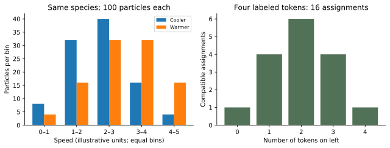

# WS29 - Lord Kelvin and Joseph Black

Name: ____________________  Date: ______________

Unit 5 | All competition levels | public-student | 20 points | 25–30 minutes

## Objectives
Explain what a thermometer measures; distinguish sensible and latent heating; connect Black’s measurements to calorimetry and Kelvin’s temperature ideas to gas ratios and engine limits.

## Instructions
Explain historical significance, not only names. Use modern equations with their assumptions. Show units and reasoning. Unless labeled otherwise, data are original illustrative models.

## Reference material
Illustrative constant-input heating model. From energy 0 to 20 units, pure ice/water coexist near 0 °C at fixed pressure; after melting, the liquid warms. Read the graph with the phase observations.

| Energy added (illustrative units) | Temperature (°C) | Observed phase |
| --- | --- | --- |
| 0 | 0 | Ice + water |
| 10 | 0 | Ice + water |
| 20 | 0 | Melting completes |
| 30 | 5 | Liquid |
| 40 | 10 | Liquid |

## WS29-Q01 (2 points; foundation)
Which contribution is most closely associated with Joseph Black? A. Naming entropy. B. Distinguishing latent heat and specific heat. C. Developing molecular speed distributions. D. Introducing radiation energy quanta. Explain your choice.

____________________________________________

____________________________________________

____________________________________________

____________________________________________

## WS29-Q02 (2 points; foundation)
Match each observation to the most relevant scientist, Kelvin or Black, and explain briefly: (i) an absolute temperature is needed for an engine-temperature ratio; (ii) melting ice absorbs energy with nearly constant temperature.

____________________________________________

____________________________________________

____________________________________________

____________________________________________

## WS29-Q03 (2 points; foundation)
Two equal-mass samples reach the same final temperature after different amounts of heating. A student says this violates thermal equilibrium. Explain the error.

____________________________________________

____________________________________________

____________________________________________

____________________________________________

## WS29-Q04 (2 points; foundation)
A museum caption says: “Black discovered latent heat in 1803 when his collected lectures were published.” Use his lifespan, 1728–1799, and the 1762 presentation date to correct it.

____________________________________________

____________________________________________

____________________________________________

____________________________________________

## WS29-Q05 (3 points; application)
A 0.15 kg sample with c=800 J/(kg·K) warms by 6 K without a phase change. Assume no losses. Find the energy supplied, and explain how the result illustrates a Black-associated concept.

____________________________________________

____________________________________________

____________________________________________

____________________________________________

____________________________________________

____________________________________________

## WS29-Q06 (3 points; application)
An ideal engine operates between 26.85 °C and 126.85 °C. Convert both to Kelvin, calculate the modern Carnot maximum efficiency, and explain why dividing the Celsius readings would be wrong.

____________________________________________

____________________________________________

____________________________________________

____________________________________________

____________________________________________

____________________________________________

## WS29-Q07 (3 points; application)
Use the WS29 reference graph. Energy continues to enter between 0 and 20 illustrative energy units while temperature stays at 0 °C. Explain where the energy goes, why Q=mcΔT alone fails here, and what observation should accompany the thermometer record.

____________________________________________

____________________________________________

____________________________________________

____________________________________________

____________________________________________

____________________________________________

## WS29-Q08 (3 points; challenge)
A coach claims: “Black proved that heat is a stored fluid, and Kelvin proved that at 0 K all forms of energy vanish.” Write a scientifically accurate correction preserving what each scientist contributed.

____________________________________________

____________________________________________

____________________________________________

____________________________________________

____________________________________________

____________________________________________

# WS30 - James Prescott Joule and Sadi Carnot

Name: ____________________  Date: ______________

Unit 5 | All competition levels | public-student | 20 points | 25–30 minutes

## Objectives
Interpret work-to-warming experiments; use the first law consistently; explain reversible engine limits; distinguish Carnot’s original caloric framework from modern energy accounting.

## Instructions
Explain historical significance, not only names. Use modern equations with their assumptions. Show units and reasoning. Unless labeled otherwise, data are original illustrative models.

## WS30-Q01 (2 points; foundation)
Which observation most directly supports Joule’s mechanical-equivalence work? A. A compass turns near a magnet. B. Falling weights drive paddles and produce a reproducible thermal rise. C. A black surface looks dark. D. A gas has many speeds. Explain.

____________________________________________

____________________________________________

____________________________________________

____________________________________________

## WS30-Q02 (2 points; foundation)
Match the questions to Joule or Carnot: (i) How much thermal change corresponds to a measured mechanical input? (ii) What limits the performance of an ideal reversible heat engine? Explain the difference.

____________________________________________

____________________________________________

____________________________________________

____________________________________________

## WS30-Q03 (2 points; foundation)
The water in an insulated paddle vessel warms. For the water system, is the paddle-shaft energy transfer heat or work? State the sign of W in ΔU=Q−W.

____________________________________________

____________________________________________

____________________________________________

____________________________________________

## WS30-Q04 (2 points; foundation)
Correct this statement: “Carnot’s 1824 book already used the modern energy ledger Q_H=W+Q_C, with exactly the same physical assumptions as today.”

____________________________________________

____________________________________________

____________________________________________

____________________________________________

## WS30-Q05 (3 points; application)
A stirred water-plus-vessel system receives 900 J of mechanical work and loses 150 J as heat. Its supplied heat capacity is 250 J/K. Find ΔU and its temperature rise. Use the established work-by convention.

____________________________________________

____________________________________________

____________________________________________

____________________________________________

____________________________________________

____________________________________________

## WS30-Q06 (3 points; application)
A cyclic engine absorbs 2000 J and rejects 1400 J each cycle. Its reservoirs are 600 K and 300 K. Find its work, actual efficiency and ideal upper bound. Does passing the bound alone prove the design works?

____________________________________________

____________________________________________

____________________________________________

____________________________________________

____________________________________________

____________________________________________

## WS30-Q07 (3 points; application)
In a Joule-style teaching experiment, students compare shaft work with only the water’s calculated thermal gain. The gain is smaller. Give two plausible omitted energy destinations and one improvement to the measurement.

____________________________________________

____________________________________________

____________________________________________

____________________________________________

____________________________________________

____________________________________________

## WS30-Q08 (3 points; challenge)
A salesperson proposes a cyclic engine between 500 K and 300 K: it absorbs 1000 J, rejects 200 J and delivers 800 J of work. Evaluate both the first-law ledger and the modern Carnot limit, then explain why both Joule-associated and Carnot-associated ideas are needed.

____________________________________________

____________________________________________

____________________________________________

____________________________________________

____________________________________________

____________________________________________

# WS31 - Max Planck and Rudolf Clausius

Name: ____________________  Date: ______________

Unit 5 | All competition levels | public-student | 20 points | 25–30 minutes

## Objectives
Explain why a radiation spectrum challenged classical models; describe energy quantization at an introductory level; connect Clausius’s entropy to irreversible processes and distinguish it from energy.

## Instructions
Explain historical significance, not only names. Use modern equations with their assumptions. Show units and reasoning. Unless labeled otherwise, data are original illustrative models.

## Reference material
The spectral panel is a qualitative teaching sketch: a finite peak contrasts with a failing classical short-wavelength trend. It has no numerical wavelength or power scale. The separate entropy panel illustrates a complete ledger and is not data for Q06.

| Feature | Interpretation |
| --- | --- |
| Horizontal spectral axis | Wavelength, increasing rightward |
| Vertical spectral axis | Relative spectral emission |
| Solid curve | Finite peaked spectrum |
| Dashed curve | Failing short-wavelength trend |

## WS31-Q01 (2 points; foundation)
Which scientist introduced the name entropy in 1865? A. Planck. B. Clausius. C. Black. D. Kelvin. Add one sentence explaining why entropy is useful.

____________________________________________

____________________________________________

____________________________________________

____________________________________________

## WS31-Q02 (2 points; foundation)
Match each contribution to Planck or Clausius: (i) energy elements in a radiation-spectrum explanation; (ii) a second-law account of why heat does not move cold-to-hot as the sole effect.

____________________________________________

____________________________________________

____________________________________________

____________________________________________

## WS31-Q03 (2 points; foundation)
Explain why the phrase “a blackbody emits no radiation because it is black” is incorrect. Keep your answer conceptual.

____________________________________________

____________________________________________

____________________________________________

____________________________________________

## WS31-Q04 (2 points; foundation)
A timeline lists “1900: Planck’s radiation breakthrough” and “1918: Planck’s Nobel Prize.” Another student combines them as “1918: quantum theory first proposed.” Correct the timeline and explain the mistake.

____________________________________________

____________________________________________

____________________________________________

____________________________________________

## WS31-Q05 (3 points; application)
The WS31 reference sketch contrasts a finite radiation spectrum with a classical trend that rises excessively at short wavelength. Explain what a failed spectral prediction means, what Planck introduced, and why this does not mean energy conservation failed.

____________________________________________

____________________________________________

____________________________________________

____________________________________________

____________________________________________

____________________________________________

## WS31-Q06 (3 points; application)
An isolated cup-plus-room combination has supplied entropy changes ΔS_cup=−4 J/K and ΔS_room=+6 J/K. Find the total. Is the cup’s decrease a violation? Explain the units and physical meaning.

____________________________________________

____________________________________________

____________________________________________

____________________________________________

____________________________________________

____________________________________________

## WS31-Q07 (3 points; application)
A refrigerator removes energy from a cold interior and releases it to a warmer room. Explain why this does not contradict Clausius’s second-law idea, and identify an extra effect that must appear in the energy account.

____________________________________________

____________________________________________

____________________________________________

____________________________________________

____________________________________________

____________________________________________

## WS31-Q08 (3 points; challenge)
Evaluate this proposed exhibit text: “Clausius discovered that entropy is destroyed energy. Planck then proved every kind of energy is a fixed identical packet and discovered the complete photon theory in 1900.” Replace it with an accurate account of both contributions.

____________________________________________

____________________________________________

____________________________________________

____________________________________________

____________________________________________

____________________________________________

# WS32 - Ludwig Boltzmann and James Clerk Maxwell

Name: ____________________  Date: ______________

Unit 5 | All competition levels | public-student | 20 points | 25–30 minutes

## Objectives
Connect microscopic motion to macroscopic gas properties; read a speed distribution; use a small counting model to explain multiplicity; distinguish statistical entropy from a vague claim of disorder.

## Instructions
Explain historical significance, not only names. Use modern equations with their assumptions. Show units and reasoning. Unless labeled otherwise, data are original illustrative models.

## Reference material
Original illustrative counts for two 100-particle samples of the same gas species. Speed bins have equal width; these are teaching data, not original Maxwell measurements.

| Speed bin (illustrative units) | Cooler count | Warmer count |
| --- | --- | --- |
| 0–1 | 8 | 4 |
| 1–2 | 32 | 16 |
| 2–3 | 40 | 32 |
| 3–4 | 16 | 32 |
| 4–5 | 4 | 16 |

## WS32-Q01 (2 points; foundation)
Which claim best matches Maxwell’s equilibrium gas description? A. All molecules have one fixed speed. B. Molecules have a range of speeds described statistically. C. Warm gases have no slow molecules. D. Collisions stop at equilibrium. Explain.

____________________________________________

____________________________________________

____________________________________________

____________________________________________

## WS32-Q02 (2 points; foundation)
Match Clausius and Boltzmann to (i) naming entropy and (ii) developing its statistical interpretation. Explain why these are complementary contributions.

____________________________________________

____________________________________________

____________________________________________

____________________________________________

## WS32-Q03 (2 points; foundation)
In the WS32 reference table, cooler and warmer samples both occupy several of the same speed bins. Does this mean the warmer sample cannot have a higher temperature? Explain for the same gas species.

____________________________________________

____________________________________________

____________________________________________

____________________________________________

## WS32-Q04 (2 points; foundation)
A student describes Maxwell’s demon as “a tiny animal Maxwell found inside a gas.” Correct the description and explain the purpose of the idea.

____________________________________________

____________________________________________

____________________________________________

____________________________________________

## WS32-Q05 (3 points; application)
Use the WS32 table. What percentage of the warmer sample lies in the two fastest bins? Compare with the cooler sample and state one limitation of the table.

____________________________________________

____________________________________________

____________________________________________

____________________________________________

____________________________________________

____________________________________________

## WS32-Q06 (3 points; application)
Four labeled tokens A,B,C,D independently choose left or right with equal chance. List the six choices of which two are on the left. Find the probability of a two-and-two split and compare it with all four specifically on the left.

____________________________________________

____________________________________________

____________________________________________

____________________________________________

____________________________________________

____________________________________________

## WS32-Q07 (3 points; application)
Explain why “entropy just means how messy a picture looks” is an inadequate account of Boltzmann’s contribution. Use microstate and macrostate correctly.

____________________________________________

____________________________________________

____________________________________________

____________________________________________

____________________________________________

____________________________________________

## WS32-Q08 (3 points; challenge)
A proposed demon sorts molecules repeatedly, but the inventor counts entropy only in the gas and ignores the controller’s information storage and restoration. Identify the missing analysis. Does a local gas entropy decrease alone establish a violation?

____________________________________________

____________________________________________

____________________________________________

____________________________________________

____________________________________________

____________________________________________

# WS33 - Historical Discoveries and Contributions

Name: ____________________  Date: ______________

Unit 5 | All competition levels | public-student | 20 points | 25–30 minutes

## Objectives
Place major developments in order; explain how experiments and theories corrected or extended earlier ideas; evaluate claims about priority and collaboration; connect all eight scientists to modern thermodynamics.

## Instructions
Explain historical significance, not only names. Use modern equations with their assumptions. Show units and reasoning. Unless labeled otherwise, data are original illustrative models.

## WS33-Q01 (2 points; foundation)
Identify the scientist for each description: (i) specific and latent heat; (ii) absolute-temperature development; (iii) mechanical equivalent of heat; (iv) ideal engine limits.

____________________________________________

____________________________________________

____________________________________________

____________________________________________

## WS33-Q02 (2 points; foundation)
Identify the scientist for each description: (i) entropy named in 1865; (ii) statistical interpretation of entropy; (iii) molecular speed distribution; (iv) radiation energy elements in 1900.

____________________________________________

____________________________________________

____________________________________________

____________________________________________

## WS33-Q03 (2 points; foundation)
Order these events from earliest to latest: Planck’s radiation breakthrough; Carnot’s book; Black’s 1762 presentation; Clausius naming entropy; Maxwell’s 1860 distribution paper. Include the corresponding years.

____________________________________________

____________________________________________

____________________________________________

____________________________________________

## WS33-Q04 (2 points; foundation)
Classify these as documented historical relationship or modern conceptual connection: (i) Joule and Thomson investigated gases together; (ii) Black’s melting observations and Planck’s radiation problem both show how data can challenge a model. Explain why the distinction matters.

____________________________________________

____________________________________________

____________________________________________

____________________________________________

## WS33-Q05 (3 points; application)
A hypothetical historian writes: “Carnot’s caloric assumptions were replaced, so none of his work matters.” Explain what was corrected, what remained useful, and how later scientists developed the account.

____________________________________________

____________________________________________

____________________________________________

____________________________________________

____________________________________________

____________________________________________

## WS33-Q06 (3 points; application)
A museum displays a paddlewheel cataloged c.1860 and says it illustrates Joule’s experimental method from the 1840s. Is this necessarily inconsistent? Explain what the label should and should not claim.

____________________________________________

____________________________________________

____________________________________________

____________________________________________

____________________________________________

____________________________________________

## WS33-Q07 (3 points; application)
A proposed cyclic engine absorbs 1500 J, delivers 750 J of work and rejects 750 J. The reservoirs are 600 K and 300 K. Calculate actual efficiency and the ideal bound. Explain what the result establishes and name the historical ideas involved.

____________________________________________

____________________________________________

____________________________________________

____________________________________________

____________________________________________

____________________________________________

## WS33-Q08 (3 points; challenge)
Write a four-to-six-sentence explanation connecting at least four of the eight scientists. Include (a) an experimental contribution, (b) a theoretical contribution, (c) one correction or extension of an earlier idea, and (d) an explicit distinction between a conceptual connection and a documented collaboration.

____________________________________________

____________________________________________

____________________________________________

____________________________________________

____________________________________________

____________________________________________
