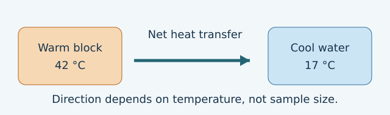

# U1-C01 - Heat, temperature, thermal energy

Unit 1 | All competition levels | public-student

## Learning objectives
Distinguish temperature, internal energy and heat; predict the direction of spontaneous heat transfer; explain why sample size matters.

## Prerequisites
Compare numbers; recognize grams and degrees Celsius. No formula knowledge is needed.

## Learn the idea
Imagine a teaspoon of warm water and a bathtub of water at the same temperature. A thermometer can show the same reading in both. Yet the bathtub can transfer much more energy as it cools. Temperature tells us something about the thermal state, not how much material is present. For samples of the same material in the same phase, at the same temperature and under comparable conditions, a larger sample has a larger total internal energy.

Matter consists of particles. Even a solid's particles move: they vibrate around relatively fixed positions. In a simple ideal-gas model, temperature is linked to average random translational kinetic energy. For liquids and solids, particles also interact strongly, so 'temperature is average particle speed' is too crude. Different particle masses can also mean different typical speeds at the same temperature.

Internal energy is the microscopic energy associated with the system's particles and their interactions. It excludes the motion of the entire object across a room and its gravitational energy as a whole. Thermal energy is a useful classroom term for the temperature-related part of microscopic energy; sources use the phrase somewhat differently. In this course, use internal energy U when making an energy balance. During a phase change, internal energy can change without a temperature change because particle interactions change.

Heat is a transfer, not a stored material. Put a warm metal spoon into cooler water: energy transfers from spoon to water because their temperatures differ. We call that energy transfer heat. We say 'the water gained internal energy by heating,' rather than 'the water contains heat.' If their temperatures match, there is no net heat transfer between them, although particles still move and microscopic exchanges continue.

A useful boundary sketch is: warmer spoon | boundary | cooler water. Label an energy arrow from the spoon toward the water. If the water is your system, the energy crosses into your system. Turning the drawing around does not change the physical transfer; it only changes which object you chose to study.

In the introductory energy examples below, assume no work and no other transfers. Then energy gained by the cool object equals energy lost by the warm object. In later units we will include work and environmental losses. These assumptions are part of the explanation, not invisible conveniences.

## Visual model

## Definitions and units
Temperature T: thermal-state reading, in °C or K. Internal energy U: microscopic system energy, in J. Heat Q: energy transferred because of a temperature difference, in J. Net transfer: transfer in one direction minus transfer in the opposite direction.

## Equations and their meaning
For an isolated two-object exchange with no work: energy lost by one = energy gained by the other. Energy units measure transfers; temperature units measure a different kind of quantity.

## Worked example 1: Energy received by water

**Given:** The spoon transfers 180 J to the water; there is no other transfer or work.

**Find:** Increase in the water’s internal energy.

**Equation:** Energy gain = energy received.

**Substitution:** Energy gain = 180 J.

**Arithmetic:** No conversion is needed.

**Answer with units:** The water’s internal energy increases by 180 J.

**Physical interpretation:** This is not an increase of 180 °C; temperature change also depends on mass and material.

## Worked example 2: An energy ledger

**Given:** A sample receives 320 J and later transfers 90 J out; no work occurs.

**Find:** Net internal-energy change.

**Equation:** Net change = energy in − energy out.

**Substitution:** Net change = 320 J − 90 J.

**Arithmetic:** 320 − 90 = 230.

**Answer with units:** The increase is 230 J.

**Physical interpretation:** Energy can enter and leave during one interval. Count the net change.

## Common confusions
A hotter small sample need not have more total internal energy than a cooler large one. A large internal energy does not determine heat-flow direction; temperature difference does. Equal temperatures do not mean particles stop. Equal temperatures also do not guarantee equal internal energies.

## Real-life connection
A hot drop may cool quickly while a warm bath stays warm longer. That difference involves quantity of material and transfer conditions. It does not mean the bath must have the higher temperature.

## Recap
Temperature describes thermal state; internal energy belongs to a system; heat crosses a boundary because temperatures differ. State the system and the assumptions before counting energy.

## Review questions
1. A 60 °C spoon touches 20 °C water. Which way is the initial net energy transfer?
2. Why can a bucket and a cup at the same temperature have different internal energies?
3. Rewrite “this cup contains 200 J of heat” in a scientifically meaningful way.

## Practice
[Open WS01](../worksheets/WS01.md). Worksheet questions are separate from the review questions above.

## Mastery checklist
- [ ] I can label heat as a transfer in a boundary sketch.
- [ ] I can explain why temperature is not a total-energy meter.
- [ ] I can compute an energy ledger without mixing J and °C.
