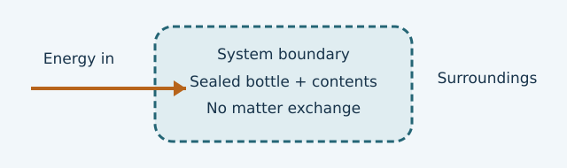

# U1-C02 - Thermodynamic systems and surroundings

Unit 1 | All competition levels | public-student

## Learning objectives
Choose a useful system boundary; classify open, closed and ideal isolated systems; distinguish matter exchange from energy exchange.

## Prerequisites
Chapter U1-C01; understand “inside,” “outside,” and transfer.

## Learn the idea
A system is the matter or region we choose to study. Everything outside it is the surroundings. The boundary separates the two. It can be an actual wall or an imaginary surface. There is no single mandatory system for a physical situation: you might study the water in a cup, the cup plus water, or the whole room. A good choice makes the question easier to answer.

A boundary is not necessarily an energy barrier. A sealed bottle can exchange energy through its walls while keeping the same matter inside. Similarly, an open cup can exchange energy and lose water molecules by evaporation. Ask two separate questions: Can matter cross? Can energy cross?

An open system can exchange both matter and energy with its surroundings. A closed system can exchange energy but not matter. An isolated system exchanges neither. “Closed” does not mean cold, insulated or motionless. A closed gas cylinder with a movable piston can exchange energy by work as its boundary moves while retaining all its gas.

Real insulation slows transfer; it does not automatically make a system perfectly isolated. A sealed, well-insulated container can be modeled as approximately isolated for a short interval if the neglected energy exchange is small enough for the task. Always identify this as a model. Do not claim that an ordinary insulated container guarantees zero transfer for all time.

Draw a rectangle labeled “water only.” Put “air” and “cup” outside it. A vapor arrow crossing out of the rectangle means matter leaves, making this an open system. Now draw a different rectangle around a sealed bottle and its contents. With no leaks, no matter crosses that larger boundary, but an energy arrow can still cross from warmer air. That is a closed system. The classification follows the stated boundary and conditions, not the everyday word “container.”

System bookkeeping also works for mass. If water enters and water leaves, the final mass equals the starting mass plus inflow minus outflow. Use a single unit before subtracting. For energy, a transfer across the boundary changes the system's energy unless another transfer offsets it. Later, we separate heat and work; for now, name the physical route in words.

## Visual model

## Definitions and units
System: selected matter or region. Surroundings: everything outside. Boundary: separating surface. Open: matter and energy exchange allowed. Closed: energy exchange allowed, matter exchange excluded. Isolated: neither exchange occurs in the model.

## Equations and their meaning
Mass bookkeeping: m_final = m_start + m_in − m_out. In a no-work energy example: net energy gain = energy in − energy out. All mass terms must share units; all energy terms must share units.

## Worked example 1: Mass through an open boundary

**Given:** An open vessel initially holds 150 g water; 25 g is poured in and 8 g evaporates.

**Find:** Final water mass.

**Equation:** m_final = m_start + m_in − m_out.

**Substitution:** m_final = 150 g + 25 g − 8 g.

**Arithmetic:** 150 + 25 − 8 = 167.

**Answer with units:** 167 g.

**Physical interpretation:** Matter crossed the boundary in both directions, so the water system is open.

## Worked example 2: A sealed bottle can warm

**Given:** A sealed bottle and its contents receive 85 J through the walls; 20 J later leaves, with no work.

**Find:** Net energy gained.

**Equation:** Net gain = energy in − energy out.

**Substitution:** Net gain = 85 J − 20 J.

**Arithmetic:** 85 − 20 = 65.

**Answer with units:** 65 J.

**Physical interpretation:** No matter crossed, yet energy changed: closed does not mean isolated.

## Common confusions
A lid alone does not prove that a system is closed: specify whether it is sealed against matter flow. Insulation alone does not prevent matter exchange. A boundary may move. Energy transfer is not the same as matter transfer, although moving matter can carry energy.

## Real-life connection
For a device calculation, defining the system as water only makes its temperature gain central; defining it as water plus cup also includes energy stored in the cup. Those are different models of the same trial.

## Recap
Name the boundary first. Classify matter exchange and energy exchange separately. Use an isolated model only when its assumptions are justified.

## Review questions
1. Is a sealed bottle in sunlight isolated? Explain.
2. How would your boundary differ for water only versus cup plus water?
3. Can a closed system exchange work?

## Practice
[Open WS02](../worksheets/WS02.md). Worksheet questions are separate from the review questions above.

## Mastery checklist
- [ ] I can draw and label a system boundary.
- [ ] I can classify exchange using two separate questions.
- [ ] I can explain the limitations of an isolated-system approximation.
