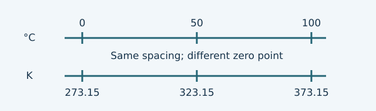

# U1-C05 - Celsius, Fahrenheit, Kelvin

Unit 1 | All competition levels | public-student

## Learning objectives
Convert °C, °F and K; distinguish absolute readings from changes; select the appropriate scale for a calculation.

## Prerequisites
Signed arithmetic, multiplication/division by 1.8, and one-variable equations.

## Learn the idea
Temperature scales attach numbers to a thermal state. They use different zero points and, in the case of Fahrenheit, a different step size. Changing the label does not change the physical sample. A glass of water does not heat up when you rewrite 20 °C as 293.15 K.

Celsius and Kelvin have equally sized steps, but their zeros are offset. The relation is T_K=T_C+273.15. Kelvin uses K, without a degree symbol. Absolute zero corresponds to 0 K or −273.15 °C. In the ordinary thermal systems in this course, Kelvin temperatures are nonnegative. Absolute zero is a limiting state; do not describe it simply as all forms of microscopic motion disappearing.

Fahrenheit has smaller steps. A change of 1 °C corresponds to a change of 1.8 °F. The readings also have an offset: T_F=1.8T_C+32. To undo that transformation, subtract 32 first and divide by 1.8. Order matters. Dividing first and then subtracting 32 gives a different and incorrect result.

A temperature reading and a temperature change are different quantities. If water goes from 20 °C to 25 °C, its change is +5 °C. In Kelvin it goes from 293.15 K to 298.15 K, a change of +5 K. The offset cancels in the subtraction. Never add 273.15 to a temperature change. For a Fahrenheit change, the 32 also cancels: ΔT_F=1.8ΔT_C.

Use a number-line sketch with paired points: −273.15 °C ↔ 0 K; 0 °C ↔ 273.15 K; 100 °C ↔ 373.15 K. The last two correspond approximately to water freezing and boiling at standard atmospheric pressure for pure water; pressure affects phase-change temperatures. The 100-degree spacing in Celsius remains a 100-K spacing.

Some equations depend on absolute temperature ratios, such as the ideal gas law introduced later. They require Kelvin. Official Thermodynamics device scoring instead requires Celsius. A unit choice follows the specified equation or rule, not a preference for whichever number looks easier.

For practice, retain digits through intermediate steps and round the final converted reading to a sensible precision. Treat 273.15, 32 and 9/5 as exact scale-conversion constants. A thermometer's measurement precision is not improved just because a conversion calculator prints many decimals.

## Visual model

## Definitions and units
T_C: Celsius reading in °C. T_F: Fahrenheit reading in °F. T_K: Kelvin reading in K. ΔT: final minus initial temperature, with the scale stated. Absolute temperature: temperature referenced to absolute zero.

## Equations and their meaning
T_K=T_C+273.15; T_C=T_K−273.15; T_F=(9/5)T_C+32; T_C=(T_F−32)×5/9. For changes only: ΔT_K=ΔT_C numerically; ΔT_F=(9/5)ΔT_C.

## Worked example 1: Room-temperature water in Kelvin

**Given:** T_C=23.0 °C.

**Find:** T_K.

**Equation:** T_K=T_C+273.15.

**Substitution:** T_K=23.0+273.15 K.

**Arithmetic:** 23.0+273.15=296.15; round to one decimal.

**Answer with units:** 296.2 K.

**Physical interpretation:** This is the same physical temperature, not a warming of the water.

## Worked example 2: Convert Fahrenheit to Celsius

**Given:** T_F=86.0 °F.

**Find:** T_C.

**Equation:** T_C=(T_F−32)×5/9.

**Substitution:** T_C=(86.0−32)×5/9 °C.

**Arithmetic:** 54.0×5/9=30.0.

**Answer with units:** 30.0 °C.

**Physical interpretation:** The reading is warm room-temperature water, consistent with 86 °F.

## Worked example 3: A change, not a reading

**Given:** Water warms from 19.0 °C to 27.0 °C.

**Find:** Temperature change in K and °F.

**Equation:** ΔT_C=T_final−T_initial; ΔT_K=ΔT_C; ΔT_F=1.8ΔT_C.

**Substitution:** ΔT_C=27.0−19.0; ΔT_F=1.8×8.0.

**Arithmetic:** ΔT_C=8.0; 1.8×8.0=14.4.

**Answer with units:** +8.0 K and +14.4 °F changes.

**Physical interpretation:** No offset appears because the zero-point offsets cancel.

## Common confusions
Kelvin readings have no ° symbol. Multiplying 20 °C by two does not mean twice the absolute temperature. Celsius is valid for a temperature difference in many energy equations, but not for an absolute-temperature gas-law ratio.

## Real-life connection
Device predictions are submitted in Celsius, while a gas-law calculation uses Kelvin. Clearly write “reading” or “change” beside a number before converting it.

## Recap
Reading conversions use offsets; change conversions do not. Kelvin and Celsius steps have equal size. Use the scale required by the equation or competition rule.

## Review questions
1. Convert 0.0 °C into K.
2. Explain why a 7 °C rise is a 7 K rise.
3. Which operation comes first when converting 77 °F to °C?

## Practice
[Open WS05](../worksheets/WS05.md). Worksheet questions are separate from the review questions above.

## Mastery checklist
- [ ] I can convert in both directions between the three scales.
- [ ] I can convert a temperature change without adding an offset.
- [ ] I can name why Kelvin is needed for absolute-temperature relationships.
