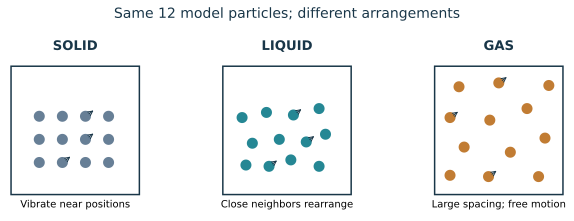

# U2-C01 - States of matter and particle behavior

Unit 2 | All competition levels | public-student | Rule alignment: 5.c.ii, printed B57

## Learning objectives
Describe solids, liquids and gases with a particle model; connect structure to shape, volume and compressibility; distinguish a model drawing from actual particle size.

## Prerequisites
Unit 1 heat, temperature, systems and density; division and volume units.

## Start with an observation
An ice cube keeps its shape on a plate. Liquid water spreads across the plate. Water vapor spreads through the available air. These are three physical states of the same substance. The molecules are still H₂O: a state change is not a chemical decomposition into hydrogen and oxygen. What changes is how the molecules are arranged, how freely they can move, and how important their interactions are relative to their motion.

A particle model replaces an enormous number of atoms or molecules with a few circles and motion arrows. It helps us explain patterns we cannot see directly. The circles are symbols; they are not photographs or accurate scale drawings. A dot does not become a larger molecule when the material is heated. The spaces and the movements may change instead. When comparing drawings of the same sealed sample, preserve particle number unless matter is explicitly added or removed.

## Solids: motion without flowing freely
In a solid, particles remain near relatively fixed positions while vibrating. Many familiar solids are crystalline: their average positions form a repeating pattern. Not all solids have a perfect repeating lattice; glass is a useful example of a noncrystalline solid. A solid generally resists a change of shape and volume because moving its particles far from their usual arrangement requires energy. Saying the particles are fixed in place is acceptable only if you also remember their vibrations.

Heating a solid usually increases the energy of its microscopic motion and changes its average spacing somewhat. At the melting transition, added energy can instead help change the arrangement into a liquid. This is why a particle model must include interactions as well as motion. Do not predict the temperature from particle separation alone.

## Liquids: close neighbors that rearrange
Liquid particles remain close to neighboring particles, but their arrangements change continuously. A liquid flows and takes the shape of the part of its container that it occupies. It has an approximately fixed volume under modest pressure changes. Flowing therefore does not imply widely separated particles: a liquid flows even though its particles are crowded together.

Both liquids and solids are usually difficult to compress substantially because much of the space is already occupied by closely packed particles. Their volumes are not mathematically constant under every condition; they can expand, compress, or change structure. “Nearly incompressible” is a useful model for many introductory questions, not an absolute law.

## Gases: widely separated particles and collisions
Gas particles are far apart on average compared with their sizes. Between collisions they move freely through the available space. Their collisions with container walls produce pressure. A gas has neither a fixed shape nor a fixed volume independent of its container. If the container allows more space, the gas spreads into it; if a piston reduces the available volume, the gas can become much denser without making each molecule smaller.

At the same temperature, particles of different gases need not have the same typical speed because their masses differ. For the same dilute gas, a higher absolute temperature corresponds to a higher average translational kinetic energy. That connection supports the ideal-gas model in Chapter U2-C07. It does not make temperature a direct measure of total internal energy.

## Connect the model to measurements
Use mass and volume to calculate density. When a sealed sample changes state, its total mass stays the same even if its volume changes. Gases commonly occupy much more volume than the same mass of liquid at ordinary conditions, giving them much smaller densities. For many substances a solid is denser than its liquid, but ordinary ice is an important exception: its structure occupies more volume per mass than liquid water. Never use “solid is always densest” as a rule.

Particle drawings can support a claim but cannot replace measured conditions. If two pictures show different dot counts and different box sizes, you need both pieces of information to compare number per volume. If a gas-filled box doubles in volume with the same number of molecules, the average number per volume halves. The molecules have not vanished; they are more spread out.

Plasma is another state of matter involving substantial ionization. This unit focuses on the solid, liquid and gas phase relationships used in the supplied syllabus. No plasma calculations are needed for this chapter.

## Visual model

Each panel has 12 model particles. Close packing in the liquid is intentional. Particle sizes are schematic, not to scale.

## Definitions and units
Solid: material that resists shape change and usually maintains volume. Liquid: material that flows while maintaining approximately fixed volume at modest pressure changes. Gas: material that expands to fill available volume. Compressibility: how readily volume decreases under pressure. Density ρ: mass per volume, such as g/mL. Particle number N: a count, not a mass.

## Equations and their meaning
ρ=m/V, with m in g and V in mL for g/mL. Number per volume=N/V. These ratios describe the whole sample; they do not imply that molecules change size. 1 L=1000 mL.

## Worked example: Density after melting

**Given:** A hypothetical sealed sample has mass 45.0 g, solid volume 50.0 mL and liquid volume 45.0 mL. No matter escapes.

**Find:** Density in each state.

**Equation:** ρ=m/V.

**Substitution:** ρ_s=45.0 g/50.0 mL; ρ_l=45.0 g/45.0 mL.

**Arithmetic:** 45.0/50.0=0.900; 45.0/45.0=1.00.

**Answer with units:** Solid: 0.900 g/mL; liquid: 1.00 g/mL.

**Physical interpretation:** This illustrative sample is denser as a liquid. Its mass is unchanged; volume changed. The numbers are not a material identification.

## Worked example: Count density in a gas model

**Given:** A diagram uses 24 dots for a sealed gas in 3.0 L. It expands to 6.0 L with no particles escaping.

**Find:** Dots per liter before and after.

**Equation:** Model number density=N/V.

**Substitution:** Before: 24/3.0; after: 24/6.0.

**Arithmetic:** 24/3.0=8.0; 24/6.0=4.0.

**Answer with units:** 8.0 model dots/L initially; 4.0 model dots/L finally.

**Physical interpretation:** The representation becomes half as crowded. A dot represents many real molecules, so these are diagram counts, not an actual molecular concentration.

## Common confusions
Solid particles move; liquid particles are not necessarily far apart; gas molecules do not grow to fill a larger container. A sealed phase change conserves mass. Density rankings need conditions and material identity.

## Real-life connection
A sealed flexible package can change volume when its contents change temperature or state. The package shape alone does not tell you whether matter was created. In the competition cup, the water is mainly a liquid whose changing temperature is measured; gases around it behave differently.

## Recap
Shape, volume and compressibility arise from particle arrangement, movement and interactions. Keep particle identity and mass distinct from spacing and sample volume.

## Review questions
1. Why can a liquid flow while remaining hard to compress?
2. What produces pressure on the walls of a gas container?
3. Why is “solid particles do not move” incorrect?

## Practice
[Open WS07](../worksheets/WS07.md). Complete the chapter examples first, then attempt the worksheet independently.

## Mastery checklist
- [ ] I can draw three states without changing particle identity.
- [ ] I can explain gas compression using spacing.
- [ ] I can calculate and compare densities without assuming solids are always densest.
