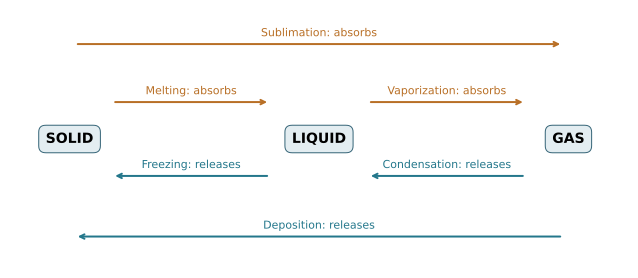

# U2-C02 - Phase transitions

Unit 2 | All competition levels | public-student | Rule alignment: 5.c.ii, printed B57

## Learning objectives
Name and distinguish six phase transitions; identify energy absorbed or released; explain evaporation, boiling and condensation using particles.

## Prerequisites
U2-C01; Unit 1 heat-flow direction, systems and mass bookkeeping.

## A phase change keeps the substance recognizable
Melting ice produces liquid water, not a new chemical substance. Freezing reverses that change. A physical phase transition rearranges matter between phases without changing the chemical identity of the substance. The surrounding conditions matter: a statement such as “water boils at 100 °C” needs the approximate pressure of 1 atmosphere and a pure-water context.

The six named transitions connect solid, liquid and gas. Melting is solid to liquid; freezing is liquid to solid. Vaporization is liquid to gas; condensation is gas to liquid. Sublimation is solid directly to gas, and deposition is gas directly to solid. Vaporization includes both evaporation and boiling. The arrow direction determines the name. A student should be able to name both directions on every connection, rather than memorize a list without a particle explanation.

## Why some transitions absorb energy
To melt a solid, energy must be supplied to change the ordered or constrained particle arrangement into a liquid arrangement. To vaporize a liquid, energy must separate particles much farther against their attractions. Sublimation also requires an energy input under the usual conditions considered here. We call melting, vaporization and sublimation endothermic phase changes for the substance: they absorb heat from surroundings when driven thermally.

Freezing, condensation and deposition release energy to the surroundings under the reverse conditions. They are exothermic for the substance. During condensation, particles become more closely associated and energy leaves. During freezing, a more constrained solid arrangement forms and energy is released. Freezing does not mean that cold is a substance entering the sample.

Remember whose energy transfer you describe. If water vapor condenses on a cooler surface, the condensing water releases energy and the surface can gain energy. Those opposite statements are consistent because their system boundaries differ. Signs in later equations will follow this boundary choice: heat entering the selected sample is positive.

## Evaporation is not the same as boiling
Evaporation happens at a liquid's surface and can occur below the boiling temperature. Some surface molecules have enough energy to leave the liquid. If higher-energy molecules escape preferentially and their energy is not immediately replaced, the remaining liquid can cool. Air movement and humidity influence the net evaporation rate, so a single temperature is not enough to predict drying time.

Boiling involves vapor bubbles forming and growing within the liquid. It occurs when the liquid's vapor pressure reaches the surrounding pressure, with a small depth-related pressure effect in real containers. Bubbles in boiling pure water contain water vapor, not separated hydrogen and oxygen gases. At lower external pressure, water can boil at a lower temperature. This matters for cooking at elevation; it is not a change in the identity of water.

Visible white mist near a kettle is mostly tiny liquid droplets formed after vapor cools and condenses. Water vapor itself is invisible. Fogging a mirror is condensation, not liquid water leaking out of the glass. Frost can form by deposition of water vapor directly onto a sufficiently cold surface; not every frost crystal began as a visible liquid drop.

## Coexistence and reversibility
A sample can contain more than one phase at once. Ice and liquid water can coexist at the melting temperature under suitable pressure. At that temperature, adding energy can increase the liquid fraction rather than increase temperature. Removing energy can increase the solid fraction. The next chapters make these energy amounts quantitative.

At equilibrium, forward and reverse molecular transfers can occur at equal average rates. In a closed container, vaporization and condensation may balance without the molecules stopping. Outside equilibrium, one direction dominates. Avoid assuming that seeing a few droplets proves the entire sample has reached a uniform equilibrium state.

## Track matter as well as energy
An open dish may lose liquid mass by evaporation, but the water has not been destroyed: it has entered the surrounding air. For a sealed system including all phases, the total mass stays constant. Fractions of the sample in different phases add to the total. Mass percentages and balances are useful before learning latent heat: they tell you how much material has completed the transition and how much remains.

All examples here are paper models. Handling boiling water, hot vapor, pressure vessels or dry ice is not required for this curriculum. Recorded classroom observations and diagrams provide the necessary evidence without a home high-temperature experiment.

## Visual model

Upper energy-absorption arrows and their lower energy-release reverses are distinguished by labels; color is supplementary.

## Definitions and units
Phase: a physically distinct, relatively uniform form of matter. Endothermic: absorbs energy as heat into the selected sample. Exothermic: releases energy as heat. Vaporization: liquid to gas. Sublimation: solid to gas without an intervening liquid phase. Deposition: gas to solid. Vapor pressure: equilibrium pressure of a substance’s vapor above its condensed phase at a given temperature.

## Equations and their meaning
m_total=m_solid+m_liquid+m_vapor when those are the included phases. Fraction changed=m_changed/m_total; percent changed=100×fraction. Do not confuse a mass fraction with a temperature reading.

## Worked example: Partial melting

**Given:** A sealed 80.0 g water sample initially consists entirely of ice. After partial melting, 30.0 g is liquid.

**Find:** Ice remaining and percentage melted.

**Equation:** m_ice=m_total−m_liquid; percent melted=100m_liquid/m_total.

**Substitution:** m_ice=80.0−30.0 g; percent=100×30.0/80.0.

**Arithmetic:** 80.0−30.0=50.0; 100×0.375=37.5.

**Answer with units:** 50.0 g ice remains; 37.5% of the mass has melted.

**Physical interpretation:** Both phases are still present. No mass disappeared as the arrangement changed.

## Worked example: Net phase exchange

**Given:** Over an interval in a closed model, 6.0 g evaporates from liquid and 2.0 g of vapor condenses back.

**Find:** Net change in liquid mass.

**Equation:** Δm_liquid=m_condensed−m_evaporated.

**Substitution:** Δm_liquid=2.0 g−6.0 g.

**Arithmetic:** 2.0−6.0=−4.0.

**Answer with units:** Liquid mass decreases by 4.0 g; vapor mass increases by 4.0 g.

**Physical interpretation:** Both directions can occur simultaneously, while the net change favors vaporization. The total closed-system mass remains constant.

## Common confusions
Evaporation does not require boiling. Condensation and freezing release rather than absorb latent energy. Ice melting does not split water molecules. Water vapor is not the visible cloud of liquid droplets.

## Real-life connection
Sweat can cool skin as water evaporates. Condensation on a cold cup transfers energy from the condensing vapor to the cup and surroundings. These phase-change routes are separate from merely warming or cooling a fixed liquid mass.

## Recap
Learn the six arrow directions, then follow energy and matter across a named system boundary. Coexisting phases and simultaneous opposite transfers do not violate conservation.

## Review questions
1. Name the reverse of sublimation and state its usual heat-transfer direction.
2. Why can a wet cloth dry without boiling?
3. What happens to total mass when water evaporates inside a sealed container?

## Practice
[Open WS08](../worksheets/WS08.md). Complete the chapter examples first, then attempt the worksheet independently.

## Mastery checklist
- [ ] I can name all six transitions from arrows.
- [ ] I can distinguish evaporation from boiling.
- [ ] I can track energy direction and phase masses separately.
