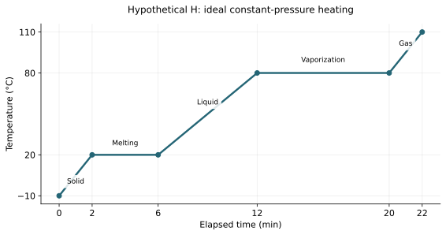

# U2-C03 - Heating and cooling curves

Unit 2 | All competition levels | public-student | Rule alignment: 5.c.ii, printed B57

## Learning objectives
Read axes, slopes and plateaus; distinguish temperature change from phase change; calculate interval energy from stated net power without calculus.

## Prerequisites
U2-C01–02; subtraction, ratios, minutes to seconds and E=Pt.

## What does the graph measure?
A heating curve shows how temperature changes as a sample receives energy. The horizontal axis might be elapsed time or energy supplied. Read it before doing any calculation. A point on a time-temperature graph gives a temperature at a time; it does not directly give joules. If a constant net power into the sample is specified, time can be converted to transferred energy using Q=P_netΔt.

The word net means the transfer that actually reaches and remains available to heat or transform the sample after relevant losses are accounted for. A heater's electrical rating is not automatically this net power. A graph drawn against energy supplied also needs a clear definition of whose supplied energy is on the axis.

The original figure in this chapter is an idealized pure substance H heated at constant pressure, with equilibrium melting at 20 °C and boiling at 80 °C. It is not water and not measured Maple device data. Its temperatures are chosen to make the ideas visible. The sample is assumed uniform, pressure fixed, net input power constant, and superheating or supercooling negligible.

## Read the five segments in order
From 0 to 2 minutes, the solid warms from −10 °C to 20 °C. Its temperature rises, so the segment slopes upward. From 2 to 6 minutes, the temperature remains at 20 °C while melting occurs. In the interior of this interval, solid and liquid coexist and the liquid fraction grows. At the endpoints, the phase just begins or just finishes changing.

From 6 to 12 minutes, the entirely liquid sample warms from 20 °C to 80 °C. From 12 to 20 minutes, the temperature holds at 80 °C as vaporization occurs. Liquid and vapor coexist during this plateau. From 20 to 22 minutes, the gas warms from 80 °C to 110 °C. A higher final temperature alone does not tell you how much of the total input was needed for the two transitions.

A plateau is not evidence of zero energy transfer. During an ideal equilibrium transition, energy changes the particle arrangement and phase fraction rather than the temperature. If you wrote Q=0 only because ΔT=0, you used the wrong physical model for that segment. Chapter U2-C05 supplies Q=mL for phase-change amounts.

## Compare slopes fairly
The average temperature-change rate over an interval is (T_2−T_1)/(t_2−t_1). This is ordinary rise divided by run, not calculus. Use the units of both axes. On the liquid segment, a 60 °C rise takes 6 minutes, so the rate is 10 °C/min. A cooling segment has a negative rate if time increases to the right.

A steeper temperature-time slope can mean smaller heat capacity, but only when the net heating power and other relevant conditions are comparable. A larger heater can make the same sample warm faster. A gas or solid segment with a different slope may reflect different heat capacities, but do not infer material properties from slope alone if power or losses change.

A longer plateau under the same net power means more energy for that transition. Comparing plateau lengths for different masses requires care: a large sample can take longer to melt even when its latent heat per kilogram is unchanged. Time is not itself a material property.

## Cooling reverses the energy transfer
A cooling curve can include a downward gas segment, a condensation plateau, a downward liquid segment, a freezing plateau and a downward solid segment. During a plateau, the sample releases energy even though its temperature is constant. At a given fixed pressure, the equilibrium freezing/melting temperature is the same, as is the condensation/boiling temperature.

Real recorded cooling data need not show perfect horizontal lines. A liquid may supercool temporarily before crystals form; mixtures can change phase over a temperature range; a probe may lag or sample an uneven temperature. These possibilities explain why the textbook graph is an idealization. They are not reasons to ignore axis labels or assume every flat-looking interval proves a phase change.

## Use a graph as evidence, not decoration
Describe a segment using three linked statements: what the graph does, what phase or phases are present under the stated model, and what happens to energy. For example: “At 20 °C from minute 2 to minute 6 the graph is flat; solid and liquid coexist; the input energy melts more solid.” This is stronger than naming only “melting.”

When drawing, label both axes and their units, plot the supplied points accurately, and connect the points only as instructed. If a line segment is declared straight, linear interpolation is allowed. Otherwise the position between measurements is an estimate, not an exact fact. Always identify simulated data as simulated.

## Visual model

Data: (0 min, −10 °C), (2, 20), (6, 20), (12, 80), (20, 80), (22, 110). Straight segments are part of the idealized model.

## Definitions and units
Heating/cooling curve: temperature versus time or transferred energy. Plateau: an approximately horizontal segment. Average slope: change in vertical quantity divided by change in horizontal quantity. Net power P_net: effective heat-transfer rate into the sample, in W. Phase fraction: mass in a selected phase divided by total sample mass.

## Equations and their meaning
Average rate=(T_2−T_1)/(t_2−t_1), in °C/min if those are the axes. For constant net power, Q=P_netΔt with Δt in seconds for J. A temperature plateau requires a phase-change model rather than Q=mcΔT alone.

## Worked example: Liquid-segment slope

**Given:** The hypothetical H curve has T=20 °C at 6 min and T=80 °C at 12 min.

**Find:** Average temperature-change rate.

**Equation:** Rate=ΔT/Δt.

**Substitution:** Rate=(80−20) °C/(12−6) min.

**Arithmetic:** 60/6=10.

**Answer with units:** 10 °C/min.

**Physical interpretation:** This is a warming rate, not a heat input in watts. It applies to the stated liquid segment.

## Worked example: Energy during a melting plateau

**Given:** The H melting plateau runs from 2 to 6 min; constant net power into the sample is 100 W.

**Find:** Heat received during melting.

**Equation:** Q=P_netΔt.

**Substitution:** Δt=(6−2)×60=240 s; Q=100 J/s×240 s.

**Arithmetic:** 100×240=24000.

**Answer with units:** 24,000 J, or 24 kJ.

**Physical interpretation:** The sample gains energy even though its temperature stays 20 °C throughout the modeled transition.

## Common confusions
A flat temperature line does not mean the heater stopped. Slope units are not energy units. A plateau cannot automatically be assigned to boiling without knowing the material, pressure and surrounding segments. A graph against time is not a pressure-temperature phase diagram.

## Real-life connection
In a competition water-heating trial near room temperature, a gradually decreasing slope may result from increasing losses rather than a phase change. Do not label a device heating curve “boiling” merely because it flattens somewhat.

## Recap
Read axes first. Separate sloping single-phase segments from ideal phase-change plateaus, and use net power only when its meaning and value are stated.

## Review questions
1. What phases coexist inside a melting plateau?
2. Why can a cooling plateau have nonzero heat transfer?
3. What assumption is needed before a longer time interval proves a larger heat input?

## Practice
[Open WS09](../worksheets/WS09.md). Complete the chapter examples first, then attempt the worksheet independently.

## Mastery checklist
- [ ] I can label all five ideal heating segments.
- [ ] I can calculate a slope with correct units.
- [ ] I can use Q=P_netΔt and explain a nonzero plateau energy.
