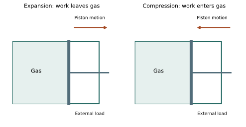

# U4-C01 - Internal Energy, Heat, and Work

Unit 4 | All competition levels | public-student | Rule alignment: 5.c.iv, printed B57

## Learning objectives
Distinguish stored internal energy from heat and work transfers; explain expansion/compression; calculate constant-pressure boundary work and interpret energy arrows.

## Prerequisites
Units 1–3: particles, systems, heat, ideal gas and joules. Pressure is force per area. A pascal is one newton per square meter; a newton is a force unit.

## Energy inside and energy crossing a boundary
A sealed sample of gas has internal energy even when it is not being heated. Its molecules move, rotate and, when those modes are active, vibrate. Interactions among particles also contribute potential energy in real materials. Internal energy U represents microscopic energy associated with the system's state. It excludes the kinetic energy of the whole container moving across the room and the gravitational potential energy of the whole container at a height.

Temperature is related to microscopic energy but is not the same quantity as U. Two equal-temperature samples can have different internal energies because they contain different amounts or types of matter. A phase change can alter internal energy without changing temperature. For a fixed amount of ideal gas, a particularly useful simplification is that U depends only on temperature. That statement does not apply unchanged to every real substance or phase transition.

Heat Q is energy transferred because of a temperature difference. Work W is energy transferred by organized forces acting through motion or by other nonthermal means. Pushing a piston and turning a paddle are work interactions. Once transferred, energy is part of the system's energy accounting; it does not retain a label saying that it is stored heat or stored work. A bank balance is a useful analogy for U, while deposits and withdrawals resemble transfers. The analogy does not explain the microscopic physics, but it clarifies the difference between a state and an event.

## The system matters
Choose the gas inside a piston-cylinder as the system. Its boundary includes the cylinder walls and the moving piston face. Energy entering through a warmer wall is heat. Energy transferred when the gas pushes the piston outward is work done by the gas. If the piston is pushed inward by the surroundings, work is done on the gas. The same piston interaction is an output for one side and an input for the other, so always identify whose work you are discussing.

Our convention throughout Unit 4 is Q positive into the system and W positive when the system does work on its surroundings. Thus an outward expansion against resistance has positive boundary work, and an inward compression has negative boundary work. Negative work by the system means positive work on it; it does not mean that no force acts.

## From a force to pressure-volume work
Imagine a flat piston of area A moving a distance d. With a constant opposing pressure P_ext, the resisting force is P_ext A. Work is force times distance along the motion, so W=P_ext A d. The volume change is A d. Therefore the signed boundary work is W=P_ext(V_f−V_i). You do not need a force calculation once pressure and volume change are known.

Expansion makes V_f−V_i positive. Compression makes it negative. The pressure in this expression is the external pressure resisting the boundary motion. For a sufficiently slow, mechanically balanced idealization, the gas pressure closely matches the external pressure. In that situation the pressure plotted on a gas P–V diagram may be used. For a rapid, strongly unbalanced process, a gas-pressure curve is not automatically an exact work calculation.

The expression applies directly when the external pressure is constant. Do not multiply an arbitrary starting pressure by a changing volume if the pressure varies substantially along the path. Later chapters use simple geometric areas for specified mechanically balanced paths. Work for curved isothermal and adiabatic paths will be supplied when needed, so no calculus or logarithms is required.

## Units connect pressure to energy
Using pascals and cubic meters gives Pa·m³=(N/m²)·m³=N·m=J. A useful alternative is kPa and liters: 1 kPa=1000 Pa and 1 L=.001 m³, so 1 kPa·L=1 J. This cancellation is exact. A milliliter is .001 L, not .001 m³. Write the conversion before substitution when volume is in mL.

Pressure on a gas-state diagram is absolute pressure unless stated otherwise. Atmospheric pressure can oppose a moving piston even if a gauge reads zero relative to the room. A gauge reading alone is therefore not necessarily the full opposing pressure needed for work. In this unit problems provide the relevant absolute or external pressure rather than asking students to invent it.

## Stored energy changes through more than one route
A gas can warm because heat enters through a wall, because compression work enters, or through both routes. It can receive heat while doing even more work and end with less internal energy. Chapter 2 turns this bookkeeping into the first-law equation. For now, follow the arrows: heat entering adds energy, work done by the gas carries energy away, and work done on the gas adds energy.

Expansion alone does not guarantee positive work. In ideal free expansion into an evacuated region there is no opposing pressure, so the boundary work is zero even though volume increases. Likewise, constant volume means zero pressure-volume boundary work but does not rule out electrical work or paddle work. Those distinctions prevent an otherwise useful piston model from becoming an incorrect universal rule.

## Visual model

A piston expansion pushes the boundary outward against an external load; compression reverses boundary motion. Arrows show work leaving or entering the gas. The drawings are schematic, not quantitative geometry.

## Definitions and units
U: internal energy, J, a state property. Q: signed heat transfer, J, positive into the selected system. W: signed work by the system, J. P_ext: constant opposing pressure, Pa or kPa. V: volume, m³ or L. ΔV=V_f−V_i. Closed system: no matter crosses its boundary; energy may cross.

## Equations and their meaning
Constant opposing-pressure work: W=P_extΔV. For a slow mechanically balanced path, use the common gas/external pressure. 1 Pa·m³=1 J; 1 kPa·L=1 J. Heat and work describe a process, while ΔU compares initial and final states.

## Worked example: Expansion against a load

**Given:** P_ext=120 kPa; V_i=2.0 L; V_f=5.0 L.

**Find:** Signed boundary work by the gas.

**Formula:** W=P_ext(V_f−V_i).

**Substitution:** W=120 kPa×(5.0−2.0) L.

**Calculation:** ΔV=3.0 L; 120×3.0=360.

**Final answer:** W=+360 J.

**Physical interpretation:** The gas transfers 360 J to the surroundings by pushing the piston outward.

## Worked example: Compression in SI units

**Given:** P_ext=150000 Pa; V_i=.0040 m³; V_f=.0020 m³.

**Find:** Work by and on the gas.

**Formula:** W_by=P_extΔV; W_on=−W_by.

**Substitution:** W_by=150000×(.0020−.0040) Pa·m³.

**Calculation:** ΔV=−.0020 m³; product=−300.

**Final answer:** W_by=−300 J; W_on=+300 J.

**Physical interpretation:** Compression supplies energy to the gas through work.

## Worked example: A milliliter conversion

**Given:** A gas expands from 200 mL to 500 mL against constant 100 kPa.

**Find:** Work by the gas.

**Formula:** W=P_extΔV; 1000 mL=1 L.

**Substitution:** ΔV=(500−200)/1000 L=.300 L; W=100×.300.

**Calculation:** 100×.300=30.0.

**Final answer:** W=+30.0 J.

**Physical interpretation:** A small volume change at atmospheric-scale pressure corresponds to tens of joules.

## Common misconceptions
A system contains internal energy, not stored heat or stored work. Expanding volume need not mean heating or positive work. Constant volume eliminates boundary displacement work only. A negative sign describes direction relative to a chosen system, not an impossible energy.

## Real-world application and safe exploration
A bicycle pump can warm through compression work as well as friction. Analyze its gas separately from its barrel. Use a paper piston diagram or a teacher-operated, unpressurized model to identify arrows. Do not heat sealed containers, block syringe outlets or improvise pressure vessels; the supplied calculations provide a complete data-based alternative.

## Chapter recap
Internal energy is a property of the system; heat and work are ways energy crosses its boundary. Constant-pressure boundary work is pressure times signed volume change. Identify the system, opposing pressure and units before calculating.

## Chapter review
1. Why is “the gas stores 50 J of heat” imprecise?
2. Why does compression give negative W in this unit?
3. How can an expanding gas do zero boundary work?

## Practice
[WS21](../worksheets/WS21.md) progresses from foundations to competition reasoning.

## Mastery checklist
- [ ] I can distinguish U, Q and W.
- [ ] I can calculate signed constant-pressure work.
- [ ] I can explain the assumptions behind a piston model.
