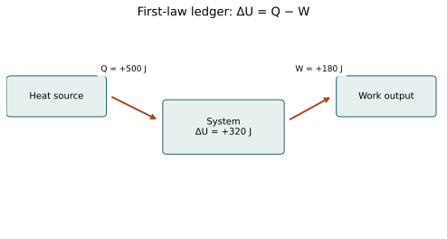

# U4-C02 - First Law of Thermodynamics

Unit 4 | All competition levels | public-student | Rule alignment: 5.c.iv, printed B57

## Learning objectives
Apply ΔU=Q−W consistently; solve for any one unknown; translate work-on language; compare processes with the same endpoints and identify model limits.

## Prerequisites
Chapter 1 definitions, signed numbers and joules. Δ means final minus initial. We first use closed systems with negligible changes in whole-system kinetic and gravitational potential energies.

## Conservation is a balance, not a new source
Energy cannot appear without an accounting source or disappear without an accounting destination. For a closed system whose overall motion and height do not change appreciably, the change in internal energy equals net heat entering minus net work done by the system: ΔU=Q−W. This is the first law in the convention used throughout this curriculum.

The minus sign does physical work in the equation. When the gas pushes an external load, energy leaves the gas as work, so positive W reduces the energy retained. When surroundings compress it, W is negative; subtracting a negative adds energy. Heat leaving has Q negative. Decide these signs from the words and arrows before typing numbers into a calculator.

The general conservation principle also includes changes in macroscopic kinetic and potential energies and energy carried by matter in open systems. Our simplified ΔU equation is appropriate only when those contributions are absent or negligible. A steam turbine with flowing matter is a real engine component, but its full accounting requires a broader model than this closed piston exercise.

## A reliable sign routine
First name the system. Second draw each heat and work arrow across its boundary. Third write Q and W with signs, treating multiple inputs and outputs as net signed totals. Fourth substitute into ΔU=Q−W. Finally state the meaning of the resulting sign. Positive ΔU means the system's internal energy increased; negative means it decreased.

A statement such as “80 J of work is done on the gas” usually gives a positive magnitude in words. Convert it to W=−80 J before using our equation. A source using W_on may instead write ΔU=Q+W_on. The two forms agree because W_on=−W. Do not combine the plus sign from one convention with the work-by definition from the other.

## Solve one unknown at a time
If Q and W are known, subtract to find ΔU. If ΔU and W are known, rearrange to Q=ΔU+W. If Q and ΔU are known, rearrange to W=Q−ΔU. These are the same conservation relationship, not three independent physical laws. In every case the dimensions remain energy units.

A single equation cannot determine two missing independent transfers. For example, knowing ΔU=0 tells us Q=W but does not tell us either magnitude. Additional data or process conditions are required. Refusing to invent a missing value is part of a correct scientific solution.

## Temperature is evidence, with assumptions
For a fixed amount of ideal gas, increasing U means increasing T, because its internal energy depends only on temperature. For solids, liquids and gases in more general circumstances, phase changes, chemical changes or interactions can complicate this relationship. The Unit 2 melting plateau is a reminder that energy can change without a temperature rise.

When a problem supplies an internal-energy temperature coefficient C_U with ΔU=C_UΔT, use that stated model. C_U has units J/K and refers to the internal-energy change of the particular sample. For an ideal gas with approximately constant heat capacities, it corresponds to the sample's constant-volume heat capacity. It is not automatically the heat supplied per degree during every process, because heat may also supply expansion work.

## Same endpoints, different routes
Internal energy is a state property. If two processes take the same system between the same initial and final states, they have the same ΔU. Their heat and work can differ. One route may receive a great deal of heat and do a great deal of work; another may receive less and do less. Conservation requires the same difference Q−W.

This is why heat and work are called path-dependent process quantities. A pressure-volume graph can show different routes between the same points. The endpoint information constrains state changes, but it does not uniquely determine all transfers. Later, a complete cycle returns to its starting state and therefore has ΔU_cycle=0 even while Q_net and W_net can be nonzero.

## Balance alone does not decide possibility
A proposed engine may satisfy energy conservation yet still be impossible because it would move energy in a forbidden overall direction or convert heat from a single reservoir entirely into work in a cycle. The first law checks the amount of energy. The second law, introduced in Chapter 8, constrains direction and attainable performance. Neither law replaces the other.

For everyday reasoning, distinguish the isolated system from one part. A cooling mug loses internal energy, but that energy can enter the room. A frictional brake warms because organized mechanical energy is converted into microscopic energy; energy is not destroyed merely because it becomes less available for useful work. Explicit boundaries keep such explanations consistent.

## Visual model

Example energy ledger: 500 J enters as heat, 180 J leaves as work, and internal energy increases by 320 J. Arrow labels are transfers; the interior label is a state change.

## Definitions and units
ΔU=U_f−U_i: internal-energy change, J. Q: net heat into system, J. W: net work by system, J. W_on=−W. C_U: supplied sample coefficient relating ΔU to ΔT, J/K. State property: depends on state rather than the process path.

## Equations and their meaning
ΔU=Q−W; Q=ΔU+W; W=Q−ΔU. Translate work-on statements with W=−W_on. If explicitly supplied, ΔU=C_UΔT. Closed-system calculations here neglect changes in bulk kinetic and potential energies.

## Worked example: Heat enters while the gas expands

**Given:** Q=+500 J; gas does 180 J of work.

**Find:** ΔU.

**Formula:** ΔU=Q−W.

**Substitution:** ΔU=500−180 J.

**Calculation:** 500−180=320.

**Final answer:** ΔU=+320 J.

**Physical interpretation:** Some incoming heat leaves as work; the rest increases internal energy.

## Worked example: Cooling during compression

**Given:** Gas releases 90 J of heat; surroundings do 140 J of work on it.

**Find:** ΔU.

**Formula:** ΔU=Q−W with Q=−90 J and W=−140 J.

**Substitution:** ΔU=−90−(−140) J.

**Calculation:** −90+140=50.

**Final answer:** ΔU=+50 J.

**Physical interpretation:** Compression input exceeds heat loss, so internal energy increases despite cooling by heat transfer.

## Worked example: Find the missing heat

**Given:** ΔU=−60 J; work by gas W=+100 J.

**Find:** Q.

**Formula:** Q=ΔU+W.

**Substitution:** Q=−60+100 J.

**Calculation:** −60+100=40.

**Final answer:** Q=+40 J.

**Physical interpretation:** Heat enters, but the gas exports more energy as work than it receives as heat.

## Worked example: Two routes between the same states

**Given:** Both routes have ΔU=+200 J. Route A does 50 J work; route B does 130 J work.

**Find:** Heat for each route.

**Formula:** Q=ΔU+W.

**Substitution:** Q_A=200+50; Q_B=200+130.

**Calculation:** Q_A=250; Q_B=330.

**Final answer:** Q_A=250 J; Q_B=330 J.

**Physical interpretation:** The state change agrees while transfers differ by route.

## Common misconceptions
Positive Q does not guarantee positive ΔU. Negative W is work input, not negative effort. Zero ΔU does not force Q and W separately to zero. Never use ΔU=Q+W while still defining W as work by the system.

## Real-world application and safe exploration
Compression, stirring and resistive heating illustrate different transfer descriptions. A paper energy-ledger activity is enough: label supplied arrows, calculate a net change and explain it in words. Physical heating and pressurized demonstrations are unnecessary. In the event water-heating model, neglecting work may be useful, but it is an assumption rather than the full first law.

## Chapter recap
The first law tracks net energy without confusing direction. State the convention once, assign signs from the physical situation and check the meaning of the result. Path-dependent transfers can give the same internal-energy change.

## Chapter review
1. Can heat enter while internal energy decreases?
2. How does work-on notation translate into this unit?
3. Why does a zero internal-energy change not determine heat individually?

## Practice
[WS22](../worksheets/WS22.md) progresses from foundations to competition reasoning.

## Mastery checklist
- [ ] I can assign both Q and W signs.
- [ ] I can rearrange for one missing quantity.
- [ ] I can distinguish conservation from a claim of physical feasibility.
