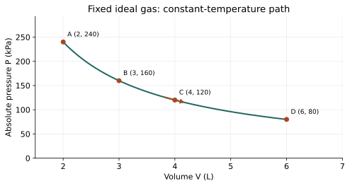

# U4-C03 - Isothermal Processes

Unit 4 | All competition levels | public-student | Rule alignment: 5.c.iv, printed B57

## Learning objectives
Explain constant-temperature ideal-gas behavior; use Boyle’s law and Kelvin; interpret curved P–V paths; connect ΔU=0 to heat and work without calculating curved-path areas.

## Prerequisites
Unit 2 ideal gas law PV=nRT, Kelvin and absolute pressure; Chapters 1–2 sign convention. A fixed amount of gas means no molecules are added or removed.

## Constant temperature is a process condition
An isothermal process keeps the system's temperature constant throughout the process. Returning to the same temperature only at the end is not sufficient. A gas can expand isothermally if energy exchange and motion are arranged so that its temperature stays essentially unchanged. A very large surrounding body at a fixed temperature can serve as a thermal reservoir.

A slow piston motion with good thermal contact is a useful approximate model. Slow motion gives time for heat transfer to compensate for energy carried away or supplied by work. Slow alone does not guarantee isothermal behavior; thermal contact and the surroundings also matter. Nor does constant temperature imply that all energy transfer has stopped.

## Boyle’s law comes from fixed n and T
The ideal-gas equation is PV=nRT. If n and T remain constant, their product with R is constant, giving P_iV_i=P_fV_f. Pressure is inversely proportional to volume: doubling volume halves pressure, while compressing to half the volume doubles pressure. Use absolute pressure. Celsius can label the constant temperature on a diagram, but any ideal-gas calculation involving the numerical T must use Kelvin.

Rearrange the single equation to find one unknown. For final pressure, P_f=P_iV_i/V_f. For final volume, V_f=P_iV_i/P_f. Use consistent pressure and volume units on both sides. Converting every value to SI is optional in a simple ratio if the units match, but mixing liters and milliliters without conversion is not acceptable.

## Read an isotherm on a P–V graph
A P–V graph places volume horizontally and pressure vertically. Each point represents a state with a particular pressure and volume. A constant-temperature ideal-gas path is a decreasing curved line, not a straight line between endpoints. At each point PV has the same value. The curve becomes less steep as volume increases.

Direction arrows tell whether the gas is expanding or compressing. Moving right increases volume; moving left decreases it. Pressure decreasing does not by itself prove heat is leaving: during an ordinary slow isothermal expansion, heat enters to replace energy exported as work. A graph labels a process path, so read both coordinates and the direction before assigning signs.

The area beneath a mechanically balanced P–V path represents boundary work, but evaluating a curved isotherm generally requires mathematics outside this unit's assessed scope. We will not replace that curve with an arbitrary rectangle or demand logarithms. When a question needs the amount of isothermal work, it supplies W or supplies Q so conservation can determine the other.

## Why ideal-gas internal energy stays constant
For a fixed amount of ideal gas, U depends only on T. Therefore isothermal ideal-gas motion has ΔU=0. The first law then gives 0=Q−W, or Q=W. This is a statement about signed transfers. During a slow expansion against positive pressure, W is positive, so Q is positive. During compression W is negative, so Q is negative.

Incoming heat during expansion does not raise the temperature because an equal amount of energy leaves through work. During compression, work enters, but heat leaves by an equal amount, holding U and T fixed. The equality does not mean heat and work are identical physical mechanisms; it means their signed amounts balance in this particular process.

The ideal-gas qualification is essential. A real substance can change phase at constant temperature and absorb latent heat. Its internal energy can change even though T does not. Do not conclude that every isothermal process of every material has ΔU=0. The statement belongs to the fixed-amount ideal-gas model, not the definition of isothermal itself.

## Contrast with neighboring processes
Isothermal specifies temperature; adiabatic specifies no heat transfer. They are different constraints. A typical gas expanding adiabatically does work without replacement heat and cools, whereas an isothermal expansion receives replacement heat. Isochoric specifies volume and isobaric specifies pressure. These words identify what is held fixed, not a universal answer for every energy quantity.

A special free expansion of ideal gas into vacuum can have Q=0, W=0 and ΔU=0, with equal initial and final temperatures. Its nonequilibrium intermediate states need not form a well-defined equilibrium isotherm. Thus equal endpoint temperatures alone cannot justify drawing a slow reversible path. Distinguish an endpoint comparison from a description of every intermediate state.

## Use the model thoughtfully
An expanding gas in thermal contact with a bath is an educational idealization. Real temperature control is imperfect and friction can create additional effects. A graph or recorded data set can illustrate the relationships safely without students creating a heated piston or sealed pressure apparatus. The important skill is stating which assumptions allow each equation, not reproducing a dangerous laboratory setup.

## Visual model

Quantitative isotherm for a fixed ideal gas with PV=480 kPa·L. Points are (2 L,240 kPa), (3 L,160 kPa), (4 L,120 kPa) and (6 L,80 kPa). The arrow points toward expansion; no curved-area calculation is required.

## Definitions and units
Isothermal: constant temperature throughout a process. Isotherm: constant-temperature curve on a state diagram. Thermal reservoir: large body idealized as maintaining a fixed temperature while exchanging heat. Boyle’s law: PV constant for fixed n and T in an ideal gas.

## Equations and their meaning
P_iV_i=P_fV_f for fixed n,T and ideal gas. ΔU=0 and Q=W for that ideal-gas isothermal process under the unit’s energy assumptions. Do not use a single constant P times ΔV along the curved isotherm. Numerical curved-path work is provided, not derived.

## Worked example: Pressure after expansion

**Given:** Ideal gas at constant T expands from 2.0 L, 240 kPa to 6.0 L; n fixed.

**Find:** Final pressure.

**Formula:** P_f=P_iV_i/V_f.

**Substitution:** P_f=240×2.0/6.0 kPa.

**Calculation:** 480/6.0=80.

**Final answer:** P_f=80 kPa absolute.

**Physical interpretation:** Tripling volume reduces pressure to one third.

## Worked example: Energy during isothermal expansion

**Given:** Fixed ideal gas expands isothermally and does 160 J work.

**Find:** ΔU and Q.

**Formula:** ΔU=0; Q=ΔU+W.

**Substitution:** Q=0+160 J.

**Calculation:** Q=160.

**Final answer:** ΔU=0 J; Q=+160 J.

**Physical interpretation:** The heat input replaces the work output while temperature stays constant.

## Worked example: Compression and heat rejection

**Given:** Surroundings do 75 J work on an ideal gas compressed isothermally.

**Find:** Signed heat transfer.

**Formula:** W=−75 J; Q=W because ΔU=0.

**Substitution:** Q=−75 J.

**Calculation:** 0=−75−(−75) verifies conservation.

**Final answer:** Q=−75 J; the gas releases 75 J.

**Physical interpretation:** Work input does not accumulate as internal energy because equal heat leaves.

## Common misconceptions
Constant temperature does not mean Q=0. Boyle’s law needs fixed gas amount and absolute pressure. A curved isotherm is not a straight diagonal. The rule ΔU=0 requires the stated ideal gas; it does not apply to isothermal melting.

## Real-world application and safe exploration
Temperature-controlled gas models help explain slow compression or expansion with a surrounding bath. Use the supplied points to verify PV and sketch the curve. A sealed heated container is not needed. In a device context, water held briefly at steady temperature is not automatically an isothermal ideal-gas process; identify the material first.

## Chapter recap
Isothermal means constant temperature throughout. Fixed ideal gas then has PV constant and ΔU=0, so signed heat and work balance. Graph direction gives expansion/compression, while supplied transfer data avoid disallowed curved-work mathematics.

## Chapter review
1. Why can an isothermal expansion require heat input?
2. Why is PV constant along the pictured curve?
3. Why does constant-temperature melting not obey the same ΔU conclusion?

## Practice
[WS23](../worksheets/WS23.md) progresses from foundations to competition reasoning.

## Mastery checklist
- [ ] I can use Boyle’s law with consistent units.
- [ ] I can explain Q=W with the correct signs.
- [ ] I can distinguish an isotherm from a constant-pressure line.
