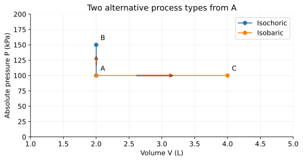

# U4-C05 - Isochoric and Isobaric Processes

Unit 4 | All competition levels | public-student | Rule alignment: 5.c.iv, printed B57

## Learning objectives
Apply constant-volume and constant-pressure conditions; use Kelvin gas ratios; calculate work and first-law changes; compare four process types without confusing their constraints.

## Prerequisites
Ideal gas law, first law, pressure-volume work and Kelvin conversion T_K=T_C+273.15. Assume fixed gas amount unless explicitly stated.

## Different constraints give different outcomes
Process names specify conditions imposed on a system. Isochoric means constant volume; isobaric means constant pressure. Neither word by itself says that temperature is fixed or heat transfer is zero. A gas can be heated at fixed volume in a rigid container or at fixed pressure beneath a freely moving loaded piston, and the two responses differ.

A rigid sealed container and a movable piston are educational models. Real containers can expand slightly and real pistons have friction. The assumptions are stated so students know which simplified relationships to use. Do not test these models by heating sealed containers; drawings and provided data are sufficient.

## Constant volume: pressure can change
For a fixed amount of ideal gas, PV=nRT. If V is constant, P/T is constant, giving P_f/P_i=T_f/T_i. Pressure is absolute and temperature must be Kelvin. Heating raises molecular motion and collision effects, so pressure rises even though the container volume stays the same.

A constant-volume path is vertical on a P–V diagram. Moving upward increases pressure; moving downward decreases it. The horizontal displacement is zero, so pressure-volume boundary work is zero. With no other work interactions, the first law simplifies to ΔU=Q. Incoming heat increases U; outgoing heat decreases it.

The restriction to boundary work matters. An electric heater or rotating paddle inside a rigid container can still transfer energy as work across an appropriately chosen system boundary. Therefore “constant volume implies no work of any kind” is too broad. Our isochoric numerical exercises explicitly exclude other work unless a question asks students to identify the limitation.

## Constant pressure: volume can change
For fixed n and constant pressure, V/T is constant, giving V_f/V_i=T_f/T_i. A heated gas under a constant load can expand as it warms, preserving pressure. A slowly cooled gas under the same load can contract. Again use Kelvin for ratios, not Celsius.

A constant-pressure path is horizontal on a P–V graph. For a mechanically balanced model, W=P(V_f−V_i). The rectangle under the path has area P times the horizontal width, with expansion positive and compression negative. This is a permitted geometry calculation. The use of gas pressure assumes it matches the opposing pressure closely enough for the model.

Heat entering during constant-pressure warming must supply both the internal-energy increase and the work exported: Q=ΔU+W. Thus Q need not equal ΔU even if temperature rises. If a sample internal-energy coefficient C_U is supplied, compute ΔU=C_UΔT and add the boundary work. No advanced gas heat-capacity identity is needed.

## Heat capacity depends on the process
In Unit 3, ordinary solid/liquid heating often used Q=mcΔT with negligible work. Gases can expand appreciably, so the amount of heat per degree depends on what the gas is allowed to do. At constant volume with only boundary work, all net heat changes internal energy. At constant pressure, some of the heat can do expansion work.

This explains qualitatively why a gas's constant-pressure heat capacity exceeds its constant-volume heat capacity under the usual ideal-gas model. Do not insert a heat capacity from one process into another without checking its definition. When this unit provides C_U, it relates to ΔU rather than automatically to Q for every path.

## Compare all four names carefully
The comparison table summarizes definitions and common ideal-gas consequences. Each row assumes a fixed amount of gas and the unit's closed-system energy model. “Not fixed by the name” means more information is required; it does not mean the quantity must be nonzero. Special cases can satisfy more than one constraint, such as a system that does not change at all.

| Process | Defining condition | Boundary work | Ideal-gas consequence |
| --- | --- | --- | --- |
| Isothermal | T constant | Generally nonzero; supplied for curves | ΔU=0; Q=W; PV constant |
| Adiabatic | Q=0 | Can be positive, negative or zero | ΔU=−W; T may change |
| Isochoric | V constant | W_PV=0 | P/T constant; ΔU=Q if no other work |
| Isobaric | P constant | W_PV=PΔV for balanced motion | V/T constant; Q=ΔU+W if only PV work |

## Translate a description before calculating
“Rigid” points toward constant volume, not zero heat transfer. “Insulated” points toward adiabatic, not constant pressure. “In good contact with a fixed-temperature bath and moved slowly” supports isothermal behavior. “Slowly moving beneath a fixed load” supports constant pressure if friction and load changes are negligible. Find the physical constraint instead of selecting a formula from a single familiar word.

When more than one stage occurs, label each stage separately. A vertical segment followed by a horizontal segment is not one globally isobaric or isochoric process. Compute work and internal-energy changes for each suitable stage, then add signed values. The next chapter extends this bookkeeping around a closed loop.

## Visual model

Two paths from A=(2 L,100 kPa): A→B is vertical to B=(2 L,150 kPa), and A→C is horizontal to C=(4 L,100 kPa). Vertical means fixed volume; horizontal means fixed pressure. These are separate possible paths.

## Definitions and units
Isochoric: constant V. Isobaric: constant P. W_PV: pressure-volume boundary work, J. Absolute pressure: measured from vacuum. C_U: internal-energy temperature coefficient of a sample, J/K. A Celsius change equals a Kelvin change, but absolute ratios require Kelvin.

## Equations and their meaning
Fixed n,V ideal gas: P_f=P_iT_f/T_i. Fixed n,P ideal gas: V_f=V_iT_f/T_i. Isochoric boundary work W_PV=0. Balanced isobaric work W=PΔV. For all stages, ΔU=Q−W with every work mode included.

## Worked example: Rigid-container heating

**Given:** Fixed ideal gas: P_i=100 kPa, T_i=300 K, T_f=360 K; V constant.

**Find:** Final pressure.

**Formula:** P_f=P_iT_f/T_i.

**Substitution:** P_f=100×360/300 kPa.

**Calculation:** 360/300=1.20; 100×1.20=120.

**Final answer:** P_f=120 kPa absolute.

**Physical interpretation:** A 20% Kelvin-temperature increase produces a 20% pressure increase at fixed volume.

## Worked example: Volume under constant load

**Given:** Ideal gas: V_i=2.0 L at 300 K; T_f=450 K; P constant and n fixed.

**Find:** Final volume.

**Formula:** V_f=V_iT_f/T_i.

**Substitution:** V_f=2.0×450/300 L.

**Calculation:** 450/300=1.5; 2.0×1.5=3.0.

**Final answer:** V_f=3.0 L.

**Physical interpretation:** Volume grows in the same ratio as absolute temperature.

## Worked example: Heat at constant pressure

**Given:** Balanced P=100 kPa; V increases from 2.0 to 3.0 L; ΔU=150 J; only boundary work.

**Find:** W and Q.

**Formula:** W=PΔV; Q=ΔU+W.

**Substitution:** W=100×(3−2) J; Q=150+W.

**Calculation:** W=100; Q=150+100=250.

**Final answer:** W=+100 J; Q=+250 J.

**Physical interpretation:** Heat supplies internal-energy growth and expansion work.

## Worked example: Isochoric cooling

**Given:** Rigid closed gas releases 80 J; no electrical, paddle or other work.

**Find:** W and ΔU.

**Formula:** W=0; ΔU=Q−W.

**Substitution:** Q=−80 J; ΔU=−80−0.

**Calculation:** ΔU=−80.

**Final answer:** W=0 J; ΔU=−80 J.

**Physical interpretation:** No boundary displacement occurs; heat loss lowers internal energy.

## Common misconceptions
Use Kelvin in P/T and V/T ratios. Constant volume does not mean constant pressure or prohibit every work mode. Constant pressure does not mean zero work. Isothermal and adiabatic are not interchangeable constraints.

## Real-world application and safe exploration
A flexible balloon is sometimes a rough constant-pressure illustration, but membrane tension changes pressure, so a constant-load piston is cleaner for calculations. A sealed rigid tank illustrates constant volume conceptually; do not heat one in class. Use virtual states or supplied recordings and discuss how real apparatus departs from each idealization.

## Chapter recap
Isochoric keeps volume fixed; isobaric keeps pressure fixed. Gas ratios require Kelvin, and first-law accounting remains valid for every stage. Use the process definition to simplify the law rather than replacing it.

## Chapter review
1. Why does isochoric heating raise ideal-gas pressure?
2. Why can isobaric heat input exceed ΔU?
3. Why does a rigid container not rule out electrical work?

## Practice
[WS25](../worksheets/WS25.md) progresses from foundations to competition reasoning.

## Mastery checklist
- [ ] I can distinguish vertical and horizontal P–V paths.
- [ ] I can apply Kelvin ratios and constant-pressure work.
- [ ] I can compare all four process conditions and their assumptions.
