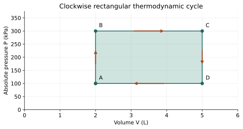

# U4-C06 - Thermodynamic Cycles

Unit 4 | All competition levels | public-student | Rule alignment: 5.c.iv, printed B57

## Learning objectives
Explain return to the initial state; calculate rectangular and triangular cycle work geometrically; use ΔU_cycle=0; interpret direction and net heat.

## Prerequisites
First law, P–V graphs, rectangle area=base×height and triangle area=base×height/2. Cycle paths used for work are slow mechanically balanced idealizations with only pressure-volume work.

## A cycle returns the working substance to its state
An engine can repeatedly produce work because its working substance follows a repeating cycle. A thermodynamic cycle returns to the starting thermodynamic state: not merely the same temperature, but the same relevant state properties. For a fixed amount of ideal gas, returning to the same P and V returns it to the same T and U.

Internal energy is a state property, so ΔU_cycle=0. This does not mean U itself is zero or that no energy flowed during the cycle. The first law gives Q_net=W_net over the complete cycle. Individual stages can have nonzero ΔU; their signed changes cancel when the cycle closes.

Heat and work are process transfers. They can have nonzero net values around a loop precisely because they are not stored state properties. A positive-work engine must receive a net positive heat input over its full cycle under the stated model. “Net heat” means absorbed heat minus released heat, not the total heat absorbed alone.

## Work along horizontal and vertical segments
For a horizontal expansion at pressure P_high, W=P_highΔV is positive. A horizontal compression at a smaller pressure P_low has negative work W=P_low(−ΔV). Vertical segments have ΔV=0 and zero boundary work. Adding the signed segment works yields W_net=(P_high−P_low)ΔV.

This difference is the area enclosed by the rectangular loop. The full area under the upper expansion line is not the cycle work, because compression consumes some work. The net output is what remains after subtracting that input. If pressure is in kPa and volume in L, the area unit is J.

A useful step-by-step check is to list each segment's direction before using the equation. Students often obtain the correct area magnitude but the wrong sign because they ignore the arrows. Labeling A, B, C and D and following them in order prevents this error.

## Clockwise and counterclockwise
On the standard plot with V horizontal and P vertical, a simple clockwise loop expands at higher pressures and compresses at lower pressures. Its net pressure-volume work by the gas is positive. Reversing the same loop makes it counterclockwise and gives negative net work by the gas: work is supplied to the system.

A refrigerator or heat pump requires work input to move heat from a colder region toward warmer surroundings. A counterclockwise cycle is consistent with such operation, but a bare P–V loop alone does not describe every thermal contact needed for a functioning refrigerator. Specific heat exchanges and reservoir interactions must also be identified.

For a self-crossing or complicated cycle, signed areas would need careful accounting. This unit uses simple non-self-crossing loops so direction and elementary geometry are sufficient. We do not ask students to integrate a general curve.

## Triangular cycles and straight sloping paths
A triangular loop encloses area one half of its base times its perpendicular height. If its arrows are clockwise, that area is positive net work; if counterclockwise, it is negative. A sloping straight segment can be treated using the area of a trapezoid under the line, provided the path is the stated mechanically balanced idealization.

For a straight pressure-versus-volume segment, the mean endpoint pressure times ΔV gives the same trapezoid area. This is an elementary geometry result for a straight line, not permission to average endpoints on an arbitrary curve. Work on a curved isotherm or adiabatic path is not calculated this way.

## Close the energy ledger
Suppose a cyclic engine absorbs Q_H and releases a positive heat magnitude Q_C. Its signed net heat is Q_H−Q_C. With ΔU_cycle=0, W_net=Q_H−Q_C. The gas can warm on one part, cool on another and return to its starting temperature while exporting work each cycle.

Be careful to separate a single stroke from the entire loop. A stroke can have ΔU≠0, so its heat need not equal its work. Only the closed-cycle sum has zero internal-energy change. If a proposed “cycle” ends at a different state, the cycle shortcut is not justified.

## What a simple engine diagram does and does not show
Rectangular and triangular loops are instructional models chosen for permitted mathematics. They are not claims that a real car engine follows those exact pressure paths, or that every drawn cycle can be implemented reversibly with only two reservoirs. Real engines have friction, finite-temperature heat transfer, moving matter and other complications.

Even an internally consistent loop must obey the second law. Knowing its area and total heat input allows an efficiency calculation, but attainable performance also depends on temperatures and irreversibilities. The next chapter adds reservoirs and the efficiency limit so energy conservation is not mistaken for a complete design test.

## Visual model

Clockwise rectangle A=(2 L,100 kPa), B=(2 L,300 kPa), C=(5 L,300 kPa), D=(5 L,100 kPa), returning to A. The shaded enclosed area is 600 J of net work; horizontal stages supply opposite-signed work.

## Definitions and units
Cycle: sequence returning to the starting thermodynamic state. Working substance: material undergoing the cycle. W_net: signed net work by the system per cycle, J/cycle. Q_net: signed net heat entering per cycle. Q_H,Q_C: positive magnitudes of absorbed and rejected heat.

## Equations and their meaning
ΔU_cycle=0; Q_net=W_net. Rectangle: |W_net|=(P_high−P_low)(V_max−V_min). Triangle: |W_net|=base×height/2. Sign comes from direction. W_net=Q_H−Q_C for a cyclic engine with only those heat exchanges.

## Worked example: A rectangular cycle

**Given:** Clockwise loop: V=2–5 L and P=100–300 kPa.

**Find:** Net work by the gas.

**Formula:** W_net=(P_high−P_low)(V_max−V_min).

**Substitution:** W_net=(300−100)×(5−2) kPa·L.

**Calculation:** 200×3=600.

**Final answer:** W_net=+600 J per cycle.

**Physical interpretation:** Expansion gives 900 J and compression uses 300 J, leaving 600 J net.

## Worked example: A triangular loop

**Given:** Clockwise right-triangle cycle has volume base 4 L and pressure height 150 kPa.

**Find:** Net work and net heat.

**Formula:** W_net=base×height/2; Q_net=W_net.

**Substitution:** W_net=4×150/2 J.

**Calculation:** 600/2=300.

**Final answer:** W_net=+300 J; Q_net=+300 J per cycle.

**Physical interpretation:** The gas returns to its initial U while heat supplies its net output.

## Worked example: Find rejected heat

**Given:** Engine cycle absorbs 1000 J and produces 250 J net work.

**Find:** Rejected heat magnitude.

**Formula:** W_net=Q_H−Q_C; Q_C=Q_H−W_net.

**Substitution:** Q_C=1000−250 J.

**Calculation:** 1000−250=750.

**Final answer:** Q_C=750 J per cycle.

**Physical interpretation:** The remaining absorbed energy leaves as heat; it is not destroyed.

## Common misconceptions
Zero ΔU_cycle does not mean zero work or zero heat. Use enclosed area, not only the area below the expansion segment. Clockwise gives positive work only with the standard P-vertical, V-horizontal axes and the stated boundary-work model. Returning to one property alone is not necessarily a cycle.

## Real-world application and safe exploration
Cycle diagrams explain repeated operation without requiring a physical steam engine. Trace the arrows on the supplied plots and compute segment work using paper rectangles. No high-pressure apparatus is needed. Real engine details belong to later study; these geometry models develop conservation and sign reasoning.

## Chapter recap
A closed state loop has no net internal-energy change but can exchange net heat and work. Simple enclosed areas give net boundary work, with sign determined by direction. Separate full-cycle statements from individual-stage balances.

## Chapter review
1. Why is ΔU zero over a complete cycle but not necessarily each stage?
2. Why must compression work be subtracted from expansion work?
3. What changes if the same simple loop is traversed backward?

## Practice
[WS26](../worksheets/WS26.md) progresses from foundations to competition reasoning.

## Mastery checklist
- [ ] I can follow arrows and assign segment-work signs.
- [ ] I can calculate rectangular and triangular enclosed areas.
- [ ] I can use the cyclic heat/work balance without erasing individual transfers.
