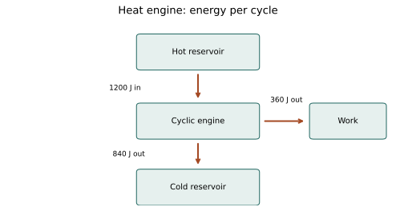
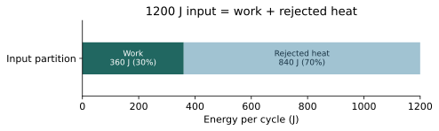

# U4-C07 - Heat Engines and Thermal Efficiency

Unit 4 | All competition levels | public-student | Rule alignment: 5.c.iv, printed B57

## Learning objectives
Relate hot/cold reservoirs, work and heat rejection; compute actual efficiency and the Carnot upper bound; use Kelvin correctly and distinguish possible from proven performance.

## Prerequisites
Cycles and the first law; fractions and percentages. A reservoir is idealized as maintaining a nearly constant temperature while accepting or supplying heat.

## An engine uses a temperature difference
A heat engine takes heat from a hotter source, converts part of that input into net work, and rejects heat to a colder sink while its working substance completes a cycle. The source and sink are called hot and cold reservoirs. They are surroundings of the working substance, not quantities stored inside it.

A power station may use a high-temperature heating source and a cooling environment. A fuel-burning engine has additional chemistry and flow, so a simple two-reservoir cycle is an idealized description of its thermal role, not a complete engineering model. Our diagrams focus on the energy amounts relevant to cyclic heat-to-work conversion.

Let Q_H be the positive heat-input magnitude from the hot reservoir and Q_C the positive heat-rejection magnitude to the cold reservoir. Let W_net be positive net work output. The cycle first law gives W_net=Q_H−Q_C. In the signed convention, Q_net=Q_H−Q_C and ΔU_cycle=0. The labels Q_H and Q_C are magnitudes, so Q_C is not a negative number in this formula.

## Efficiency compares useful output with required input
Thermal efficiency η is the fraction of absorbed heat converted into net work: η=W_net/Q_H. Combining the cycle balance gives η=1−Q_C/Q_H. Efficiency is dimensionless. Multiplying a fraction by 100 gives a percentage; .25 means 25%, not .25%.

The denominator is heat absorbed, not net heat. Since Q_net=W_net for the cycle, dividing W by Q_net would give 100% and conceal the rejected heat. The correct denominator measures what the engine had to take from the hot source to deliver its output. Rejected heat is still energy; “waste heat” means it was not converted into the desired work output, not that it disappeared.

Efficiency differs from power. An engine can have high efficiency and small output because its input rate is small. If heat-input power and work-output power refer to the same steady operating conditions, their ratio gives the same efficiency. Energy per cycle, cycles per second and watts must not be mixed without the time relationship.

## Why a cyclic heat engine cannot use all the heat
The first law alone allows an equation with Q_C=0 and W_net=Q_H. The second law rules out a device whose only overall effect is to absorb heat from a single reservoir and turn it entirely into work while returning the working substance to its starting state. Heat transfer has direction and entropy consequences in addition to energy magnitude.

A gas can convert heat into equal work during one isothermal expansion, as Chapter 3 showed. That stroke is not a complete cycle; the gas ends at a different volume. Restoring the initial state requires additional transfers. A device must account for its reset as well as its productive stroke. This distinction resolves the apparent contradiction between Q=W on one stroke and less-than-100% cyclic heat-engine efficiency.

For an engine exchanging heat only with two reservoirs at finite positive temperatures, rejected heat is required. Other energy converters, such as an electric motor or fuel cell, are not simply the same thermal cycle and should not be judged by substituting arbitrary temperatures into the heat-engine formula.

## Carnot’s contribution and the ideal upper bound
Carnot studied the limits of heat-engine performance and the role of a reversible cycle. In modern thermodynamics, a reversible engine between two reservoirs sets the greatest possible efficiency between those temperatures. All reversible engines operating between the same two temperatures have the same efficiency, independent of working substance.

The maximum is η_max=1−T_C/T_H, where both temperatures are in Kelvin and T_H>T_C>0. Kelvin is required because the ratio refers to absolute thermodynamic temperature. Converting only the hot temperature or using Celsius can produce absurd answers. A temperature difference can use Celsius degrees, but a temperature ratio cannot substitute them for Kelvin.

The expression is an upper bound, not the promised efficiency of a real engine. Friction, finite-temperature heat transfer and other irreversible effects make real performance lower. A proposed efficiency below the bound is not automatically achievable by a particular design; it merely passes this one necessary limit. A value above it is impossible under the stated two-reservoir conditions.

## Read the limit physically
Raising T_H while holding T_C fixed increases the ideal bound. Lowering T_C while holding T_H fixed also increases it. If the temperatures approach equality, the maximum efficiency approaches zero: no useful thermal advantage remains. A 100% bound would require the cold-temperature ratio to vanish; ordinary finite positive reservoir temperatures do not allow that.

Do not interpret the formula as instructions to seek dangerous temperatures. It is a comparison tool. Materials, environment and practical safety impose additional constraints. Unit 6 addresses the third law separately; no advanced low-temperature theory is needed to see that the stated positive-temperature ratio produces a bound below one.

## Visual model

Engine energy-flow model: hot reservoir supplies 1200 J/cycle; engine exports 360 J/cycle as work and rejects 840 J/cycle to the cold reservoir. A proportional bar divides the input into 30% work and 70% rejected heat.

## Definitions and units
η: thermal efficiency, dimensionless fraction. Q_H: heat absorbed per cycle, J. Q_C: heat rejected per cycle, positive magnitude in J. W_net: net work output per cycle, J. T_H,T_C: reservoir temperatures in K. Reversible limit: ideal operation with no entropy generation.

## Equations and their meaning
W_net=Q_H−Q_C; η=W_net/Q_H=1−Q_C/Q_H; percent efficiency=100η. Two-reservoir upper bound η_max=1−T_C/T_H with Kelvin. Actual efficiency cannot exceed this bound under the stated conditions. T_K=T_Celsius+273.15.

## Worked example: Actual cycle efficiency

**Given:** Q_H=1200 J; Q_C=840 J.

**Find:** Work and efficiency.

**Formula:** W=Q_H−Q_C; η=W/Q_H.

**Substitution:** W=1200−840; η=360/1200.

**Calculation:** W=360; η=.300.

**Final answer:** W=360 J/cycle; η=30.0%.

**Physical interpretation:** Thirty percent of heat input becomes net work; the remaining 70% is rejected.

## Worked example: Input needed for a desired output

**Given:** Engine delivers 200 J/cycle at η=.25.

**Find:** Required heat input and rejected heat.

**Formula:** Q_H=W/η; Q_C=Q_H−W.

**Substitution:** Q_H=200/.25; Q_C=800−200.

**Calculation:** 200/.25=800; 800−200=600.

**Final answer:** Q_H=800 J; Q_C=600 J per cycle.

**Physical interpretation:** The required heat input exceeds the useful output.

## Worked example: A Kelvin upper bound

**Given:** Reservoirs at T_H=600 K and T_C=300 K.

**Find:** Maximum ideal efficiency.

**Formula:** η_max=1−T_C/T_H.

**Substitution:** η_max=1−300/600.

**Calculation:** 300/600=.50; 1−.50=.50.

**Final answer:** η_max=50%.

**Physical interpretation:** Real engines between these reservoirs have efficiencies below the reversible limit.

## Worked example: Celsius must be converted

**Given:** Reservoirs at 126.85 °C and 26.85 °C.

**Find:** Ideal maximum efficiency.

**Formula:** T_K=T_Celsius+273.15; η_max=1−T_C/T_H.

**Substitution:** T_H=400 K; T_C=300 K; η_max=1−300/400.

**Calculation:** 300/400=.75; 1−.75=.25.

**Final answer:** η_max=25%.

**Physical interpretation:** Using 26.85/126.85 would compare the wrong zero points and overstate the limit.

## Visualize the efficiency fraction

The bar uses a quantitative energy scale. The work portion occupies30% of the total width, matching the first worked example.

## Common misconceptions
Use Q_H, not Q_net, in the efficiency denominator. Q_C is a positive magnitude in engine formulas. An isothermal expansion is not a complete engine cycle. Carnot efficiency is a maximum, not every engine’s actual efficiency. Kelvin is essential in temperature ratios.

## Real-world application and safe exploration
Cooling towers and radiators make sense once rejected heat is included in the ledger. Compare the supplied reservoir cases using paper energy arrows. No burning fuel, steam or high-temperature apparatus is required. Carnot’s historical context is expanded in Unit 5; this chapter teaches the physical limit used in calculations.

## Chapter recap
A heat engine converts some absorbed heat to net work and rejects the rest during a cycle. Efficiency measures the useful fraction, while the Carnot bound sets a two-reservoir limit. Conservation and the second law must both be satisfied.

## Chapter review
1. Why is rejected heat not destroyed energy?
2. Why can one Q=W stroke not establish a 100% efficient cyclic engine?
3. Why must reservoir temperatures be Kelvin?

## Practice
[WS27](../worksheets/WS27.md) progresses from foundations to competition reasoning.

## Mastery checklist
- [ ] I can calculate W, Q_H, Q_C and efficiency.
- [ ] I can check a proposed efficiency against a Kelvin bound.
- [ ] I can distinguish real performance from an ideal limit.
