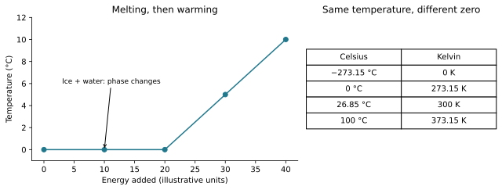

# U5-C01 - Lord Kelvin and Joseph Black

Unit 5 | All competition levels | public-student | Rule 5.c.v, printed B57

## Learning objectives
Explain what a thermometer measures; distinguish sensible and latent heating; connect Black’s measurements to calorimetry and Kelvin’s temperature ideas to gas ratios and engine limits.

## Prerequisites and how to read this chapter
Units 1–4 introduced temperature, heat, work, phase changes, particles and energy conservation. This chapter explains how those ideas developed. Historical terminology can differ from modern terminology. All numerical data below are original teaching models, not reconstructed historical measurements. No quotation is attributed to a scientist unless explicitly identified as a quotation; this unit uses original paraphrases.

## Two questions that temperature alone cannot answer
Put a small cup and a large bucket of water in the same room overnight. They can reach the same temperature, but warming the bucket by another degree requires more energy. Now place melting ice and liquid water together. Energy can enter while their temperature remains nearly constant. These familiar situations expose a basic difficulty: a thermometer reading does not tell us the total energy transferred or stored. Joseph Black’s work helped clarify this distinction long before the modern first law had taken shape.

There is a different difficulty with temperature scales. A reading of 20 °C is not twice the thermodynamic temperature of 10 °C. Celsius assigns its zero by convention; it does not begin at the lower limit of ordinary thermodynamic temperature. William Thomson, later Lord Kelvin, helped develop an absolute scale linked to general thermal principles rather than to one particular thermometer substance. Black and Kelvin therefore addressed related but different measurement problems.

## Black: observations before a complete energy theory
Joseph Black lived from 1728 to 1799 and taught chemistry at Glasgow and Edinburgh. During his Glasgow work he developed ideas about latent heat and specific heat, describing his investigations publicly in 1762. His lectures were influential, but their collected publication in 1803 was posthumous. The publication date should not be mistaken for the date of the discoveries. [H01]

Black’s surviving lectures discuss the slow melting of ice and the different thermal effects of different substances. They also discuss earlier experiments by other investigators. This matters historically: scientific progress included interpreting existing observations, not only inventing new equipment. Black argued that equal thermometer readings could not be treated as equal quantities of heat. His language sometimes treated heat as a material substance. We retain the experimental distinctions while translating their explanation into modern energy language. [H02]

## Why melting ice can absorb energy without warming
Imagine supplying a steady, measured amount of energy to pure ice already at its melting point, at approximately atmospheric pressure. As long as ice and water coexist under these conditions, the mixture remains close to 0 °C. The added energy changes the phase rather than producing the usual temperature rise. The molecular arrangement changes; energy is associated with the changed interactions and structure. It is not correct to say that the heater has stopped transferring energy because the thermometer has stopped rising.

The modern relationship Q=mL describes this idealized phase change. Q is transferred energy in joules, m is mass in kilograms, and L is specific latent heat in joules per kilogram. For melting, Q is positive into the material. For freezing the same mass under comparable conditions, energy leaves. The word latent means that the transfer is not revealed by a temperature rise during the phase change; it does not mean energy has vanished or become impossible to measure.

Once all the ice has melted, continued input can warm the liquid. For a modest temperature interval with no phase change, Q=mcΔT is a useful model. Here c is specific heat capacity in J/(kg·K). Different substances generally have different c values. A sample’s heat capacity C=mc is in J/K and also depends on its mass. A conductivity value, in W/(m·K), answers a different question about the rate of heat flow through a material. Black’s legacy connects especially to capacity and phase energy, not to identifying the fastest conductor.

## Calorimetry: infer a transfer from an energy balance
Calorimetry means measuring energy transfer through controlled thermal changes. In an insulated mixing experiment, the warmer object loses energy while the cooler object and container gain it. Temperatures, masses and suitable heat-capacity data let us balance those transfers. If the container absorbs appreciable energy, ignoring it introduces an error. If equal masses of the same liquid are mixed with negligible losses and constant c, their final temperature lies halfway between the starting temperatures. With unequal masses or different materials, a simple average is generally wrong.

This reasoning does not require calling the material a container of stored heat. In modern terminology, heat names a transfer caused by a temperature difference; internal energy is a state property. Black’s historical vocabulary is evidence about his period, not permission to abandon the precise definitions from Unit 1. A scientifically strong historical explanation can admire a measurement while correcting the old model used to interpret it.

## Kelvin: an absolute scale and the laws of thermodynamics
William Thomson lived from 1824 to 1907 and became a professor at Glasgow. His 1848 paper proposed an absolute thermometric scale. The first proposal was not identical to the modern linear Kelvin scale; his temperature ideas developed further as energy-based thermodynamics matured. He also worked on the limits of converting heat into work and collaborated with Joule on gas investigations. These are documented connections, rather than a claim that the two developed every law together. [H03]

The modern conversion is T=t+273.15, where T is in kelvins and t is in degrees Celsius. A change of 1 K equals a change of 1 °C, but the zeros differ. Use K without a degree symbol. A temperature difference can therefore be expressed with either degree size, whereas an absolute-temperature ratio in the ideal-gas law or Carnot bound must use Kelvin values.

Absolute zero is 0 K, corresponding to −273.15 °C. It represents the lower limit approached by ordinary positive-temperature equilibrium systems. Do not picture it as the disappearance of all energy, all particles or every kind of motion. Modern quantum physics allows ground-state energy and quantum motion; temperature alone also does not specify all stored energy. The detailed third-law treatment belongs to the State/National Unit 6. This chapter supplies the historical context without assessing that advanced law.

## Compare contributions by the question answered
Black helps us ask, “How much energy is required for this material change?” Kelvin helps us ask, “How should thermodynamic temperature be measured consistently?” A phase-change calculation may use Black-associated concepts without any Kelvin ratio. An engine-limit calculation needs absolute temperatures even if no material melts. Neither scientist’s contribution makes the other unnecessary.

Today thermodynamic temperature is tied to a fixed value of the Boltzmann constant in the SI. That is a modern refinement of measurement, not something Kelvin wrote in 1848. [H04] Engineers using cryogenic sensors, scientists measuring gas behavior, and students comparing reservoirs all benefit from an absolute scale. Cooling packs and thermal storage materials instead make especially visible the distinction between energy transfer and temperature change.

## Visual model

Two panels connect a melting plateau to energy input and compare Celsius with Kelvin. Plateau data are illustrative; both scale columns refer to the same physical temperatures.

## Important terminology
Thermodynamic temperature: absolute temperature, K. Specific heat capacity c: energy per mass per temperature change, J/(kg·K). Heat capacity C: sample coefficient, J/K. Specific latent heat L: energy per mass for a specified phase change, J/kg. Calorimetry: measurement through thermal energy accounting.

## Worked example: A scale suitable for ratios

**Given:** A sample is at 26.85 °C.

**Find:** Its absolute temperature.

**Formula:** T=t+273.15.

**Substitution:** T=26.85+273.15 K.

**Calculation:** 26.85+273.15=300.00.

**Final answer:** T=300.00 K.

**Physical interpretation:** The offset changes the zero, not the size of one temperature step.

## Worked example: Equal temperature rise, different material

**Given:** Two 0.20 kg samples warm by 5.0 K; c_A=4200 and c_B=900 J/(kg·K). No phase change or loss.

**Find:** Energy needed by each.

**Formula:** Q=mcΔT.

**Substitution:** Q_A=0.20×4200×5.0; Q_B=0.20×900×5.0.

**Calculation:** Q_A=4200; Q_B=900.

**Final answer:** A needs 4200 J; B needs 900 J.

**Physical interpretation:** Equal mass and temperature rise do not imply equal energy transfer. This is the distinction associated with specific heat.

## Worked example: Energy on the melting plateau

**Given:** 0.050 kg ice melts at 0 °C; L=334000 J/kg; ignore losses.

**Find:** Energy absorbed.

**Formula:** Q=mL.

**Substitution:** Q=0.050×334000 J.

**Calculation:** Q=16700.

**Final answer:** Q=16700 J, or 16.7 kJ.

**Physical interpretation:** A zero temperature rise does not imply zero heat transfer during melting.

## Common historical and scientific confusions
Black did not invent the Kelvin scale. Kelvin did not discover latent heat. Equal temperature is not equal internal energy. The 1803 lecture publication is not Black working after his death. The modern SI definition and quantum account of absolute zero must not be projected backward into the 1848 paper.

## Application and safe investigation
Use a teacher-prepared ice-water data table or observe a small open cup with a room-temperature thermometer under adult supervision. Do not reproduce historical mercury experiments. Record phase and temperature together: a single temperature trace cannot establish whether the mixture is still melting. Compare equal masses using supplied c values rather than assuming heating-rate differences measure conductivity alone.

## Chapter summary
Black separated temperature from the amount of thermal transfer, making phase changes and material-specific heating clearer. Kelvin helped develop an absolute temperature framework connected to general thermodynamics. Modern equations express these contributions with later refinements, consistent units and explicit assumptions.

## Chapter review
1. Why can melting ice absorb energy with little temperature change?
2. Why is 20 °C not twice 10 °C on an absolute scale?
3. How can a historical observation remain valuable after its explanation changes?

## Practice
[WS29](../worksheets/WS29.md) includes eight questions from recognition to evidence-based reasoning.

## Mastery checklist
- [ ] I can distinguish Black’s and Kelvin’s contributions.
- [ ] I can choose Q=mL or Q=mcΔT and state the conditions.
- [ ] I can separate a historical date from a later publication or refinement.

## Historical evidence
H01: Edinburgh history of Black; H02: Black’s lectures, published 1803; H03: MacTutor biography of Thomson; H04: BIPM Kelvin definition.

Full bibliographic details, links and attribution limits: [Unit 5 source guide](../references/U5-sources.md).
