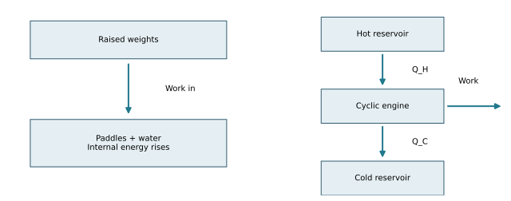

# U5-C02 - James Prescott Joule and Sadi Carnot

Unit 5 | All competition levels | public-student | Rule 5.c.v, printed B57

## Learning objectives
Interpret work-to-warming experiments; use the first law consistently; explain reversible engine limits; distinguish Carnot’s original caloric framework from modern energy accounting.

## Prerequisites and how to read this chapter
Units 1–4 introduced temperature, heat, work, phase changes, particles and energy conservation. This chapter explains how those ideas developed. Historical terminology can differ from modern terminology. All numerical data below are original teaching models, not reconstructed historical measurements. No quotation is attributed to a scientist unless explicitly identified as a quotation; this unit uses original paraphrases.

## Two engine questions with different answers
Suppose a workshop uses a heat engine to lift a load. How many joules enter, leave and become work? That is an energy-accounting question. Could an improved engine convert every incoming joule into work during a complete cycle? That is a performance-limit question. Joule’s work strongly supported the quantitative relationship between mechanical work and thermal effects. Carnot’s analysis identified a general structure for ideal engine performance. The modern first and second laws combine these ideas without making them identical.

## Joule: careful measurements of very small warming
James Prescott Joule lived from 1818 to 1889 and worked in the Manchester area. In the 1840s he investigated ways that mechanical and electrical processes produced thermal changes. A famous arrangement used falling weights to turn paddles in water. The water’s temperature rose slightly. Repetition, careful thermometry and attention to other energy destinations were essential because the rise was small. The Science and Industry Museum describes this experimental program; its collection also contains a later paddlewheel, dated approximately 1860. A museum object’s date is not automatically the date of the first discovery. [H05]

Follow the energy rather than just the thermometer. Raised weights have gravitational potential energy. As they descend, that energy can be transferred through the apparatus as mechanical work. The paddles stir the water. Viscous effects convert organized motion into microscopic energy, and the water warms. If the water is the chosen system, the paddle interaction is work entering it. It is not heat entering merely because the result is a higher temperature. Heat may subsequently leave through the container to the room.

Joule’s repeated measurements helped establish a consistent mechanical equivalent for a specified thermal change. The result challenged the idea that heat was simply an indestructible fluid that could only be moved around. Energy conservation emerged through the work of multiple investigators; Joule was a major experimental contributor, not the sole person responsible for every statement of the first law. In modern SI, the same energy unit measures work, heat transfer and internal-energy change. One joule is one newton-meter of work when force and displacement are aligned.

## Reconstruct the reasoning, not the historical apparatus
For a teaching model, suppose a known amount of paddle work enters a thermally insulated vessel. If no energy leaves and bulk motion has settled, the water-plus-vessel internal energy rises by that input. Our convention remains ΔU=Q−W, with W positive by the system. Work done on the system is negative W. If Q=0 and W=−600 J, then ΔU=+600 J.

The sample may then obey ΔU=CΔT with a supplied heat capacity C in J/K. A complete experiment needs the vessel and paddle heat capacities, transfer losses, and measurement uncertainty. Measuring the water alone can undercount energy if the container also warms. A small discrepancy is a reason to improve the accounting, not instant evidence that energy conservation failed. These controls connect historical experimentation to the practical data work in Units 3 and 7.

## Carnot: the problem of the best possible engine
Sadi Carnot lived from 1796 to 1832 and trained as a French military engineer. In 1824 he published his study of the motive power of heat. It was motivated by engines and their performance, but its importance was broader than improving a single machine. He considered idealized reversible operation and the temperatures between which an engine works. Clapeyron’s 1834 reformulation helped communicate the work; Clausius and Thomson later incorporated its insights into energy-based thermodynamics. [H06]

Carnot’s published analysis used the caloric framework, which treated heat as a conserved substance passing from a warmer body to a cooler one. Modern thermodynamics instead allows some absorbed energy to leave as work, so the heat rejected by a cyclic engine is less than the heat absorbed by the net work output. We should not pretend that Carnot’s 1824 book already used today’s complete energy ledger. His valuable ideas about reversible limits survived the replacement of that framework.

## The modern Carnot engine as an ideal comparison
A reservoir is idealized as large enough to exchange heat without appreciably changing temperature. A modern Carnot cycle contains two reversible isothermal stages and two reversible adiabatic stages. During hot isothermal expansion, a suitable working gas absorbs heat and does work while maintaining temperature. Adiabatic expansion lowers its temperature without heat transfer. Cold isothermal compression rejects heat. Adiabatic compression returns the gas to the starting temperature and state. This is a conceptual sequence; no curved-path work integral is required.

Reversible means that the process could be undone without a net change to both system and surroundings. Merely moving slowly is insufficient if friction or finite temperature differences still produce irreversibility. A truly reversible cycle is an ideal limiting model. It is useful because it tells us a ceiling that improved materials alone cannot exceed between the same reservoirs.

With Q_H and Q_C positive magnitudes, a cyclic engine satisfies W_net=Q_H−Q_C. Its actual thermal efficiency is η=W_net/Q_H. The modern reversible upper bound is η_max=1−T_C/T_H, with reservoir temperatures in Kelvin. An actual engine usually performs below this bound. The equation belongs to the later mature thermodynamic interpretation of Carnot’s insight, not a claim that his original notation and physical assumptions matched ours.

## Why conservation does not promise complete conversion
An engine taking 1000 J from a hot reservoir and rejecting 700 J can provide 300 J of net work. The rejected energy has not been destroyed. It enters the colder surroundings. A claim of 1000 J work and no rejected heat could balance a first-law ledger, but for a cyclic engine operating with ordinary finite positive-temperature reservoirs it fails the second-law limit. Returning the working substance to its starting state is essential; one expansion stroke is not a whole engine cycle.

The first law asks how much energy is transferred. The second law restricts its possible redistribution and usefulness. This is why Joule and Carnot belong together in a conceptual history but must not be merged into a single discovery. One gives a quantitative bridge between transfer modes; the other supplies the roots of a limit on useful conversion.

## Visual model

Left: work from descending weights enters a stirred sample. Right: a modern cyclic engine divides heat input into net work and rejected heat. Arrows are conceptual, not proportional.

## Important terminology
Mechanical equivalent of heat: quantitative equivalence between mechanical input and a specified thermal effect. Caloric theory: historical conserved-heat-substance model. Reservoir: nearly fixed-temperature thermal source or sink. Reversible cycle: ideal cycle with no net irreversible effects. Efficiency η: useful net work divided by absorbed heat, dimensionless.

## Worked example: Paddles warm an insulated sample

**Given:** Work input=840 J; Q=0; total C=420 J/K; no bulk energy change.

**Find:** ΔU and ΔT.

**Formula:** ΔU=Q−W; ΔT=ΔU/C.

**Substitution:** ΔU=0−(−840); ΔT=840/420.

**Calculation:** ΔU=840; ΔT=2.0.

**Final answer:** ΔU=+840 J; ΔT=+2.0 K.

**Physical interpretation:** Mechanical work can warm a sample without incoming heat.

## Worked example: An engine ledger

**Given:** Q_H=1200 J; Q_C=840 J per cycle.

**Find:** Net work and efficiency.

**Formula:** W_net=Q_H−Q_C; η=W_net/Q_H.

**Substitution:** W_net=1200−840; η=360/1200.

**Calculation:** W_net=360; η=0.30.

**Final answer:** W_net=360 J; η=30%.

**Physical interpretation:** The other 70% is rejected energy, not missing energy.

## Worked example: A modern ideal ceiling

**Given:** T_H=500 K; T_C=300 K; actual η=30%.

**Find:** Maximum efficiency and comparison.

**Formula:** η_max=1−T_C/T_H.

**Substitution:** η_max=1−300/500.

**Calculation:** 1−0.60=0.40.

**Final answer:** Maximum=40%; 30% is below the bound.

**Physical interpretation:** Passing this necessary limit does not prove every feature of a proposed design feasible.

## Common historical and scientific confusions
Joule’s paddle work is not incoming heat merely because water warms. Carnot did not build a practical frictionless engine. The modern Carnot equation is not a complete description of the 1824 framework. Engine efficiency is not output power, and rejected energy is not destroyed energy.

## Application and safe investigation
Use supplied data for paddle-work experiments; falling masses, shafts and improvised steam engines are unnecessary. A safe paper activity assigns energy cards to water, vessel and surroundings. Students find which omitted destination explains a mismatch. For engine examples, compare actual η and the Kelvin-based bound before discussing a possible improvement.

## Chapter summary
Joule connected mechanical input to measurable thermal change. Carnot analyzed ideal engine performance in a framework later corrected by energy conservation. Modern thermodynamics preserves the useful reversible insight while accounting for heat input, heat rejection and work in common energy units.

## Chapter review
1. Why is paddling water work rather than heat transfer into it?
2. Which part of Carnot’s historical framework had to change?
3. How can an engine conserve energy and still be impossible?

## Practice
[WS30](../worksheets/WS30.md) includes eight questions from recognition to evidence-based reasoning.

## Mastery checklist
- [ ] I can account for work-on signs.
- [ ] I can distinguish actual efficiency from its ideal upper bound.
- [ ] I can explain a surviving insight without retaining an obsolete model.

## Historical evidence
H05: Science and Industry Museum experimental history and collection record; H06: MacTutor history of Carnot; H03 and H07 support the later Thomson/Clausius development.

Full bibliographic details, links and attribution limits: [Unit 5 source guide](../references/U5-sources.md).
