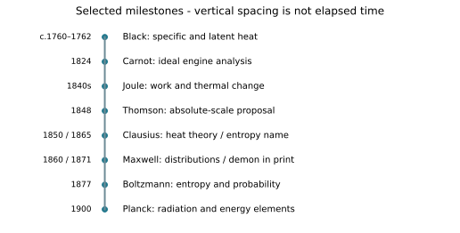

# U5-C05 - Historical Development and Scientific Connections

Unit 5 | All competition levels | public-student | Rule 5.c.v, printed B57

## Learning objectives
Place major developments in order; explain how experiments and theories corrected or extended earlier ideas; evaluate claims about priority and collaboration; connect all eight scientists to modern thermodynamics.

## Prerequisites and how to read this chapter
Units 1–4 introduced temperature, heat, work, phase changes, particles and energy conservation. This chapter explains how those ideas developed. Historical terminology can differ from modern terminology. All numerical data below are original teaching models, not reconstructed historical measurements. No quotation is attributed to a scientist unless explicitly identified as a quotation; this unit uses original paraphrases.

## A history of problems, not a parade of names
Learning history is more useful when each name answers a scientific question. What does a thermometer tell us? Why can ice melt without warming? Can mechanical motion produce a predictable thermal change? What limits an engine? Why do ordinary processes have a preferred direction? What does a gas’s temperature mean for its molecules? Why does hot matter emit the spectrum it does? The scientists in this unit addressed different parts of this connected set of problems.

The order of discovery is not identical to the order of a modern textbook. Carnot’s engine analysis appeared before Joule’s mature experimental program and before the modern first law was established. Black’s useful thermal distinctions preceded an energy-based explanation. Maxwell and Boltzmann developed statistical accounts after important macroscopic principles were already in place. Teaching the completed theory first helps us interpret the history, but it must not make the past look inevitable.

## Begin with measurements: Black to calorimetry
Black’s eighteenth-century work helped separate temperature from the energy associated with a thermal change. Melting and warming could not be understood by reading a thermometer alone. Specific heat and latent heat provided ways to compare the effects of energy transfers on different materials and phases. The problem was quantitative even before the modern language of joules and internal energy became standard.

This is a conceptual foundation for later calorimetry. If a scientist wants to compare mechanical input with a thermal effect, that thermal effect must be measured reliably. However, a conceptual foundation is not proof of a direct collaboration. Black died in 1799, before Joule was born in 1818. It would be historically false to stage a shared laboratory conversation between them. A classroom dialogue can be used only if clearly labeled fictional; this unit instead uses explanatory connections.

## Engines and the revision of an inherited model
Carnot’s 1824 engine theory pursued a limit, not merely a better component. A powerful feature of such reasoning is that an ideal comparison can constrain many real machines. Yet his published analysis retained caloric assumptions. Joule’s work-to-warming evidence contributed to a new account in which energy is conserved while heat and work are interchangeable transfer modes.

The later synthesis did not require throwing away every part of Carnot’s reasoning. Clausius and Thomson helped preserve the reversible-engine insight while correcting its energy interpretation. Clapeyron’s 1834 reformulation was one historical route by which Carnot’s work became better known. These relationships are supported in the historical sources. They show how an idea can be reformulated, circulated and corrected, rather than simply accepted or rejected as a whole.

## Absolute temperature connects measurement to theory
Thomson’s 1848 proposal belongs in this sequence, but it should not be treated as the final modern Kelvin definition. Temperature-scale development interacted with engine reasoning and the emerging dynamical theory of heat. Today the absolute scale allows consistent ideal-gas and engine-efficiency ratios. A formula written with T in Kelvin is not merely using a different label for Celsius; it is relying on an absolute zero.

Joule and Thomson also carried out documented gas investigations together. This is an actual collaborative relationship, unlike the looser claim that every paired name in this workbook represents a shared laboratory. When discussing influence, ask what evidence is available: a joint investigation, a published citation, a reformulation, or simply a useful connection made by a modern teacher. These are different kinds of statements and deserve different wording.

## Conservation and entropy answer complementary questions
By the middle nineteenth century, thermal theory increasingly distinguished energy accounting from process direction. Clausius’s development of entropy, named in 1865, provided a state quantity for the second-law discussion. A complete cycle returns the working substance to its original state, while its surroundings can change. This prevents a cyclic engine from being judged solely by one favorable stroke.

The first law and second law do not compete. An engine that creates energy fails the first. An energy-balanced cyclic engine that turns all heat from a single reservoir into work with no other effect fails the second. Similarly, saying a warm cup and cooler room exchange equal amounts of energy does not establish which direction is natural. A history answer becomes stronger when it explains this conceptual need instead of merely listing “Clausius: entropy.”

## From molecules to probabilities
Maxwell’s 1860 gas-distribution work replaced a single typical molecular speed with a population description. Boltzmann’s statistical reasoning connected accessible microscopic possibilities to entropy, notably in 1877. The macroscopic laws remained useful; statistics offered a route to explaining why large collections behave so reliably. That bridge is central to modern thermal physics.

Do not confuse a later named formula with a single isolated moment of invention. The name Maxwell–Boltzmann recognizes connected contributions to a developing subject. Clausius supplied an important macroscopic entropy framework; Boltzmann supplied a statistical interpretation. The modern constant named for Boltzmann also appears in temperature measurement and radiation theory. Naming conventions compress a complicated history and should be expanded when attribution matters.

## Radiation takes the story beyond classical physics
Planck’s 1900 radiation work drew on thermodynamic and statistical ideas while introducing energy elements into the explanation of a measured spectrum. It was not a discovery that hot objects radiate; that was already known. The achievement concerned the quantitative form and physical account of the radiation distribution. The later photon interpretation and full quantum mechanics involved additional scientists and developments.

This sequence shows both continuity and correction. Energy conservation remained essential. Entropy and statistics remained useful. But a classical description of all microscopic energy exchange was not enough for the radiation problem. New evidence constrained the model, and new concepts were developed. In modern science, a theory can be extremely successful within a domain without being the final explanation at every scale.

## How to read and verify a timeline
A timeline entry needs an event as well as a date. A birth date, lecture date, publication date and award date cannot be substituted for one another. Black’s 1762 presentation and 1803 posthumous lectures are different events. Planck’s 1900 work and 1918 Nobel Prize are different events. Maxwell’s distribution papers and demon thought experiment are different contributions even though both involve molecules.

Dates should be precise only when the evidence supports that precision. The 1840s is appropriate for Joule’s broad experimental program; attaching one year to every experiment would falsely compress a series. A museum’s later apparatus can illustrate an earlier method, but its catalog date should remain visible. A historian’s retrospective summary is useful, while a primary source helps reveal the language and assumptions of the period. Neither should be copied without context.

## Use the connected history in competition reasoning
An unfamiliar question may describe evidence rather than name a scientist. Start by identifying the physical issue. A melting plateau points toward latent heat and Black. A work input producing controlled warming points toward Joule. A reversible upper limit points toward Carnot and its later thermodynamic interpretation. Entropy’s naming points toward Clausius; its statistical interpretation toward Boltzmann. A molecular speed distribution points toward Maxwell. Absolute-temperature development points toward Kelvin. Discrete energy elements in a radiation explanation point toward Planck.

Some prompts correctly require more than one name. Explain the separate roles rather than forcing a single answer. A calorimetric test of an engine links thermal measurement, energy conservation and efficiency limits. A radiation problem can connect Planck’s energy elements with statistical reasoning. These are connections among tools, not evidence that all eight scientists worked as one team.

## The continuing importance of these questions
Thermodynamics informs heat pumps, engines, materials, atmospheric processes, electronics and measurement standards. The history matters because it teaches how to test explanations: define the system, measure the relevant quantities, state assumptions, compare competing predictions and track what a result actually establishes. In the later device unit, a temperature gain will likewise be evidence about a particular experiment, not proof that every proposed model of the device is correct.

## Visual model

A dated timeline runs from Black’s eighteenth-century work through Planck’s 1900 breakthrough. The date labels identify distinct developments; spacing is not proportional to elapsed time.

## Important terminology
Chronology: ordering by time. Primary source: evidence from the period or investigator. Historical interpretation: later analysis of that evidence. Refinement: improved version of an idea. Conceptual connection: relationship between ideas, not automatically personal contact. Attribution: assigning credit accurately and with appropriate limits.

## Worked example: Separate a discovery from its award

**Given:** Planck’s radiation breakthrough: 1900; Nobel Prize: 1918.

**Find:** Elapsed calendar years.

**Formula:** Interval=later year−earlier year.

**Substitution:** 1918−1900.

**Calculation:** 18.

**Final answer:** 18 years.

**Physical interpretation:** A later award recognizes earlier work; the dates label different events.

## Worked example: Apply two laws to one historical-style claim

**Given:** Engine: Q_H=1000 J, W=600 J, Q_C=400 J; T_H=500 K, T_C=300 K.

**Find:** Whether the ledger and ideal limit both pass.

**Formula:** Q_H=W+Q_C; η=W/Q_H; η_max=1−T_C/T_H.

**Substitution:** 600+400=1000; η=600/1000; η_max=1−300/500.

**Calculation:** Ledger balances; η=0.60; η_max=0.40.

**Final answer:** Conserves energy but exceeds the 40% bound.

**Physical interpretation:** Joule-associated conservation is necessary; Carnot/Clausius-associated limits add a separate restriction.

## Common historical and scientific confusions
A modern equation beside a scientist’s name does not prove that person wrote it in today’s form. A discovery date is not a birthday or prize date. Being influential does not mean working alone. A conceptual arrow does not prove a meeting. An earlier model can contain a useful observation and an incorrect explanation at the same time.

## Application and safe investigation
Use the separate timeline and comparison chart to build an evidence board: each claim gets a date, contribution and source ID. Ask students to correct an intentionally misleading museum caption. Keep all classroom data labeled illustrative and all invented scenarios labeled hypothetical. This practice prepares students to explain unfamiliar evidence rather than memorize a fixed list.

## Comparing all eight contributions
| Scientist | Contribution | Why it matters |
| --- | --- | --- |
| Joseph Black | Specific heat; latent heat | Separated temperature from thermal quantity; foundation for calorimetry. |
| Sadi Carnot | Ideal reversible engine reasoning | Established roots of a general performance limit; original caloric framework later revised. |
| James Prescott Joule | Mechanical equivalent of heat | Quantitative experimental support for energy conversion and conservation. |
| Rudolf Clausius | Second-law development; entropy | Added direction and irreversibility to energy accounting. |
| William Thomson / Lord Kelvin | Absolute temperature; thermodynamic theory | Developed a general temperature framework; original proposal later refined. |
| James Clerk Maxwell | Molecular velocity distribution; demon | Connected particle populations with bulk properties; examined second-law assumptions. |
| Ludwig Boltzmann | Statistical interpretation of entropy | Explained thermal regularities through microscopic possibilities. |
| Max Planck | Radiation law; energy quanta | Opened quantum theory through the thermal-radiation problem. |

## Chapter summary
Thermodynamics developed through measurements, idealizations, disagreements and revisions. Black’s thermal distinctions, Carnot’s limits, Joule’s equivalence, Kelvin’s scale, Clausius’s entropy, Maxwell’s distributions, Boltzmann’s statistics and Planck’s quanta address connected but distinct problems. Accurate history explains both the contribution and its limits.

## Chapter review
1. Why does Carnot appearing before Joule complicate a simple textbook-order timeline?
2. What evidence distinguishes a collaboration from a teaching connection?
3. How can a model be corrected while part of its reasoning survives?

## Practice
[WS33](../worksheets/WS33.md) includes eight questions from recognition to evidence-based reasoning.

## Mastery checklist
- [ ] I can place the main developments in order and label what each date means.
- [ ] I can explain all eight contributions with their physical significance.
- [ ] I can identify and correct unsupported collaboration and sole-discoverer claims.

## Historical evidence
H01–H14 support the chronology and named contributions; the separate source guide maps specific claims to references. Modern worked examples are original illustrations, not historical records.

Full bibliographic details, links and attribution limits: [Unit 5 source guide](../references/U5-sources.md).
