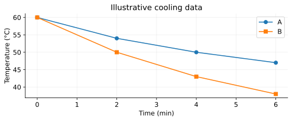

# T02 - Heat Transfer and Thermal Calculations

REGIONAL WEBSITE RELEASE 1.0 | public-student

Name/team: ____________________  Date: ______________

24 questions | 60 points

## Instructions
Use metric units and show reasoning. Suggested practice time: 45–55 minutes. These are instructional practice timings, not official event allocations. The full official event includes device testing. Use 273.15 for Celsius-to-Kelvin conversion and supplied constants. Q is positive into the system; W is positive by it; ΔU=Q−W. Closed-system energy calculations neglect bulk kinetic/potential changes unless stated. No calculus, trigonometry, logarithms or State/National-only radiation/third-law calculations are required. All datasets are original illustrative models.

Tests 1–3 are focused practice and are not full official written-test simulations. Test 4 covers all five Regional written categories; device items use supplied foundational models and do not require deferred Unit 7.

## T02-F1 - Cooling curves
Recorded-style teaching data for two samples cooling toward a room colder than both. No historical or official device measurements are claimed.

| Time (min) | A (°C) | B (°C) |
| --- | --- | --- |
| 0 | 60 | 60 |
| 2 | 54 | 50 |
| 4 | 50 | 43 |
| 6 | 47 | 38 |

## T02-D2 - Steady slab data
Same material, cross-sectional area and face temperature difference for each row; steady one-dimensional model.

| Thickness (m) | Transfer rate (W) |
| --- | --- |
| 0.01 | 36 |
| 0.02 | 18 |
| 0.04 | 9 |

## T02-Q01 (2 points)
A metal spoon handle warms when its other end rests in warmer water. What mechanism carries energy along the stationary spoon? Choose and explain.

A. Natural convection

B. Conduction

C. Evaporation only

D. Work by a piston

____________________________________________

____________________________________________

____________________________________________

____________________________________________

## T02-Q02 (2 points)
Which example is forced convection? Choose and explain.

A. Energy through a solid rod

B. Radiation through vacuum

C. Fan-driven airflow

D. Buoyant warm air rising without a fan

____________________________________________

____________________________________________

____________________________________________

____________________________________________

## T02-Q03 (2 points)
A warmer object transfers energy to a cooler object across a vacuum gap. Which mechanism can do this? Choose and explain.

A. Radiation

B. Convection

C. Conduction through air

D. Liquid circulation

____________________________________________

____________________________________________

____________________________________________

____________________________________________

## T02-Q04 (2 points)
Which unit belongs to thermal conductivity k? Choose and explain the quantity it describes.

A. J

B. J/K

C. J/(kg·K)

D. W/(m·K)

____________________________________________

____________________________________________

____________________________________________

____________________________________________

## T02-Q05 (2 points)
A body has heat capacity 360 J/K. Neglect losses and work. How much heat raises its temperature by 4.5 K?

____________________________________________

____________________________________________

____________________________________________

____________________________________________

## T02-Q06 (2 points)
A 0.300 kg sample has c=750 J/(kg·K). Calculate its heat capacity.

____________________________________________

____________________________________________

____________________________________________

____________________________________________

## T02-Q07 (2 points)
Explain why natural convection can occur in a liquid but does not describe energy transfer through a solid block that remains fixed in shape.

____________________________________________

____________________________________________

____________________________________________

____________________________________________

## T02-Q08 (2 points)
A polished metal surface reflects much of the incident thermal radiation in a specified wavelength range. Does this mean it creates energy? Explain the energy accounting for an opaque surface.

____________________________________________

____________________________________________

____________________________________________

____________________________________________

## T02-Q09 (2 points)
Use the T02 cooling graph. Which sample cools more rapidly during the first 2 minutes, and what are the two average temperature-change rates?

____________________________________________

____________________________________________

____________________________________________

____________________________________________

## T02-Q10 (2 points)
Equal masses of two materials receive equal net energy without a phase change. Sample X warms less than Y. Which has the larger specific heat, and why?

____________________________________________

____________________________________________

____________________________________________

____________________________________________

## T02-Q11 (2 points)
Name the dominant transfer mechanism for each described segment: a lamp sends energy across air to a plate; energy moves through the solid plate; heated water circulates above the plate.

____________________________________________

____________________________________________

____________________________________________

____________________________________________

## T02-Q12 (2 points)
A 15 W heater operates for 80 s. What energy does it supply? State why 15 W is not an energy amount.

____________________________________________

____________________________________________

____________________________________________

____________________________________________

## T02-Q13 (3 points)
A plane slab has k=0.060 W/(m·K), A=0.50 m², thickness L=0.030 m and a steady temperature difference of 18 K. Use P=kAΔT/L to find its conductive transfer rate.

____________________________________________

____________________________________________

____________________________________________

____________________________________________

____________________________________________

____________________________________________

## T02-Q14 (3 points)
For the slab in Q13, find energy transferred in 5.0 minutes if the rate remains constant. If thickness doubles with all other model quantities unchanged, what is the new rate?

____________________________________________

____________________________________________

____________________________________________

____________________________________________

____________________________________________

____________________________________________

## T02-Q15 (3 points)
A 0.180 kg sample of water warms from 21.0 °C to 29.0 °C. With c=4200 J/(kg·K), find its thermal energy gain in the negligible-work model.

____________________________________________

____________________________________________

____________________________________________

____________________________________________

____________________________________________

____________________________________________

## T02-Q16 (3 points)
A body absorbs 2340 J and warms by 13.0 K. Its mass is 0.400 kg. Neglect losses and phase changes. Find c and state its unit.

____________________________________________

____________________________________________

____________________________________________

____________________________________________

____________________________________________

____________________________________________

## T02-Q17 (3 points)
A small water sample and its cup have heat capacities 420 J/K and 60 J/K respectively. They warm together by 7.0 K. Neglect losses. Find their total energy gain and the error from counting water alone.

____________________________________________

____________________________________________

____________________________________________

____________________________________________

____________________________________________

____________________________________________

## T02-Q18 (3 points)
Explain how trapped air can help an insulating layer, and why a large open air space that circulates freely may perform differently.

____________________________________________

____________________________________________

____________________________________________

____________________________________________

____________________________________________

____________________________________________

## T02-Q19 (3 points)
Two surfaces have equal geometry and temperature and receive identical incident radiation. In the relevant spectral range A absorbs a larger fraction than B. Can you conclude A always reaches a higher final temperature in every setup? Explain.

____________________________________________

____________________________________________

____________________________________________

____________________________________________

____________________________________________

____________________________________________

## T02-Q20 (3 points)
In the T02 graph, sample A has mass 0.100 kg and c=4200 J/(kg·K). Find the magnitude of its energy loss over the first 4 minutes and its average outward power. Neglect evaporation and cup energy.

____________________________________________

____________________________________________

____________________________________________

____________________________________________

____________________________________________

____________________________________________

## T02-Q21 (3 points)
A team compares two insulating covers, but changes water mass, initial temperature and airflow at the same time. Identify two controls and explain why the comparison cannot isolate the cover’s effect.

____________________________________________

____________________________________________

____________________________________________

____________________________________________

____________________________________________

____________________________________________

## T02-Q22 (3 points)
A warm body loses 7 W by convection and 5 W by radiation while receiving 20 W from a heater. Other transfers are negligible and rates are constant for 90 s. Find its net energy gain.

____________________________________________

____________________________________________

____________________________________________

____________________________________________

____________________________________________

____________________________________________

## T02-Q23 (3 points)
In two steady slab tests, area and temperature difference are fixed. The T02 table lists thickness 0.010, 0.020 and 0.040 m with powers 36, 18 and 9 W. Does P×L stay constant? Predict the power at 0.030 m under this model and state one assumption.

____________________________________________

____________________________________________

____________________________________________

____________________________________________

____________________________________________

____________________________________________

## T02-Q24 (3 points)
A student says, “The material with the greatest specific heat must also conduct fastest.” Explain why the claim does not follow, including the units of both quantities and the different experiments needed.

____________________________________________

____________________________________________

____________________________________________

____________________________________________

____________________________________________

____________________________________________
