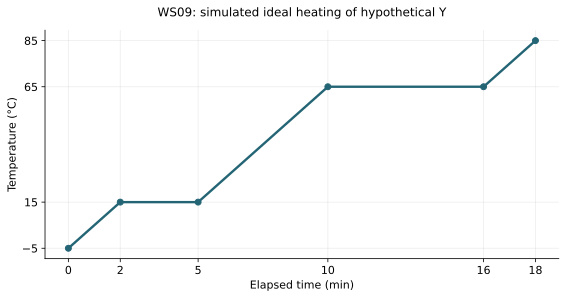

# WS09 - Heating and cooling curves

Name: ____________________   Date: ____________________

Unit 2 | All levels | public-student

Objectives: Read axes, slopes and plateaus; distinguish temperature change from phase change; calculate interval energy from stated net power without calculus.

Difficulty: Beginner through application; final question is a challenge

Suggested duration: 20–25 minutes | Total: 20 points

Show the equation, substitution, arithmetic and units for numerical answers. Explain physical meaning. Use given constants. Retain intermediate digits and round final answers as requested; for unspecified precision, accept sensible rounding. Graphs and data are simulated educational models.

## Reference data
Hypothetical Y, pure substance at constant pressure; ideal equilibrium transitions and straight segments. The sample is solid at the start. Net power into the sample is a constant 80 W. These are simulated teaching data, not a real experiment.

| time_min | temperature_C |
| --- | --- |
| 0 | -5 |
| 2 | 15 |
| 5 | 15 |
| 10 | 65 |
| 16 | 65 |
| 18 | 85 |

## WS09-Q01 (2 points)
Use the WS09 reference graph for hypothetical Y. Identify both axes and their units.

____________________________________________________________
____________________________________________________________
____________________________________________________________
____________________________________________________________

## WS09-Q02 (2 points)
What are the melting and boiling temperatures in the stated Y model?

____________________________________________________________
____________________________________________________________
____________________________________________________________
____________________________________________________________

## WS09-Q03 (2 points)
At t=4 min, name the coexisting phases and state whether heat can still enter.

____________________________________________________________
____________________________________________________________
____________________________________________________________
____________________________________________________________

## WS09-Q04 (2 points)
Which interval shows warming of liquid only: 0–2, 2–5, 5–10, 10–16, or 16–18 min? Explain.

____________________________________________________________
____________________________________________________________
____________________________________________________________
____________________________________________________________

## WS09-Q05 (3 points)
Find the average temperature-change rate from t=5 min to t=10 min, including units.

____________________________________________________________
____________________________________________________________
____________________________________________________________
____________________________________________________________
____________________________________________________________
____________________________________________________________

## WS09-Q06 (3 points)
The constant net input is 80 W. Find the energy received during the boiling plateau from 10 to 16 min.

____________________________________________________________
____________________________________________________________
____________________________________________________________
____________________________________________________________
____________________________________________________________
____________________________________________________________

## WS09-Q07 (3 points)
Sketch an ideal cooling curve for the same pure Y at the same pressure, beginning with gas at 85 °C and ending with solid at −5 °C. Label both plateau temperatures and their transitions; exact time lengths are not specified.

____________________________________________________________
____________________________________________________________
____________________________________________________________
____________________________________________________________
____________________________________________________________
____________________________________________________________

## WS09-Q08 (3 points)
Challenge: During the melting plateau, net power stays constant and all input drives melting. What fraction of the sample has melted at 3 min 30 s? Assume all solid at 2 min and all liquid at 5 min. Explain why using temperature alone cannot find this fraction.

____________________________________________________________
____________________________________________________________
____________________________________________________________
____________________________________________________________
____________________________________________________________
____________________________________________________________
