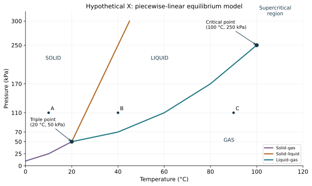

# WS12 - Reading phase diagrams

Name: ____________________   Date: ____________________

Unit 2 | All levels | public-student

Objectives: Identify phase regions and coexistence boundaries; follow constant-pressure and constant-temperature paths; distinguish triple and critical points from an ordinary boiling point.

Difficulty: Beginner through application; final question is a challenge

Suggested duration: 25–30 minutes | Total: 20 points

Show the equation, substitution, arithmetic and units for numerical answers. Explain physical meaning. Use given constants. Retain intermediate digits and round final answers as requested; for unspecified precision, accept sensible rounding. Graphs and data are simulated educational models.

## Reference data
Hypothetical X equilibrium phase diagram; model data, not a measured material. Connect consecutive points on each named boundary by straight segments. Solid-liquid line: P=10T−150 over 20≤T≤45, with kPa and °C. Point A=(10 °C,110 kPa); B=(40 °C,110 kPa); C=(90 °C,110 kPa).

| boundary | temperature_C | pressure_kPa |
| --- | --- | --- |
| solid–gas | 0 | 10 |
| solid–gas | 10 | 25 |
| solid–gas | 20 | 50 |
| solid–liquid | 20 | 50 |
| solid–liquid | 45 | 300 |
| liquid–gas | 20 | 50 |
| liquid–gas | 40 | 70 |
| liquid–gas | 60 | 110 |
| liquid–gas | 80 | 170 |
| liquid–gas | 100 | 250 |

## WS12-Q01 (2 points)
In the X phase diagram, identify the horizontal and vertical quantities with units.

____________________________________________________________
____________________________________________________________
____________________________________________________________
____________________________________________________________

## WS12-Q02 (2 points)
Name the stable phase at A=(10 °C,110 kPa) and at C=(90 °C,110 kPa).

____________________________________________________________
____________________________________________________________
____________________________________________________________
____________________________________________________________

## WS12-Q03 (2 points)
Give the triple-point coordinates and name the phases that can coexist there.

____________________________________________________________
____________________________________________________________
____________________________________________________________
____________________________________________________________

## WS12-Q04 (2 points)
What is the critical-point coordinate, and which coexistence boundary ends there?

____________________________________________________________
____________________________________________________________
____________________________________________________________
____________________________________________________________

## WS12-Q05 (3 points)
At 70 kPa, use the stated solid-liquid line P=10T−150 to find the melting temperature. The table gives boiling at 40 °C at this pressure. Find the width of the liquid-only temperature interval.

____________________________________________________________
____________________________________________________________
____________________________________________________________
____________________________________________________________
____________________________________________________________
____________________________________________________________

## WS12-Q06 (3 points)
At T=80 °C, pressure increases slowly from 100 to 200 kPa. Use the boundary table to name the transition and the pressure at which coexistence is crossed.

____________________________________________________________
____________________________________________________________
____________________________________________________________
____________________________________________________________
____________________________________________________________
____________________________________________________________

## WS12-Q07 (3 points)
A point lies on the liquid-gas boundary at (40 °C,70 kPa). Can you conclude that exactly half the mass is liquid? Explain what is known and what extra information would be needed.

____________________________________________________________
____________________________________________________________
____________________________________________________________
____________________________________________________________
____________________________________________________________
____________________________________________________________

## WS12-Q08 (3 points)
Challenge: At 25 kPa, heat X from 0 °C to 30 °C. Use the solid-gas boundary point (10 °C,25 kPa). Identify the transition and explain why no stable liquid interval is crossed.

____________________________________________________________
____________________________________________________________
____________________________________________________________
____________________________________________________________
____________________________________________________________
____________________________________________________________
