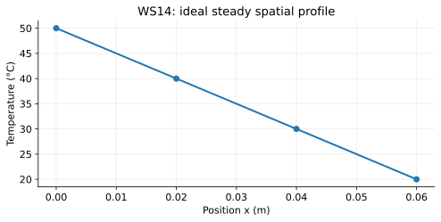

# WS14 - Conduction

Name: ____________________   Date: ____________________

Unit 3 | All levels | public-student

Objectives: Explain conduction microscopically; identify its direction; interpret a temperature profile; calculate a gradient and energy from a constant rate.

Difficulty: Beginner through application; final question is a challenge

Suggested duration: 25–30 minutes | Total: 20 points

Show the equation, substitution, arithmetic and units for numerical answers. Explain physical meaning. Use given constants. Retain intermediate digits and round final answers as requested; for unspecified precision, accept sensible rounding. Graphs and data are simulated educational models.

## Reference data
Ideal, uniform, steady one-dimensional profile. Position is measured from the warmer face. These are model values, not time readings.

| position_m | temperature_C |
| --- | --- |
| 0 | 50 |
| 0.02 | 40 |
| 0.04 | 30 |
| 0.06 | 20 |

## WS14-Q01 (2 points)
A solid rod warms at one end. Explain how energy can reach the other end without the atoms flowing along the rod.

____________________________________________________________
____________________________________________________________
____________________________________________________________
____________________________________________________________

## WS14-Q02 (2 points)
A rod has faces at 45 °C and 25 °C. In which direction is net conduction? What happens to the net conducting transfer if the entire rod reaches 25 °C?

____________________________________________________________
____________________________________________________________
____________________________________________________________
____________________________________________________________

## WS14-Q03 (2 points)
Which statement is correct? A. Only solids conduct. B. Still fluids can conduct. C. Conduction requires bulk circulation. Explain.

____________________________________________________________
____________________________________________________________
____________________________________________________________
____________________________________________________________

## WS14-Q04 (2 points)
A constant conducting rate is 4.0 W. State what this means in joules and seconds, then calculate the energy transferred in 30 s.

____________________________________________________________
____________________________________________________________
____________________________________________________________
____________________________________________________________

## WS14-Q05 (3 points)
The WS 14 reference profile is steady. Calculate its gradient magnitude in K/m and identify the direction of net conduction.

____________________________________________________________
____________________________________________________________
____________________________________________________________
____________________________________________________________
____________________________________________________________
____________________________________________________________

## WS14-Q06 (3 points)
A conducting path transfers 2.5 W for 2.0 min and then 1.5 W for 1.0 min. Calculate total energy.

____________________________________________________________
____________________________________________________________
____________________________________________________________
____________________________________________________________
____________________________________________________________
____________________________________________________________

## WS14-Q07 (3 points)
Two dry room-temperature blocks, metal and wood, have the same measured temperature. The metal feels colder. Explain and name a reason touch is a poor thermometer.

____________________________________________________________
____________________________________________________________
____________________________________________________________
____________________________________________________________
____________________________________________________________
____________________________________________________________

## WS14-Q08 (3 points)
Challenge: A student compares equal-area slabs of the same material, one 5 mm thick and one 10 mm thick, with identical fixed face-temperature differences. Predict the ideal rate ratio, then explain why a real contact gap could spoil this comparison.

____________________________________________________________
____________________________________________________________
____________________________________________________________
____________________________________________________________
____________________________________________________________
____________________________________________________________
