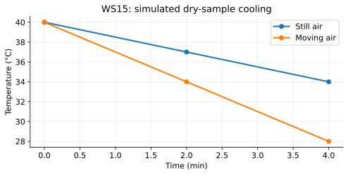

# WS15 - Convection

Name: ____________________   Date: ____________________

Unit 3 | All levels | public-student

Objectives: Explain buoyancy-driven circulation and forced circulation; distinguish flow from molecular conduction; analyze rates, density and cooling data.

Difficulty: Beginner through application; final question is a challenge

Suggested duration: 25–30 minutes | Total: 20 points

Show the equation, substitution, arithmetic and units for numerical answers. Explain physical meaning. Use given constants. Retain intermediate digits and round final answers as requested; for unspecified precision, accept sensible rounding. Graphs and data are simulated educational models.

## Reference data
Simulated equal-capacity dry samples, identical starts and room conditions. Only imposed airflow differs in this ideal comparison.

| time_min | still_air_C | moving_air_C |
| --- | --- | --- |
| 0 | 40 | 40 |
| 2 | 37 | 34 |
| 4 | 34 | 28 |

## WS15-Q01 (2 points)
Define a fluid and explain why a rigid solid cannot transfer energy by bulk convection within itself.

____________________________________________________________
____________________________________________________________
____________________________________________________________
____________________________________________________________

## WS15-Q02 (2 points)
Ordinary air well above freezing warms and expands at nearly constant pressure with no mass change. Explain the density change and its possible buoyant motion.

____________________________________________________________
____________________________________________________________
____________________________________________________________
____________________________________________________________

## WS15-Q03 (2 points)
Classify (a) a pump circulating radiator water and (b) air rising above a warm radiator without a fan.

____________________________________________________________
____________________________________________________________
____________________________________________________________
____________________________________________________________

## WS15-Q04 (2 points)
A sealed flexible model parcel contains 2.0 g of air in 2.5 L. Calculate density.

____________________________________________________________
____________________________________________________________
____________________________________________________________
____________________________________________________________

## WS15-Q05 (3 points)
Sketch a plausible natural-convection loop for water heated gently from below and cooled near the top. Label warmer/less-dense and cooler/denser regions. Assume water stays above 10 °C.

____________________________________________________________
____________________________________________________________
____________________________________________________________
____________________________________________________________
____________________________________________________________
____________________________________________________________

## WS15-Q06 (3 points)
Use the WS 15 cooling data. Calculate the average 0–4 min slopes for still air and moving air. Which has larger cooling magnitude?

____________________________________________________________
____________________________________________________________
____________________________________________________________
____________________________________________________________
____________________________________________________________
____________________________________________________________

## WS15-Q07 (3 points)
A fan moves 45 °C dry air over a dry object at 25 °C. Predict the direction of convective transfer and explain why “fans always cool” fails.

____________________________________________________________
____________________________________________________________
____________________________________________________________
____________________________________________________________
____________________________________________________________
____________________________________________________________

## WS15-Q08 (3 points)
Challenge: Two equal water samples begin at 30 °C. One is heated from below and one from above. Explain which arrangement more readily produces natural overturning. Name two controls needed to compare it fairly.

____________________________________________________________
____________________________________________________________
____________________________________________________________
____________________________________________________________
____________________________________________________________
____________________________________________________________
