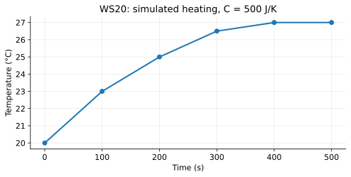

# WS20 - Combined Heat Transfer and Experimental Reasoning

Name: ____________________   Date: ____________________

Unit 3 | All levels | public-student

Objectives: Combine energy paths with heat capacity; read interval slopes; evaluate controls, uncertainty and device-model limits; justify competition-style predictions.

Difficulty: Beginner through application; final question is a challenge

Suggested duration: 25–30 minutes | Total: 20 points

Show the equation, substitution, arithmetic and units for numerical answers. Explain physical meaning. Use given constants. Retain intermediate digits and round final answers as requested; for unspecified precision, accept sensible rounding. Graphs and data are simulated educational models.

## Reference data
Simulated common-temperature cup-and-water system with C=500 J/K, no phase change and negligible work. Absorbed input stays20 W. Use interval averages; these are not actual device measurements.

| time_s | temperature_C |
| --- | --- |
| 0 | 20 |
| 100 | 23 |
| 200 | 25 |
| 300 | 26.5 |
| 400 | 27 |
| 500 | 27 |

## WS20-Q01 (2 points)
A cup-and-water system has absorbed input 10 W and total separate losses 6 W. State net power and whether its temperature rises in a no-phase-change, negligible-work model.

____________________________________________________________
____________________________________________________________
____________________________________________________________
____________________________________________________________

## WS20-Q02 (2 points)
Why is a lamp’s electrical wattage insufficient to calculate the water temperature rise? Name two missing quantities or processes.

____________________________________________________________
____________________________________________________________
____________________________________________________________
____________________________________________________________

## WS20-Q03 (2 points)
A model water-and-cup system has capacity 500 J/K and receives net 2000 J. Find ΔT and final temperature from 21 °C.

____________________________________________________________
____________________________________________________________
____________________________________________________________
____________________________________________________________

## WS20-Q04 (2 points)
Name two controls for comparing surface treatments using water temperature gain, and explain why final temperature alone can be misleading.

____________________________________________________________
____________________________________________________________
____________________________________________________________
____________________________________________________________

## WS20-Q05 (3 points)
100 g water (c=4.18 J/(g·°C)) and a cup(C=32 J/K) share a temperature. Absorbed input is 14 W; separate losses are 3 W and 2 W. Constant rates act for 250 s from 20 °C. Find final temperature.

____________________________________________________________
____________________________________________________________
____________________________________________________________
____________________________________________________________
____________________________________________________________
____________________________________________________________

## WS20-Q06 (3 points)
Use the WS 20 simulated curve for C=500 J/K. Calculate average net powers for 0–100 s and 100–200 s. If absorbed input stays 20 W, infer average total losses in each interval.

____________________________________________________________
____________________________________________________________
____________________________________________________________
____________________________________________________________
____________________________________________________________
____________________________________________________________

## WS20-Q07 (3 points)
Trials A and B show gains 3.0 °C and 3.2 °C. Each initial and final reading has a stated possible error±.1 °C. Give worst-case gain ranges and assess whether the bounds prove B is better.

____________________________________________________________
____________________________________________________________
____________________________________________________________
____________________________________________________________
____________________________________________________________
____________________________________________________________

## WS20-Q08 (3 points)
Challenge: The WS 20 system levels at 27 °C from 400–500 s while still absorbing 20 W. Explain its net power and loss rate. Why is a prediction made by extending the first 100 s slope to 500 s unjustified?

____________________________________________________________
____________________________________________________________
____________________________________________________________
____________________________________________________________
____________________________________________________________
____________________________________________________________
