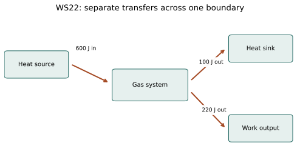

# WS22 - First Law of Thermodynamics

Name: ____________________   Date: ____________________

Unit 4 | All levels | public-student

Objectives: Apply ΔU=Q−W consistently; solve for any one unknown; translate work-on language; compare processes with the same endpoints and identify model limits.

Difficulty: Beginner through application; final question is a challenge

Suggested duration: 25–30 minutes | Total: 20 points

Use ΔU=Q−W: Q positive into the system and W positive by the system. Show the equation, signed substitution, arithmetic and units for numerical answers. Explain physical meaning. Use given constants. Retain intermediate digits and round final answers as requested; for unspecified precision, accept sensible rounding. Graphs and data are simulated educational models.

## Reference data
All arrows cross the boundary of one closed gas system. Whole-system motion and height changes are negligible. The heat arrows are separate transfers, not already net quantities.

| transfer | energy_J | direction |
| --- | --- | --- |
| heat | 600 | in |
| heat | 100 | out |
| work | 220 | out |

## WS22-Q01 (2 points)
State the Unit 4 first law and define both transfer signs.

____________________________________________________________
____________________________________________________________
____________________________________________________________
____________________________________________________________

## WS22-Q02 (2 points)
A gas receives 90 J of heat and does 30 J of work. Find ΔU.

____________________________________________________________
____________________________________________________________
____________________________________________________________
____________________________________________________________

## WS22-Q03 (2 points)
A source says 40 J of work is done ON the gas. What value belongs in W in ΔU=Q−W?

____________________________________________________________
____________________________________________________________
____________________________________________________________
____________________________________________________________

## WS22-Q04 (2 points)
True or false: If ΔU=0, both Q and W must be zero. Give a numerical counterexample or justification.

____________________________________________________________
____________________________________________________________
____________________________________________________________
____________________________________________________________

## WS22-Q05 (3 points)
A closed gas releases 120 J as heat while surroundings do 200 J of work on it. Calculate ΔU and explain the direction of its change.

____________________________________________________________
____________________________________________________________
____________________________________________________________
____________________________________________________________
____________________________________________________________
____________________________________________________________

## WS22-Q06 (3 points)
A process has ΔU=−150 J and W=+250 J. Find Q and explain how heat input can accompany decreasing U.

____________________________________________________________
____________________________________________________________
____________________________________________________________
____________________________________________________________
____________________________________________________________
____________________________________________________________

## WS22-Q07 (3 points)
Use the WS 22 energy ledger: 600 J heat enters, 100 J heat leaves and 220 J work leaves the gas. Calculate net Q and ΔU.

____________________________________________________________
____________________________________________________________
____________________________________________________________
____________________________________________________________
____________________________________________________________
____________________________________________________________

## WS22-Q08 (3 points)
Challenge: Routes A and B connect exactly the same initial and final states of a closed gas. A has Q=400 J and W=150 J. B has W=−50 J. Find ΔU for each and Q for B; explain why the heats can differ.

____________________________________________________________
____________________________________________________________
____________________________________________________________
____________________________________________________________
____________________________________________________________
____________________________________________________________
