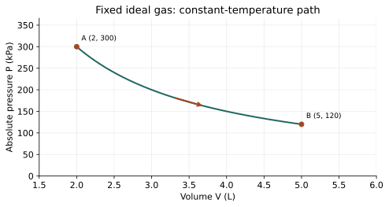

# WS23 - Isothermal Processes

Name: ____________________   Date: ____________________

Unit 4 | All levels | public-student

Objectives: Explain constant-temperature ideal-gas behavior; use Boyle’s law and Kelvin; interpret curved P–V paths; connect ΔU=0 to heat and work without calculating curved-path areas.

Difficulty: Beginner through application; final question is a challenge

Suggested duration: 25–30 minutes | Total: 20 points

Use ΔU=Q−W: Q positive into the system and W positive by the system. Show the equation, signed substitution, arithmetic and units for numerical answers. Explain physical meaning. Use given constants. Retain intermediate digits and round final answers as requested; for unspecified precision, accept sensible rounding. Graphs and data are simulated educational models.

## Reference data
Fixed amount of ideal gas on a slow, mechanically balanced isothermal expansion. The curve has PV=600 kPa·L. Do not calculate its curved-path work using a rectangle.

| state | volume_L | absolute_pressure_kPa |
| --- | --- | --- |
| A | 2 | 300 |
| B | 5 | 120 |

## WS23-Q01 (2 points)
Define isothermal. Does merely ending at the starting temperature prove that an entire process was isothermal?

____________________________________________________________
____________________________________________________________
____________________________________________________________
____________________________________________________________

## WS23-Q02 (2 points)
A fixed ideal gas doubles its volume isothermally. What happens to its absolute pressure?

____________________________________________________________
____________________________________________________________
____________________________________________________________
____________________________________________________________

## WS23-Q03 (2 points)
For fixed ideal gas undergoing isothermal expansion, choose the correct statement: A. Q=0 always. B. ΔU=0 and Q=W. Explain.

____________________________________________________________
____________________________________________________________
____________________________________________________________
____________________________________________________________

## WS23-Q04 (2 points)
Why should an isothermal melting process not automatically be assigned ΔU=0 using the ideal-gas rule?

____________________________________________________________
____________________________________________________________
____________________________________________________________
____________________________________________________________

## WS23-Q05 (3 points)
Fixed ideal gas starts at 300 kPa and 2.0 L. It expands isothermally to 5.0 L. Find final absolute pressure.

____________________________________________________________
____________________________________________________________
____________________________________________________________
____________________________________________________________
____________________________________________________________
____________________________________________________________

## WS23-Q06 (3 points)
A fixed ideal gas does 180 J of work during isothermal expansion. Find Q and ΔU.

____________________________________________________________
____________________________________________________________
____________________________________________________________
____________________________________________________________
____________________________________________________________
____________________________________________________________

## WS23-Q07 (3 points)
Use the WS 23 curve. Verify PV at A and B, then state why P_A(V_B−V_A) is not a valid work calculation for this curved path.

____________________________________________________________
____________________________________________________________
____________________________________________________________
____________________________________________________________
____________________________________________________________
____________________________________________________________

## WS23-Q08 (3 points)
Challenge: Surroundings do 110 J of work ON a fixed ideal gas compressed isothermally. A student writes Q=+110 J because “compression heats gas.” Correct the signs and explain how temperature remains fixed.

____________________________________________________________
____________________________________________________________
____________________________________________________________
____________________________________________________________
____________________________________________________________
____________________________________________________________
