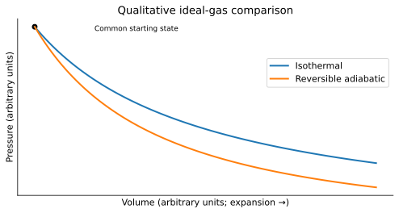

# WS24 - Adiabatic Processes

Name: ____________________   Date: ____________________

Unit 4 | All levels | public-student

Objectives: Explain Q=0; apply the first law to expansion and compression; distinguish insulation, speed and reversibility; interpret a conceptual adiabatic P–V curve.

Difficulty: Beginner through application; final question is a challenge

Suggested duration: 25–30 minutes | Total: 20 points

Use ΔU=Q−W: Q positive into the system and W positive by the system. Show the equation, signed substitution, arithmetic and units for numerical answers. Explain physical meaning. Use given constants. Retain intermediate digits and round final answers as requested; for unspecified precision, accept sensible rounding. Graphs and data are simulated educational models.

## Reference data
Conceptual comparison only: reversible ideal-gas expansion from the same state. Arbitrary-unit axes have no quantitative ticks. Use the relative curves, not invented numerical coordinates.

| path | temperature_condition |
| --- | --- |
| isothermal | constant T |
| reversible adiabatic | Q=0 with positive work output |

## WS24-Q01 (2 points)
Define adiabatic. Which quantity is constrained to zero?

____________________________________________________________
____________________________________________________________
____________________________________________________________
____________________________________________________________

## WS24-Q02 (2 points)
Adiabatic gas does 70 J of work. Calculate ΔU.

____________________________________________________________
____________________________________________________________
____________________________________________________________
____________________________________________________________

## WS24-Q03 (2 points)
Explain why rapid motion alone does not prove a process is exactly adiabatic.

____________________________________________________________
____________________________________________________________
____________________________________________________________
____________________________________________________________

## WS24-Q04 (2 points)
An insulated gas is compressed and 90 J of work is done on it. Give W_by and ΔU.

____________________________________________________________
____________________________________________________________
____________________________________________________________
____________________________________________________________

## WS24-Q05 (3 points)
Adiabatic ideal gas begins at 310 K with supplied C_U=10 J/K. It does 150 J of work. Find final temperature.

____________________________________________________________
____________________________________________________________
____________________________________________________________
____________________________________________________________
____________________________________________________________
____________________________________________________________

## WS24-Q06 (3 points)
Use the qualitative WS 24 graph. At the same enlarged volume, which path has lower pressure: reversible adiabatic or isothermal expansion from the same initial ideal-gas state? Explain.

____________________________________________________________
____________________________________________________________
____________________________________________________________
____________________________________________________________
____________________________________________________________
____________________________________________________________

## WS24-Q07 (3 points)
An insulated ideal gas expands into vacuum with no resisting load. Compare its endpoint ΔU and ΔT with those of an adiabatic expansion that does positive work.

____________________________________________________________
____________________________________________________________
____________________________________________________________
____________________________________________________________
____________________________________________________________
____________________________________________________________

## WS24-Q08 (3 points)
Challenge: A gas with C_U=8 J/K falls from 300 K to 280 K while doing 200 J of work. Is the process adiabatic? Calculate Q and justify.

____________________________________________________________
____________________________________________________________
____________________________________________________________
____________________________________________________________
____________________________________________________________
____________________________________________________________
