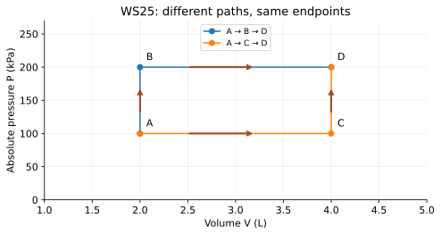

# WS25 - Isochoric and Isobaric Processes

Name: ____________________   Date: ____________________

Unit 4 | All levels | public-student

Objectives: Apply constant-volume and constant-pressure conditions; use Kelvin gas ratios; calculate work and first-law changes; compare four process types without confusing their constraints.

Difficulty: Beginner through application; final question is a challenge

Suggested duration: 25–30 minutes | Total: 20 points

Use ΔU=Q−W: Q positive into the system and W positive by the system. Show the equation, signed substitution, arithmetic and units for numerical answers. Explain physical meaning. Use given constants. Retain intermediate digits and round final answers as requested; for unspecified precision, accept sensible rounding. Graphs and data are simulated educational models.

## Reference data
Fixed gas, mechanically balanced paths, only PV work. A→B→D and A→C→D are two alternatives, not one closed cycle. Straight horizontal/vertical segments are exact model assumptions.

| state | volume_L | absolute_pressure_kPa |
| --- | --- | --- |
| A | 2 | 100 |
| B | 2 | 200 |
| C | 4 | 100 |
| D | 4 | 200 |

## WS25-Q01 (2 points)
Match isochoric and isobaric with (a) constant volume, (b) constant pressure. State which is a vertical line on a standard P–V graph.

____________________________________________________________
____________________________________________________________
____________________________________________________________
____________________________________________________________

## WS25-Q02 (2 points)
A fixed ideal gas at constant volume warms from 300 K to 330 K. If initial pressure is 100 kPa, find final pressure.

____________________________________________________________
____________________________________________________________
____________________________________________________________
____________________________________________________________

## WS25-Q03 (2 points)
A rigid gas container receives 60 J of heat; no other work occurs. Find pressure-volume work and ΔU.

____________________________________________________________
____________________________________________________________
____________________________________________________________
____________________________________________________________

## WS25-Q04 (2 points)
Why can a constant-pressure warming ideal gas require more heat than its increase in internal energy?

____________________________________________________________
____________________________________________________________
____________________________________________________________
____________________________________________________________

## WS25-Q05 (3 points)
Fixed ideal gas at constant pressure has V_i=3.0 L at 27.0 °C. It warms to 87.0 °C. Find V_f using 273.15 for the Celsius-to-Kelvin offset.

____________________________________________________________
____________________________________________________________
____________________________________________________________
____________________________________________________________
____________________________________________________________
____________________________________________________________

## WS25-Q06 (3 points)
Balanced isobaric expansion at 120 kPa takes gas from 2.0 to 4.5 L. If ΔU=180 J and only PV work occurs, find W and Q.

____________________________________________________________
____________________________________________________________
____________________________________________________________
____________________________________________________________
____________________________________________________________
____________________________________________________________

## WS25-Q07 (3 points)
Use the WS 25 paths. For A→B→D, calculate work on the vertical stage and horizontal stage. Compare total work with A→C→D.

____________________________________________________________
____________________________________________________________
____________________________________________________________
____________________________________________________________
____________________________________________________________
____________________________________________________________

## WS25-Q08 (3 points)
Challenge: A student says “the gas is insulated, so pressure is constant and no work occurs.” Identify each error and state what insulation actually permits you to conclude.

____________________________________________________________
____________________________________________________________
____________________________________________________________
____________________________________________________________
____________________________________________________________
____________________________________________________________
