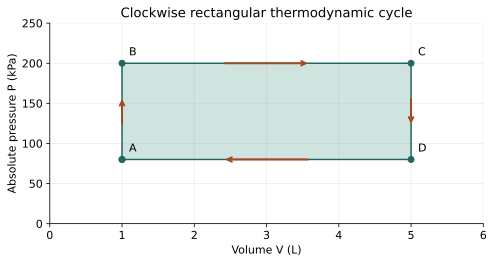

# WS26 - Thermodynamic Cycles

Name: ____________________   Date: ____________________

Unit 4 | All levels | public-student

Objectives: Explain return to the initial state; calculate rectangular and triangular cycle work geometrically; use ΔU_cycle=0; interpret direction and net heat.

Difficulty: Beginner through application; final question is a challenge

Suggested duration: 25–30 minutes | Total: 20 points

Use ΔU=Q−W: Q positive into the system and W positive by the system. Show the equation, signed substitution, arithmetic and units for numerical answers. Explain physical meaning. Use given constants. Retain intermediate digits and round final answers as requested; for unspecified precision, accept sensible rounding. Graphs and data are simulated educational models.

## Reference data
Clockwise cycle A→B→C→D→A. Mechanically balanced, only PV work, closed gas returns to its original state. All segments are horizontal or vertical.

| state | volume_L | absolute_pressure_kPa |
| --- | --- | --- |
| A | 1 | 80 |
| B | 1 | 200 |
| C | 5 | 200 |
| D | 5 | 80 |

## WS26-Q01 (2 points)
What must return to its starting value in a complete thermodynamic cycle: U, total heat transferred, or total work transferred? Explain.

____________________________________________________________
____________________________________________________________
____________________________________________________________
____________________________________________________________

## WS26-Q02 (2 points)
On a P-vertical, V-horizontal diagram, what sign is net PV work by the gas for a simple clockwise loop?

____________________________________________________________
____________________________________________________________
____________________________________________________________
____________________________________________________________

## WS26-Q03 (2 points)
A cycle receives net 300 J of heat. Determine ΔU_cycle and W_net.

____________________________________________________________
____________________________________________________________
____________________________________________________________
____________________________________________________________

## WS26-Q04 (2 points)
A gas moves vertically on a standard P–V plot. What is its PV work and why?

____________________________________________________________
____________________________________________________________
____________________________________________________________
____________________________________________________________

## WS26-Q05 (3 points)
Use the WS 26 rectangle A→B→C→D→A. Find the work on each horizontal segment and the net work.

____________________________________________________________
____________________________________________________________
____________________________________________________________
____________________________________________________________
____________________________________________________________
____________________________________________________________

## WS26-Q06 (3 points)
A clockwise triangular cycle encloses a right triangle with base 3.0 L and pressure height 160 kPa. Find net work and net heat per cycle.

____________________________________________________________
____________________________________________________________
____________________________________________________________
____________________________________________________________
____________________________________________________________
____________________________________________________________

## WS26-Q07 (3 points)
A cycle absorbs 900 J and rejects 650 J. Find W_net. If it completes 4 cycles each second at these values, find average mechanical output power.

____________________________________________________________
____________________________________________________________
____________________________________________________________
____________________________________________________________
____________________________________________________________
____________________________________________________________

## WS26-Q08 (3 points)
Challenge: Reverse the WS 26 rectangular cycle. Find signed W_net and Q_net. Explain why negative work by the gas means work input, and why the diagram alone does not fully specify a refrigerator.

____________________________________________________________
____________________________________________________________
____________________________________________________________
____________________________________________________________
____________________________________________________________
____________________________________________________________
