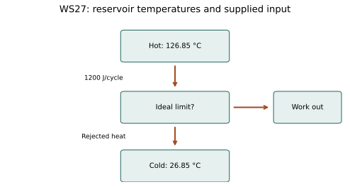

# WS27 - Heat Engines and Thermal Efficiency

Name: ____________________   Date: ____________________

Unit 4 | All levels | public-student

Objectives: Relate hot/cold reservoirs, work and heat rejection; compute actual efficiency and the Carnot upper bound; use Kelvin correctly and distinguish possible from proven performance.

Difficulty: Beginner through application; final question is a challenge

Suggested duration: 25–30 minutes | Total: 20 points

Use ΔU=Q−W: Q positive into the system and W positive by the system. Show the equation, signed substitution, arithmetic and units for numerical answers. Explain physical meaning. Use given constants. Retain intermediate digits and round final answers as requested; for unspecified precision, accept sensible rounding. Graphs and data are simulated educational models.

## Reference data
Two-reservoir cyclic heat-engine model. Input is a positive heat magnitude of1200 J/cycle. Temperatures are given in Celsius and require conversion for the ideal bound.

| quantity | value | unit |
| --- | --- | --- |
| hot temperature | 126.85 | °C |
| cold temperature | 26.85 | °C |
| heat absorbed | 1200 | J/cycle |

## WS27-Q01 (2 points)
In an engine balance, Q_H and Q_C are defined as positive heat magnitudes. Write the cycle work equation and efficiency equation.

____________________________________________________________
____________________________________________________________
____________________________________________________________
____________________________________________________________

## WS27-Q02 (2 points)
An engine produces 240 J of work from 800 J heat input. Calculate efficiency as a fraction and a percent.

____________________________________________________________
____________________________________________________________
____________________________________________________________
____________________________________________________________

## WS27-Q03 (2 points)
Why does the efficiency denominator use heat absorbed rather than net heat for a complete cycle?

____________________________________________________________
____________________________________________________________
____________________________________________________________
____________________________________________________________

## WS27-Q04 (2 points)
Convert 76.85 °C and 26.85 °C to Kelvin for a reservoir-ratio calculation.

____________________________________________________________
____________________________________________________________
____________________________________________________________
____________________________________________________________

## WS27-Q05 (3 points)
An engine absorbs 1500 J per cycle and rejects 1050 J. Find work and thermal efficiency.

____________________________________________________________
____________________________________________________________
____________________________________________________________
____________________________________________________________
____________________________________________________________
____________________________________________________________

## WS27-Q06 (3 points)
An engine supplies 360 J/cycle at efficiency.40. Determine required Q_H and Q_C.

____________________________________________________________
____________________________________________________________
____________________________________________________________
____________________________________________________________
____________________________________________________________
____________________________________________________________

## WS27-Q07 (3 points)
Reservoirs are at 500 K and 300 K. Find the maximum ideal efficiency and decide whether a claimed 45% engine between them is possible.

____________________________________________________________
____________________________________________________________
____________________________________________________________
____________________________________________________________
____________________________________________________________
____________________________________________________________

## WS27-Q08 (3 points)
Challenge: Use the WS 27 reservoir diagram: hot 126.85 °C, cold 26.85 °C; Q_H=1200 J/cycle. Find maximum work output and minimum rejected heat. Explain why real work is lower.

____________________________________________________________
____________________________________________________________
____________________________________________________________
____________________________________________________________
____________________________________________________________
____________________________________________________________
