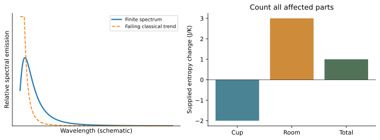

# WS31 - Max Planck and Rudolf Clausius

Name: ____________________  Date: ______________

Unit 5 | All competition levels | public-student | 20 points | 25–30 minutes

## Objectives
Explain why a radiation spectrum challenged classical models; describe energy quantization at an introductory level; connect Clausius’s entropy to irreversible processes and distinguish it from energy.

## Instructions
Explain historical significance, not only names. Use modern equations with their assumptions. Show units and reasoning. Unless labeled otherwise, data are original illustrative models.

## Reference material
The spectral panel is a qualitative teaching sketch: a finite peak contrasts with a failing classical short-wavelength trend. It has no numerical wavelength or power scale. The separate entropy panel illustrates a complete ledger and is not data for Q06.

| Feature | Interpretation |
| --- | --- |
| Horizontal spectral axis | Wavelength, increasing rightward |
| Vertical spectral axis | Relative spectral emission |
| Solid curve | Finite peaked spectrum |
| Dashed curve | Failing short-wavelength trend |

## WS31-Q01 (2 points; foundation)
Which scientist introduced the name entropy in 1865? A. Planck. B. Clausius. C. Black. D. Kelvin. Add one sentence explaining why entropy is useful.

____________________________________________

____________________________________________

____________________________________________

____________________________________________

## WS31-Q02 (2 points; foundation)
Match each contribution to Planck or Clausius: (i) energy elements in a radiation-spectrum explanation; (ii) a second-law account of why heat does not move cold-to-hot as the sole effect.

____________________________________________

____________________________________________

____________________________________________

____________________________________________

## WS31-Q03 (2 points; foundation)
Explain why the phrase “a blackbody emits no radiation because it is black” is incorrect. Keep your answer conceptual.

____________________________________________

____________________________________________

____________________________________________

____________________________________________

## WS31-Q04 (2 points; foundation)
A timeline lists “1900: Planck’s radiation breakthrough” and “1918: Planck’s Nobel Prize.” Another student combines them as “1918: quantum theory first proposed.” Correct the timeline and explain the mistake.

____________________________________________

____________________________________________

____________________________________________

____________________________________________

## WS31-Q05 (3 points; application)
The WS31 reference sketch contrasts a finite radiation spectrum with a classical trend that rises excessively at short wavelength. Explain what a failed spectral prediction means, what Planck introduced, and why this does not mean energy conservation failed.

____________________________________________

____________________________________________

____________________________________________

____________________________________________

____________________________________________

____________________________________________

## WS31-Q06 (3 points; application)
An isolated cup-plus-room combination has supplied entropy changes ΔS_cup=−4 J/K and ΔS_room=+6 J/K. Find the total. Is the cup’s decrease a violation? Explain the units and physical meaning.

____________________________________________

____________________________________________

____________________________________________

____________________________________________

____________________________________________

____________________________________________

## WS31-Q07 (3 points; application)
A refrigerator removes energy from a cold interior and releases it to a warmer room. Explain why this does not contradict Clausius’s second-law idea, and identify an extra effect that must appear in the energy account.

____________________________________________

____________________________________________

____________________________________________

____________________________________________

____________________________________________

____________________________________________

## WS31-Q08 (3 points; challenge)
Evaluate this proposed exhibit text: “Clausius discovered that entropy is destroyed energy. Planck then proved every kind of energy is a fixed identical packet and discovered the complete photon theory in 1900.” Replace it with an accurate account of both contributions.

____________________________________________

____________________________________________

____________________________________________

____________________________________________

____________________________________________

____________________________________________
